# Learning Precise Affordances from Egocentric Videos for Robotic Manipulation

> [!summary] 一句话总结
> 本文是一套**端到端"数据—模型—真机"闭环**的 2D affordance 系统：用第一人称视频的叙事文本自动定位**可抓取点（graspable）**与**功能点（functional）**，以点为 prompt 调 SAM 生成**精确部件级分割掩码**（而非粗高斯热图）；再用 **GAT**（DINOv2 + 伪深度交叉注意力 DFI + LoRA）在低分辨率、单域数据上训练出跨域模型，AED 上 mIoU 68.62（比 OOAL 高 13.8）；最后 **Aff-Grasp** 串起 GroundingDINO + GAT + Contact-GraspNet，在 179 次真机试验中做到 77.1% 成功抓取，并支持工具—物体交互与机器人到人的工具递交。

---

## 1. 研究背景与三大挑战

作者把 affordance 研究的问题归为三条**互相咬合**的瓶颈（P1-P2）：

> [!info] 三大挑战（原文立场）
> 1. **数据稀缺（data scarcity）**：affordance 数据集需要部件级标注，而部件小、分辨率低、常被遮挡（例：勺柄细长、堆叠场景被遮）。现有数据集要么类别少，要么限于实验室环境。
> 2. **泛化差（poor generalization）**：多数模型在有限数据上**从零训练**，换物体、换 affordance、换环境就崩。
> 3. **落地缺失（real-world deployment）**：极少工作在真机上验证，而真机要求模型对噪声、新场景鲁棒。
>
> 三者的因果链：**数据不足 → 泛化受限 → 无法可靠部署**。所以本文不去单点刷指标，而是把三件事打通成一个系统。

> [!question] 作者对前人数据流水线的两点具体不满（这也是全文的起点，P2）
> - **只关心"人怎么抓"，不关心"工具哪一部分在被用"**：既有工作 [2,19,28,36] 学的是 graspable affordance，缺失 functional affordance（刀刃/锤头）。
> - **affordance 被表示成概率分布（Gaussian heatmap）**：粗、噪声大、易被干扰，真机不好用。
> - ⇒ 本文主张：**同时标注 graspable + functional，且输出精确分割掩码而非热图**。

---

## 2. 系统总览：三段式

| 阶段 | 模块 | 解决哪个挑战 | 输出 |
|------|------|--------------|------|
| 数据 | 自第一人称视频自动标注流水线 | 数据稀缺 | 物体裁剪图 + 可抓/功能两类精确掩码 |
| 模型 | **GAT**（Geometry-guided Affordance Transformer） | 泛化差 | 部件级 affordance 概率图（支持开放词表） |
| 部署 | **Aff-Grasp** | 落地缺失 | 6-DoF 抓取位姿 + 顺序动作基元 |

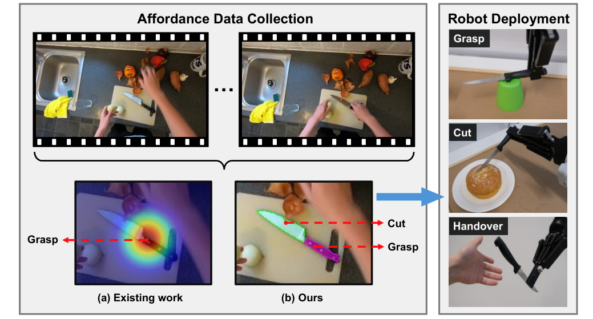
*左栏为既有做法（只给抓取高斯热图），右栏为本文（可抓与功能两块精确掩码，进而支撑抓取、切割、递交给人类三种真机行为）。*

---

## 3. 数据采集流水线（Sec. 3.1）

输入是一段第一人称人—物交互视频。作者把交互分成两类，各取一种接触点：

- **hand-object interaction** → 接触点 = 人**抓**在哪里 → **graspable point**
- **tool-object interaction** → 接触点 = 工具的**哪一部分**在作用于目标 → **functional point**

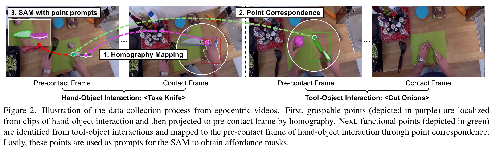
*数据流水线：先由手物交互片段取可抓点并用单应变换投影到接触前帧，再由工具物交互片段取功能点并用点对应映射回同一接触前帧，最后把两类点作为 SAM 的提示生成掩码。*

### 3.1.1 可抓点定位（Graspable Point Localization）

> [!note] 步骤（原文事实）
> 1. 借 Epic-Kitchens / Ego4D 的**带时间戳叙事**，检索 "take" / "hold" 这类手物交互片段。
> 2. 用手物检测器 [47]（100DOH）逐帧给出**接触状态**与**手、物包围盒**。
> 3. 用标注时间戳取**接触帧**（通常是动作起点）。
> 4. 在该帧以手框为 prompt 跑 **EfficientSAM** [55] 得到手掩码。
> 5. 取**手掩码 ∩ 物体包围盒**作为接触区域，采样 n 个接触点。
> 6. **关键一步**：接触帧里的物体被手遮住了，不能直接当标注。需要往前找到**接触前帧**（contact frame 之前、无手物接触的最后一帧），用**单应变换（homography）** [50] 把采样点的均值位置投过去。

### 3.1.2 功能点定位（Functional Point Localization）

> [!note] 步骤（原文事实）
> 1. 从既有 affordance 数据集取"物体—affordance 关系"（如 knife ↔ cut / grasp）。
> 2. 按该关系在叙事里检索**紧邻其后的工具—物体交互片段**（拿着刀去切）。
> 3. 同样用检测器 + EfficientSAM 拿**手持工具**的框与掩码；用 **GroundedSAM** [45] 分割目标物体。
> 4. 在接触帧之前的帧上，逐帧算工具框与目标框的 **IoU**，直到 IoU 低于阈值 → 得到**工具—物交互的接触前帧**。
> 5. 在该帧计算工具掩码到目标掩码所有点的距离，取**工具掩码内距离最近的那个点**作为功能点；对工具掩码做**腐蚀（erosion）**，保证点落在工具内部而不是边界。
>
> **回退策略**：并不是每个类别都能在叙事里找到对应动作片段。此时改用**最远点采样**——以到可抓点的距离为依据挑功能点。作者的依据是"多数工具的设计就是把可抓部分和功能部分放在两端"，实测有效。

> [!warning] 这是全流程最脆的一环
> 「功能部分与可抓部分在两端」这一几何先验对**工具类**成立，但对**容器（杯口/壶嘴在顶端）、家具、开关类**物体并不成立；而回退分支恰恰覆盖的是"数据集里没有动作片段"的长尾类别 —— 长尾 + 弱先验叠加，恰是错误最容易积累的地方。文中未报告该分支占比及其与主分支的精度差。

### 3.1.3 数据生成（掩码怎么来）

- 功能点需要被投影回**手物交互的接触前帧**（因为最终要标注的是同一张物体图）。同一物体类别 → 用基础模型特征 [1]（DIFT 类）在物体框内做**点对应**，把功能点从工具—物帧映射到手—物帧。
- **标注技巧（很实用）**：把**可抓点标为正、功能点标为负**送入 SAM，得**可抓掩码**；**反过来**（功能为正、可抓为负）得**功能掩码**。
- 最后裁剪物体区域，与掩码一起存盘。

> [!warning] 这套"正负互补"标注的隐含假设
> 「可抓掩码」与「功能掩码」在物体内部**互补**——即每个像素非"可抓"即"功能"。但真实物体存在**两者皆非**（刀背中段、锤柄尾部）和**两者皆是**（握刀柄同时可作为敲击面）的区域。互补标注把这些区域强行二分，构成系统性标注偏置，也是后文"某些边界不精确"的潜在来源。文中未讨论这一点。

---

## 4. GAT：Geometry-guided Affordance Transformer（Sec. 3.2）

### 4.1 要解决的两个数据缺陷

采集来的数据虽然免标注，但有两个硬伤：

1. **分辨率极低**：目标物体常只占原帧 5% 面积，裁剪后**高或宽不足 100 像素**。
2. **多样性差**：背景单一、几乎全是室内场景。

作者的判断：既然外观又糊又窄，就别只靠外观 —— **引入几何先验**；既然域窄，就**换掉 ImageNet 预训练编码器**。

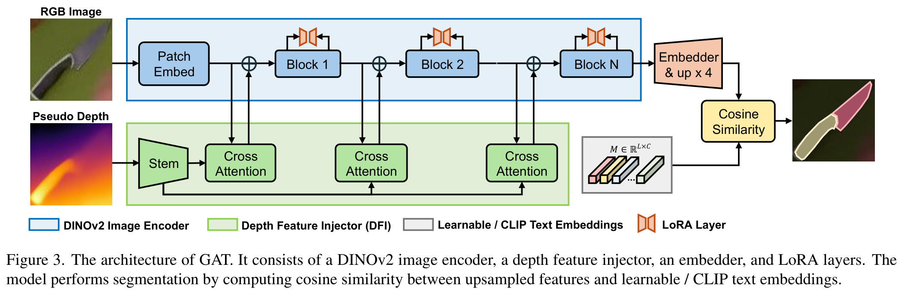
*GAT 结构：DINOv2 编码 RGB，并行的深度特征注入器（DFI）把伪深度经 stem 编码后，在四个 block 前以交叉注意力注入图像特征；末端不做解码器，而是把特征上采样 4 倍后与可学习嵌入／CLIP 文本嵌入算余弦相似度得到分割图。*

### 4.2 Depth Feature Injector（DFI）——本文最核心的设计

> [!tip] 动机（作者给出的两条理由）
> - 深度图带来**前景/背景分离与部件分离**所需的几何信息；
> - 深度图**去掉了颜色**，迫使模型专注**形状**——而形状与 affordance 高度相关：可抓部件多是**圆柱/球形**，切割部件多有**锐边与平面**。

实现：

- 每张训练图用 **Depth-Anything** [57] 生成**伪深度图**；
- 伪深度先过 **stem**（3 个 3×3 卷积），再用 1×1 卷积把通道对齐到 RGB 特征维度；
- 整个 backbone 分 4 个 block，每个 block 入口处 DFI 接收图像特征 $F_i \in \mathbb{R}^{N\times C}$ 与深度特征 $F_d \in \mathbb{R}^{N\times C}$，以 $F_i$ 为 query、$F_d$ 为 key/value 做交叉注意力：

$$Q=\phi_q(F_i),\quad K=\phi_k(F_d),\quad V=\phi_v(F_d)$$

$$\hat{F}_i=\beta\cdot\mathrm{softmax}\!\left(\frac{QK^{\top}}{\sqrt{d_k}}\right)V+F_i$$

- $\beta \in \mathbb{R}^{C}$ 是**初始化为 0 的可学习门控向量**（沿用 [5] 的做法），保证训练初期不扰动图像特征、训练更稳。

> [!tip] 一个意外好用的性质：DFI 可以只在训练时用
> 表 4 里 `+DFI-training only` 一项 mIoU 60.15，比不加 DFI 的 56.70 高 **+3.45**，仅次于带推理的 `+DFI`（64.66）。也就是说 **DFI 起到了正则化作用**：训练时见几何、推理时扔掉，能白拿精度。
> 表 5 给出代价核算：带 DFI 推理 96.9 M / 204.9 GFLOPs / 10.1 ms；去掉后 91.7 M（−5.4%）/ 185.5 GFLOPs（−9.5%）/ **6.3 ms（−37.6%）**。

### 4.3 DINOv2 + LoRA

- 不用 ImageNet 预训练：① affordance 分割要**细粒度部件**，而分类表征偏**全局物体特征**；② ImageNet 域多样性不足。
- 改用自监督基础模型 **DINOv2**（作者前作 [24] 已证明它对数据受限的 affordance 学习有效），并加 **LoRA** 微调：$W_0+\Delta W = W_0 + BA$，$B\in\mathbb{R}^{d\times r}$、$A\in\mathbb{R}^{r\times k}$、$r \ll \min(d,k)$，只训 $A,B$，$W_0$ 冻结。

### 4.4 分类头与损失

> [!note] 刻意"反重型解码器"
> 为真机推理速度，**不加复杂 decoder**：特征过 embedder（MLP）→ reshape → 上采样 ×4 得 $F_{out}\in\mathbb{R}^{C\times \frac{4H}{p}\times \frac{4W}{p}}$ → 与 $L$ 个可学习嵌入 $M\in\mathbb{R}^{L\times C}$ 算**余弦相似度** → 双线性插值回原图尺寸。
>
> **隐式背景**：由于域差距大，**不学背景类**（避免过拟合）；某像素所有 affordance 预测都低于阈值 $\tau$ 即判为背景。
>
> **开放词表**：$M$ 可直接换成 CLIP 文本嵌入，从而在推理时使用**训练时没见过的 affordance 词**。

训练目标（focal + dice，应对极端不平衡）：

$$\mathcal{L}=\alpha\cdot\mathcal{L}_{focal}+\mathcal{L}_{dice}$$

---

## 5. Aff-Grasp：从掩码到动作（Sec. 3.3）

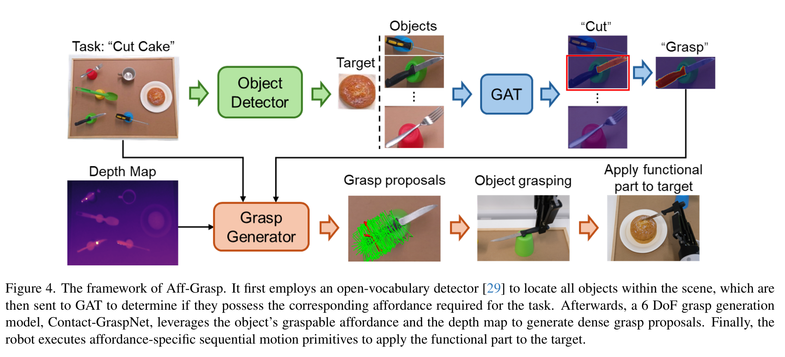
*Aff-Grasp 流程：任务（动词 + 目标，如 "cut cake"）→ GroundingDINO 检测目标与该场景内其他物体 → 逐个裁剪送入 GAT 判断是否具备所需 affordance → 选出最有把握的那个 → 在其可抓取区生成 6-DoF 抓取位姿 → 抓取并执行该 affordance 对应的顺序动作基元，把功能部件作用到目标上。*

> [!info] 关键设计（原文事实）
> 1. **不需要人告诉它拿哪个物体**：任务只给动词 + 目标（"cut cake"）。除目标外，其余物体统一用 "objects" 做**类别无关检测**，再由 GAT 判断"谁具备 cut 这个 affordance"。
> 2. **抓取在可抓区、作用在功能区**：从该物体的 **graspable** 掩码内用 **Contact-GraspNet** [49] 生成稠密抓取提案，取分数最高者执行；随后调用 **affordance-specific 的顺序动作基元**，把 functional 区压到目标上。
> 3. **递交（handover）是反向的**：要求抓取提案落在 **functional** 区（握刀刃），然后把 **graspable** 部分（刀柄）递给人手 —— 这是"抓法由意图决定"最直观的体现（对应摘要开头"握刀柄切菜 vs 握刀刃递交"）。
> 4. 用 CLIP 文本嵌入作分类器时，任务动词可直接转成文本嵌入，实现**开放词表 affordance 分割**，增强适应性。

---

## 6. 实验（全部为零样本／跨域设定）

作者强调：**所有评测都是零样本或跨域**，因为测试数据与真机物体都和训练用的第一人称视频差异极大。

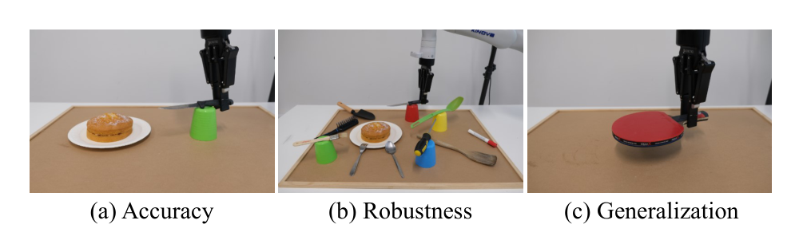
*真机三个维度的评测设置：左为"精度"（单物体、识别 affordance 并完成任务）、中为"鲁棒性"（杂乱场景中挑对物体）、右为"泛化"（对未见物体推断可抓区）。*

### 6.1 视觉评测：AED 数据集

作者发现现有数据集都不合用（类别少 / 实验室环境 / 关键点级粗标注 / 分辨率低），于是**自建 AED（Affordance Evaluation Dataset）**：从多个既有数据集与网络资源人工标注 **721 张图**，覆盖 **13 个物体类、8 个 affordance 类**。

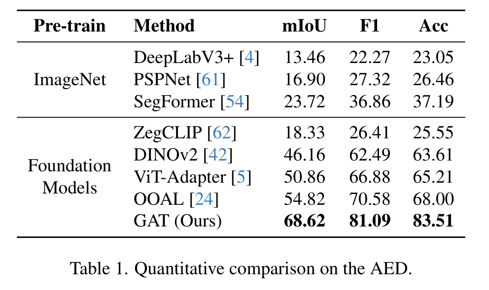
*AED 上的定量对比。ImageNet 预训练组（DeepLabV3+ / PSPNet / SegFormer）全线垫底，基础模型组明显更高，GAT 的 68.62 mIoU 比此前最好的 OOAL 高 13.8。*

> [!info] 结论
> 1. **编码器预训练方式比网络结构重要得多**：DeepLabV3+ 13.46 → DINOv2 46.16，同一任务下光换表征就差 30+ mIoU。这从反面确认了训练集与评测集之间存在巨大域差。
> 2. **DINOv2 单独用（46.16）就已经超过所有 ImageNet 模型**，说明"抗噪训练样本 + 跨域表征"是这条路线的前提，而不是可选项。

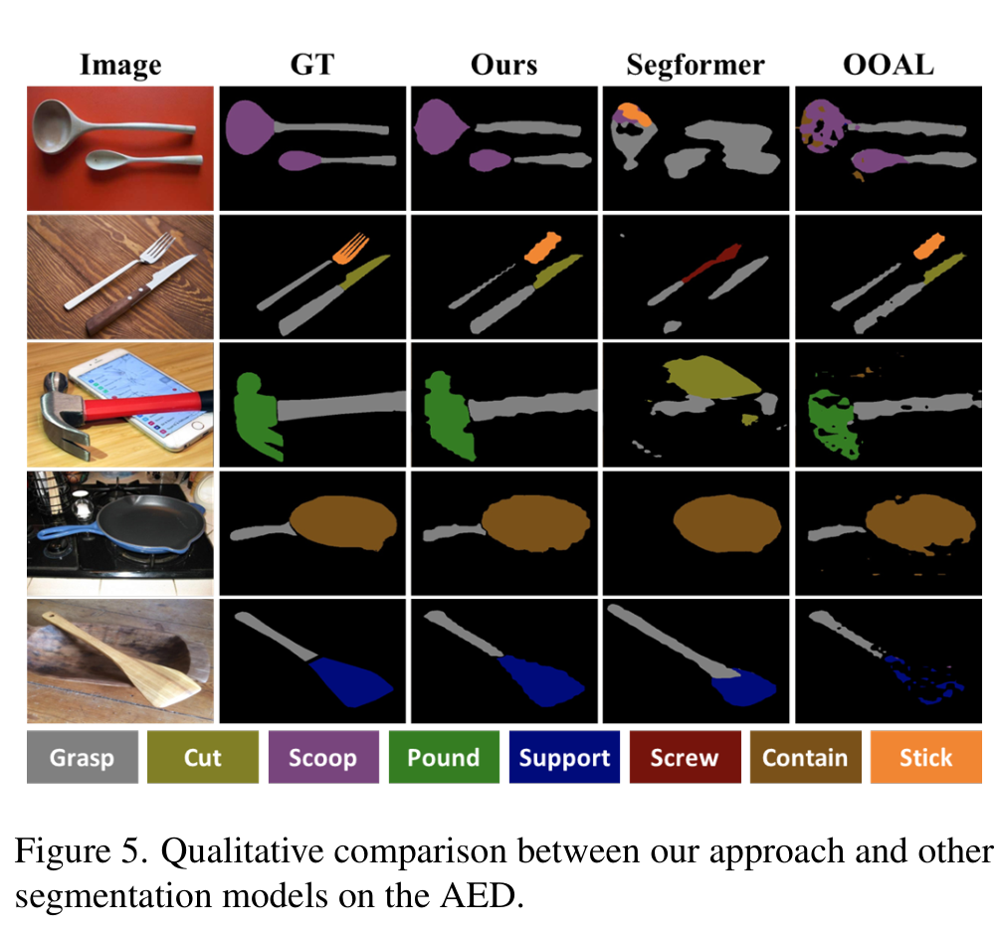
*定性对比（列序：输入图 / 真值 / 本文 / SegFormer / OOAL，底部为八类 affordance 的配色图例）。SegFormer 常给出不完整或形状错乱的预测；OOAL 能粗对齐但部件激活不全、边界附近有碎斑；GAT 的结果更"贴部件"、边界保留更好，多物体场景优势最明显。*

### 6.2 真机评测

设置：**7 个任务、34 个不同物体**，含已见与未见类别、杂乱场景；对比 LOCATE（图像级 affordance）与 Robo-ABC（视频级语义对应）。

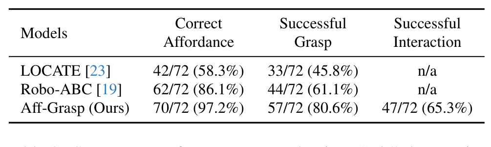
*精度评测（已见类别）：Aff-Grasp 在 affordance 判定与抓取成功两项上均大幅领先，且是唯一能做工具—物体交互的方法。*

| 方法 | Affordance 判对 | 抓取成功 | 交互成功 |
|------|-----------------|----------|----------|
| LOCATE | 42/72 (58.3%) | 33/72 (45.8%) | n/a |
| Robo-ABC | 62/72 (86.1%) | 44/72 (61.1%) | n/a |
| **Aff-Grasp** | **70/72 (97.2%)** | **57/72 (80.6%)** | **47/72 (65.3%)** |

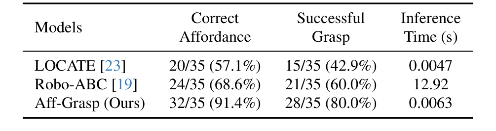
*泛化评测（未见物体）与推理耗时。注意 Robo-ABC 的 12.92 s 是本文 6.3 ms 的两千倍量级差。*

| 方法 | Affordance 判对 | 抓取成功 | 推理时间 |
|------|-----------------|----------|----------|
| LOCATE | 20/35 (57.1%) | 15/35 (42.9%) | 0.0047 s |
| Robo-ABC | 24/35 (68.6%) | 21/35 (60.0%) | 12.92 s |
| **Aff-Grasp** | **32/35 (91.4%)** | **28/35 (80.0%)** | **0.0063 s** |

**鲁棒性**：在含多个已见/未见干扰物的杂乱场景中，affordance 判对率 **95%**。

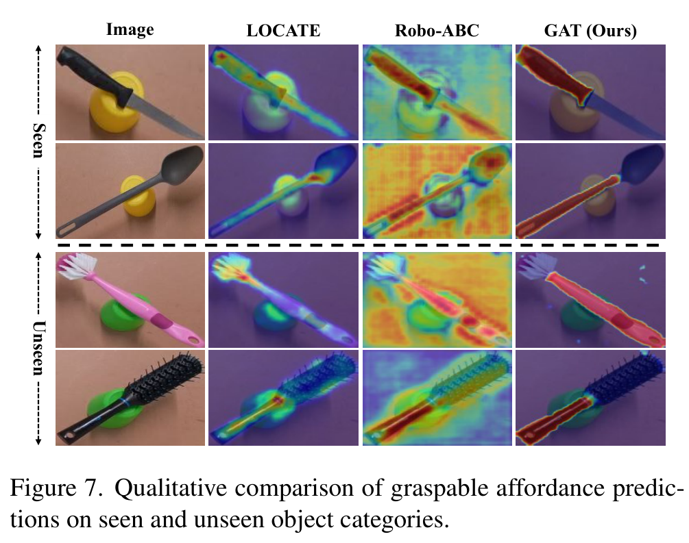
*可抓取 affordance 的定性对比（上两行为已见类别，下两行为未见类别）：LOCATE 预测不完整或错位；Robo-ABC 有时落在正确部件内，但对背景或整个物体都有高响应；GAT 在已见与未见物体上都给出干净的部件级掩码，且不被背景带偏。*

**总体**：摘要给出的数字是 **179 次试验中 77.1% 成功抓取**（含已见、未见、杂乱三类场景）。

### 6.3 消融

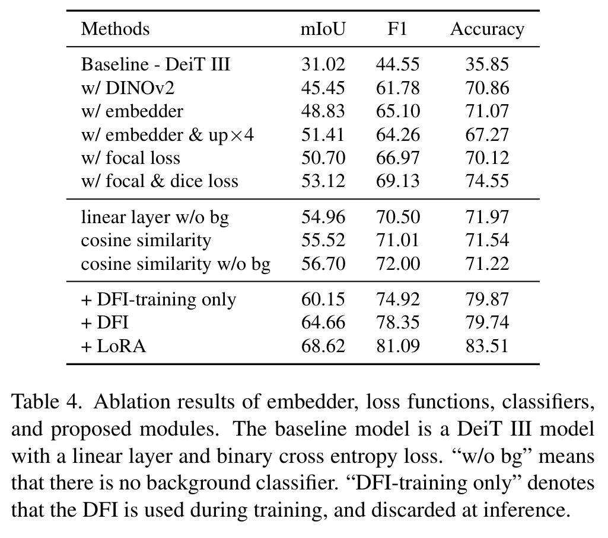
*逐项消融：从 DeiT III 基线 31.02 一路加到 DFI + LoRA 的 68.62。最后三行是本模块贡献，前六行是"把工程细节做对"的贡献。*

| 配置 | mIoU | F1 | Acc | 相对上一步 |
|------|------|----|-----|-----------|
| Baseline（DeiT III + 线性层 + BCE） | 31.02 | 44.55 | 35.85 | — |
| w/ DINOv2 | 45.45 | 61.78 | 70.86 | **+14.43** |
| w/ embedder | 48.83 | 65.10 | 71.07 | +3.38 |
| w/ embedder & up×4 | 51.41 | 64.26 | 67.27 | +2.58 |
| w/ focal loss | 50.70 | 66.97 | 70.12 | −0.71 |
| w/ focal & dice loss | 53.12 | 69.13 | 74.55 | +2.42 |
| linear layer w/o bg | 54.96 | 70.50 | 71.97 | +1.84 |
| cosine similarity | 55.52 | 71.01 | 71.54 | +0.56 |
| cosine similarity w/o bg | 56.70 | 72.00 | 71.22 | +1.18 |
| + DFI（**仅训练时**） | 60.15 | 74.92 | 79.87 | **+3.45（免费）** |
| + DFI（训练 + 推理） | 64.66 | 78.35 | 79.74 | +4.51 |
| + LoRA | **68.62** | **81.09** | **83.51** | **+3.96** |

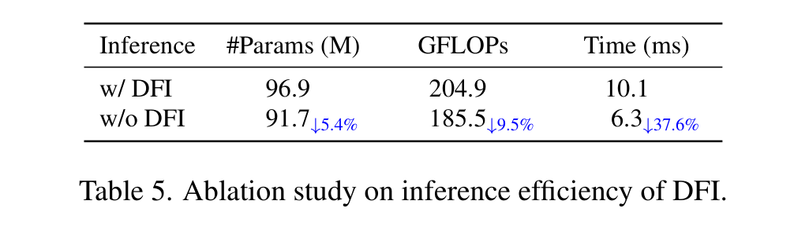
*DFI 的推理开销：去掉 DFI 参数量降 5.4%、算力降 9.5%，但耗时降 37.6% —— 说明交叉注意力在实际部署上的代价远高于 FLOPs 所暗示的。*

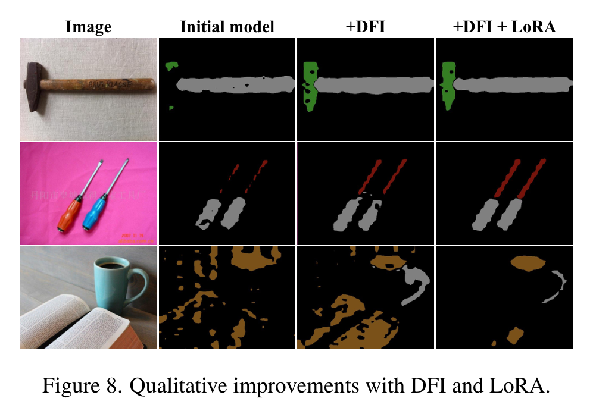
*定性消融：DFI 对小而细长部件的定位提升最明显，LoRA 进一步把边界做干净、把掩码补完整。*

> [!tip] 消融里最值得记住的两个数
> - **DINOv2 换掉 DeiT III 值 +14.4 mIoU**，是全表最大单项 —— 表征选择的杠杆远大于结构设计。
> - **DFI 仅训练时使用值 +3.45 mIoU 且零推理成本** —— "把几何先验当正则化器"这一招几乎无风险，任何 2D→部件任务的流水线都可以先试它。

---
## 7. 局限与可质疑点

> [!warning] 方法论层面
> - **功能点的回退分支靠几何先验**：`最远点采样` 假设"可抓与功能在两端"，对容器、开关、家具类不成立，而这恰好是"叙事里没有动作片段"的长尾类别。
> - **正负互补标注**：可抓与功能掩码在物体内互补，忽略了"两者皆非/两者皆是"的区域（刀背中段、可敲击的刀柄尾）。
> - **单应变换假设平面 + 小运动**：曲面物体与快速片段上投影点会漂，正文未给误差定量。
> - **只在 2D 图像上做部件级分割**：几何信息仅以**伪深度**形式作为正则化注入，模型本身不输出 3D，深度也只在抓取生成环节被真正使用。

> [!warning] 实验层面
> - AED 只有 721 张图 / 13 类 / 8 个 affordance，规模仍小，且**由作者自建**，与训练集的类别一致性是"人工挑选"的结果，泛化结论的边界受此约束。
> - 真机 7 任务 / 34 物体、单臂桌面，动作侧依赖**预录的动作基元**，任务范围仍被基元库限定。
> - 与基线的对比中存在"评测口径不同"（是否含功能 affordance）的问题，虽然方向上对本文有利，但读者需自行折算。

---

## 8. 在坐标系里的位置

沿用 [[3D Affordance Grounding]] 笔记里的两条正交轴（**输入模态** × **任务粒度**），再补一条**是否闭环到真机**：

| 工作 | 模态 | 粒度 | 部件角色 | 真机闭环 |
|------|------|------|----------|----------|
| AGD20K / LOCATE | 2D | 单步 | 单角色（可抓或功能） | ✗ |
| Robo-ABC | 2D（视频） | 单步 | 单角色 | 部分（抓取） |
| **本文 Aff-Grasp** | **2D（第一人称视频训练）** | **单步** | **双角色（可抓 / 功能）** | **✓ 77.1% / 179 试** |
| [[EgoAfford - Task-Oriented Affordance Grounding via Egocentric Referring Segmentation]] | 2D（第一人称） | **多步** | **三角色（直接物体/工具/目的）** | ✗（纯静态评测） |
| [[AffordAny]] | 3D（单目重建） | 单步 | 单角色 | ✗ |
| [[HAMMER]] | 3D 点云 | 单步 | 单角色 | ✗ |

> [!info] 与两篇近邻工作的关系
> - **对 [[EgoAfford - Task-Oriented Affordance Grounding via Egocentric Referring Segmentation]]**：本文是"**单步 × 双角色 × 有真机**"，EgoAfford 是"**多步 × 三角色 × 只有静态指标**"。两者恰好互补 —— 本文补上了 EgoAfford 缺的可执行性验证，EgoAfford 补上了本文缺的任务级规划。**"双角色 + 真机成功率的评测协议"可以从本文借，"角色分配与后续步骤"从 EgoAfford 借。**
> - **对 [[AffordAny]]**：AffordAny 是 3D 开放词表 473 类，规模与类别数碾压，但没有真机。本文正好相反：类别少（8）、只有 2D，但跑通了闭环。这条对照很适合在综述里用来说明"**3D 开放词表 ≠ 可执行**"。

---

## 9. 可迁移到 3D affordance 的四点

> [!tip] 可以直接搬的做法
> 1. **"点 → 掩码"的标注范式搬到 3D**：本文用接触点作 prompt 调 SAM 得 2D 掩码。完全对应的 3D 版本是：第一人称视频的接触点经手部/物体位姿投影到点云或 3DGS，作为 prompt 调 3D 分割器（SAM3D / 2D 掩码多视图提升）→ 得到**点级可抓/功能标签**。这比"用 2D 掩码反投影"更省，且天然带接触语义。
> 2. **DFI 式"几何当正则"**：在 3D 里反而更容易 —— 训练时把点云法向/曲率/深度作为辅助分支做交叉注意力注入，推理时可丢弃。成本几乎为零，且能直接对上"几何对 affordance 有用"的论断。
> 3. **可抓 / 功能 的二分标签**：这是 3D affordance 数据集普遍缺失的维度（现有 3D 基准多是单一 affordance 类别）。若在 3D 上把"抓哪儿"与"用哪儿"分开标注，可直接接 [[EgoAfford - Task-Oriented Affordance Grounding via Egocentric Referring Segmentation]] 的多角色协议，形成 3D 多角色基准。
> 4. **评测拆成 accuracy / robustness / generalization 三组**：比单一 mIoU 有信息量得多，且能直接对上我们自己"瓶颈到底在定位还是知识"的诊断需求。

> [!question] 反过来，本文没有回答、但我们关心的问题
> - 本文的功能性 affordance 仍然**是"类别级 + 动词级"**（cut、grasp），没有"下一步该对谁做"的任务状态概念。要把 2D 的这套数据管线接到 3D 多步场景，**关键的缺口是"接触点的时序语义"**：同一个接触点在不同任务阶段含义不同（刀柄既可抓也可敲）。
> - 真机侧完全依赖**预录动作基元**，所以"77.1%"度量的是"选对物体 + 抓对部件 + 基元执行"，而不是端到端策略学习。跨到 3D affordance 驱动策略时，这个上限要提前算清。

---

## 10. 关键数字速查

| 项 | 数值 |
|----|------|
| 视觉 SOTA 提升 | mIoU **68.62**（较 OOAL +13.8），F1 81.09，Acc 83.51 |
| AED 规模 | 721 图 / 13 物体类 / 8 affordance 类 |
| 真机规模 | 7 任务 / 34 物体 / **179 次试验 / 77.1% 抓取成功** |
| 精度评测（已见） | 判对 97.2%，抓取 80.6%，交互 65.3% |
| 泛化评测（未见） | 判对 91.4%，抓取 80.0% |
| 杂乱场景鲁棒性 | 判对率 95% |
| 推理耗时 | GAT 6.3 ms（去 DFI）/ 10.1 ms（含 DFI） |
| 关键消融 | DINOv2 +14.4 mIoU；DFI（仅训练）+3.45 mIoU 零成本；LoRA +3.96 mIoU |
| 训练数据来源 | Epic-Kitchens / Ego4D 第一人称视频，无需人工标注 |
