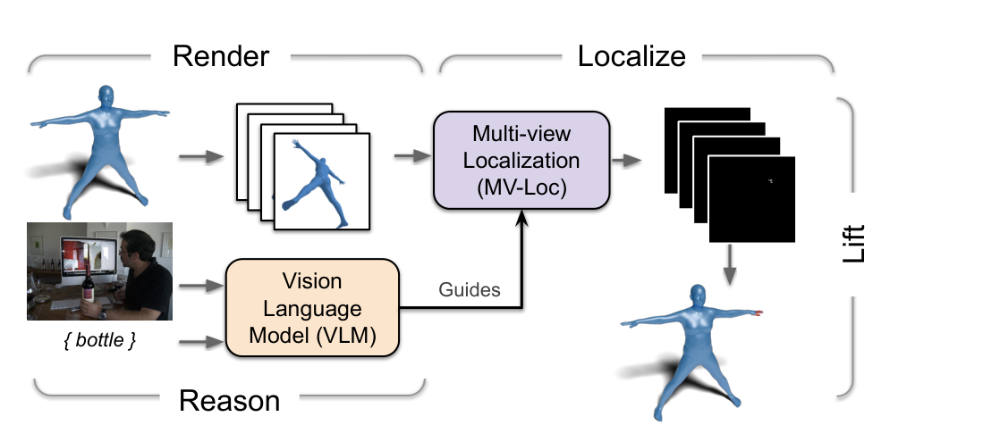
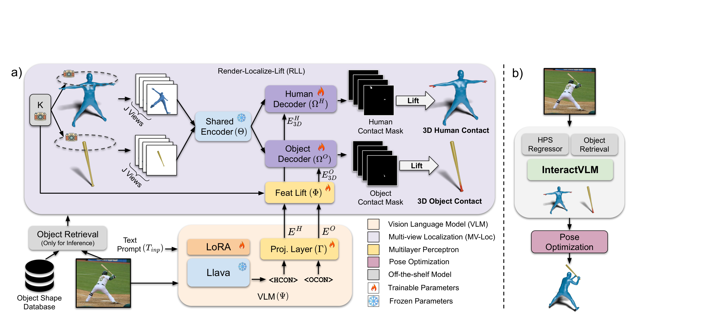
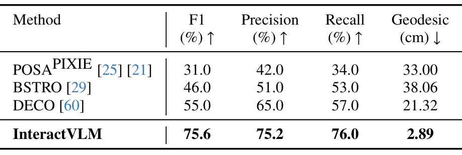
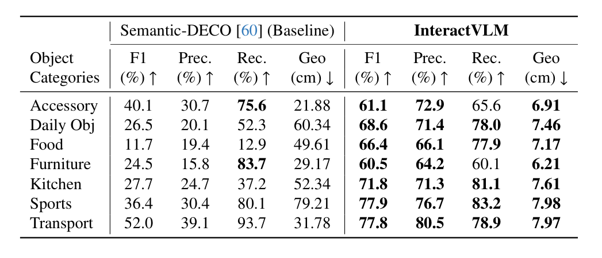
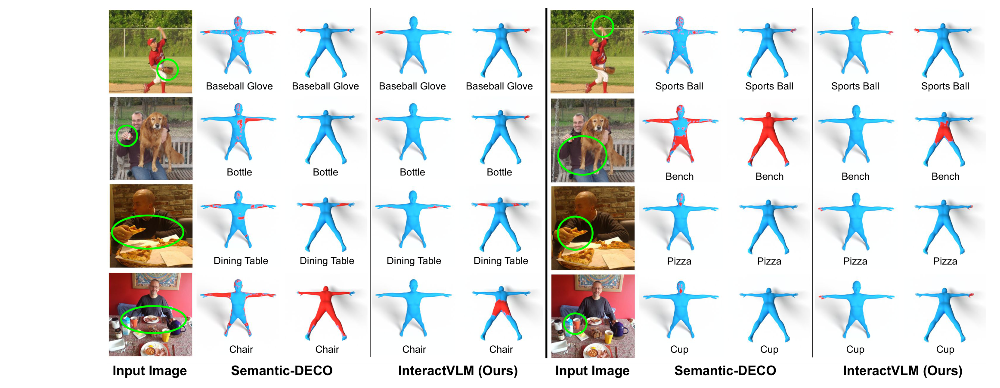
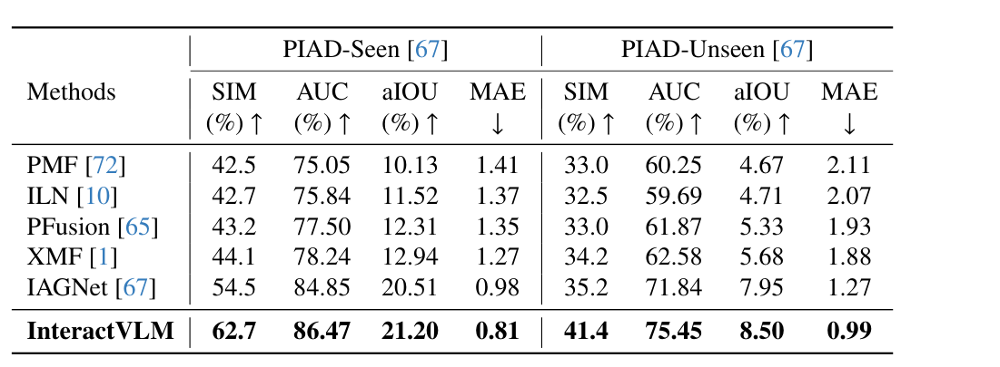
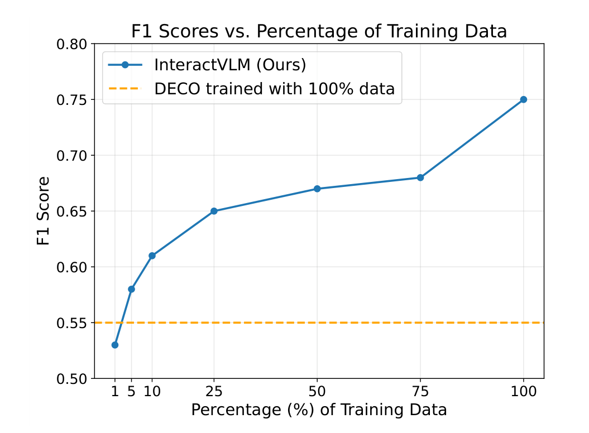
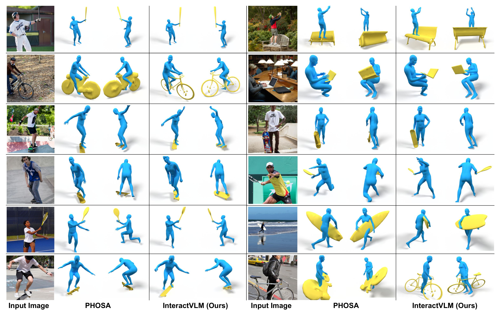

# InteractVLM

## 核心信息

- 标题: InteractVLM: 3D Interaction Reasoning from 2D Foundational Models
- 标题翻译: InteractVLM：从二维基础模型出发的三维交互推理
- 作者: Sai Kumar Dwivedi, Dimitrije Antić, Shashank Tripathi, Omid Taheri, Cordelia Schmid, Michael J. Black, Dimitrios Tzionas
- 机构: 马普智能系统研究所（德国图宾根）、阿姆斯特丹大学、法国国家信息与自动化研究所、巴黎高等师范学院
- 发表时间: 2025
- 发表渠道: CVPR 2025
- DOI: 10.1109/CVPR52734.2025.02105
- arXiv: 2504.05303
- 论文链接: https://arxiv.org/abs/2504.05303
- 代码 / 项目: https://interactvlm.is.tue.mpg.de
- 数据 / 资源: DAMON、PIAD、3DIR、LEMON 的图像侧监督；人体用 SMPL+H 模板，重建用 SMPL-X；物体几何取自 Objaverse 检索库
- 论文类型: AI 方法（AI_method）

## 原文摘要翻译

我们提出 InteractVLM，一种从单张野外图像估计人体与物体三维接触点、进而实现精确人-物联合三维重建的新方法。该任务因遮挡、深度歧义以及物体形状差异极大而困难。现有方法依赖通过昂贵的动作捕捉系统或繁琐的人工标注收集的三维接触标注，这限制了可扩展性与泛化能力。为克服这一点，InteractVLM 利用大型视觉语言模型广泛的视觉知识，并用有限的三维接触数据进行微调。然而直接套用这些模型并不简单，因为它们只在二维空间推理，而人-物接触本质上是三维的。因此我们引入一个新的「渲染-定位-提升」模块，它（1）通过多视角渲染把三维人体与物体表面嵌入二维空间，（2）训练一个新的多视角定位模型 MV-Loc 在二维推断接触，（3）再把这些接触提升到三维。此外，我们提出一个称为「语义人体接触」的新任务，其中人体接触预测以物体语义为显式条件，从而支持更丰富的交互建模。InteractVLM 在接触估计上优于现有工作，并且有助于从野外图像完成三维重建。为估计三维人体与物体位姿，我们先推断初始的人体与物体网格，再通过 InteractVLM 在这两者上推断接触，最后利用这些接触把网格拟合到图像证据上。结果表明我们的方法在野外场景中表现良好。代码与模型见项目主页。

## 创新点

- 把三维稠密接触预测重写成「在已知几何的多视角渲染上做二维分割，再按预先生成的像素与顶点映射反投影」。这一步让现成的二维分割基础模型不必改造就能输出三维接触，是全文真正的枢纽，后续所有模块都围绕它组织。
- 提出多视角接触定位模型 MV-Loc：共享图像编码器加人体、物体两个解码器，并用 FeatLift 把视觉语言模型的令牌特征按相机参数变换成逐视角的三维感知特征，以特征层面的相机条件化替代缺失的跨视角注意力。
- 提出「语义人体接触」任务，把人体接触从「是否接触任意物体」的二分类改成以物体标签为条件的多类预测，可以同时表达身体不同部位接触不同物体这一日常情况。
- 给出首个把双向推断出的接触当作优化约束、完成单张野外图像人-物联合重建的流程：接触既用于把物体吸附到人体表面，也参与物体相对图像的位姿优化。

## 一句话总结

这篇论文的价值不在模型规模，而在于把「三维接触估计」重写成「已知几何上的二维分割再加反投影」，从而让二维基础模型的视觉常识以极小的三维标注代价进入三维交互理解。

## 研究问题

### 接触是三维交互里最缺监督的中间量

三维人-物交互重建的关键中间量是接触。知道身体哪些顶点与物体哪些表面相贴，就能在深度歧义与遮挡之下把两块几何互相锚住。问题是这个量几乎没有廉价监督：高精度的接触标注来自动作捕捉，成本高且场景受限；多相机方案更易扩展但精度不足；众包得到的标注也只覆盖人体一侧。

### 二分类假设丢掉了「与谁接触」

现有做法把接触预测当成人体顶点的二分类：某个顶点是否与任意物体接触。这个简化在真实场景里立刻失效——人常常同时接触多个物体，比如坐在单人沙发上用笔记本。此时「接触」这个标签无法区分到底是沙发还是笔记本，也就无法支撑联合重建。

### 为什么换问题表述比换网络更划算

作者的判断是：与其在三维空间里堆一个更大的稠密预测网络去拟合稀少标注，不如把三维问题搬到二维。二维基础模型在互联网规模数据上已经带有关于人与物体如何相处的视觉常识，缺的只是一个能让它们输出三维答案的接口。这个判断决定了全文的技术路线，也是后面所有消融要检验的对象。

*论文图 2：核心思路示意。渲染分支把人体与物体几何变成多视角二维图，推理分支由视觉语言模型给出条件，定位分支输出接触，最后提升回三维。*

## 数据与任务定义

### 三个任务的输入输出

论文在同一个框架下评估三件事。第一是二分类人体接触：输入单张图像，输出 SMPL+H 模板上 10475 个顶点的二值标签。第二是语义人体接触，这是本文新提的任务：输入图像加一个物体类别标签，输出以该物体为条件的人体接触区域。第三是物体可供性预测：输入图像与交互意图，输出物体点云上连续的接触可能性。

### 标签形态

人体侧是逐顶点二值标签，取值只可能是 0 或 1。物体侧是逐点连续值，落在 0 到 1 之间。这里有一个口径问题：野外图像没有物体接触真值，作者用可供性数据代替接触，并在正文里把这两个词当作同义使用。这意味着物体侧学到的是「这里可能被接触」，而不是「这里此刻正被接触」。

### 数据集与规模

人体接触用 DAMON 训练与评测，物体可供性用 PIAD。补充材料另在 3DIR 上做对比，并与需要配对数据的 LEMON 比较。作者的类别覆盖说法是：人体交互推理覆盖 80 类，物体可供性覆盖 32 类。训练时额外引入接触部位的文本描述，以及用大模型为训练图像自动生成的人-物交互视觉问答数据。

### 评测指标

人体侧沿用 DECO 的口径，在阈值 0.5 下报告 F1、精确率、召回率，并加测地距离衡量空间位置误差。物体侧沿用 PIAD 的口径，报告相似度、曲线下面积、平均交并比与平均绝对误差。

## 方法主线

### 机制流程

1. 输入一张彩色图像与文本提示，视觉语言模型输出含接触令牌的文本，并取出这两个令牌的末层嵌入，经投影层得到人体与物体的条件特征。
2. 把规范姿态的 SMPL+H 人体与归一化到单位球的物体几何各渲染成 4 个固定视角的二维图并送入共享图像编码器；同时用 FeatLift 把上一步的条件特征按相机参数变换为逐视角的三维感知特征。
3. 人体与物体两个解码器在渲染图上输出二维接触掩码，只在渲染轮廓内的有效区域计算焦点加权二值交叉熵与 Dice 损失，得到逐视角的接触概率图。
4. 按渲染阶段预计算的像素与顶点映射把二维接触反投影回三维几何，得到三维接触并施加稀疏约束；推理阶段再把这些三维接触送入位姿优化。

*论文图 3：方法总览。左半部是接触估计的完整数据流，从物体检索、视觉语言模型、特征提升到多视角定位与提升；右半部是把接触用作约束的位姿优化回路。*

### 交互推理：视觉语言模型只提供条件信号

骨干是 LLaVA 第一版，加 LoRA 适配层，秩为 8。作者在词表里新增两个特殊令牌，一个表示人体接触，一个表示物体接触，让模型在回答里生成它们，再取这两个令牌的末层嵌入，经两层各 256 维的投影网络变成条件特征。整个模块不直接回归任何三维坐标，只负责「说清楚哪里该接触」。

令牌预测用交叉熵监督：

$$L_{\mathrm{tok}}=-\sum_{i=1}^{N}T^{(i)}_{\mathrm{gt}}\log T^{(i)}_{\mathrm{pred}}$$

这个设计有个直接后果：模型的输出空间是词表而不是坐标，因此三维精度完全由下游定位模块承担。理解这一点才能理解后面的消融——去掉视觉语言模型后 F1 从 75.6 掉到 32.3，说明条件信号不只是加速收敛，而是承担了大部分语义决策。

### FeatLift：把二维特征抬成三维感知

视觉语言模型只在图像平面推理，它的令牌嵌入没有视角概念。直接把相机参数拼到特征后面虽然给了网络信息，但没有在特征空间里建立跨视角对应。FeatLift 的做法是先用两层全连接把令牌嵌入映射到 128 维，再按每个视角做一次 256 维的变换并过 sigmoid，输出逐视角条件特征。

$$\Phi\left(E,K\right)\rightarrow E^{3D}_{j},\quad j=1\ldots J$$

消融给出了这条设计的定价：完全不给相机参数时 F1 为 69.4，直接拼接为 71.9，换成 FeatLift 为 75.6。也就是说 3.7 点增益来自「把相机信息写进特征」而不是「把相机信息加到特征旁边」。

### MV-Loc 与三重监督

定位模块复用 SAM 的结构：一个共享图像编码器，人体与物体各一个解码器，初始化时加载 LISA 的预训练分割权重。前置条件特征作为引导信号进入解码器：

$$M_{H,O}=\Omega_{H,O}\left(\Theta\left(R_{H,O}\right),E^{3D}_{H,O}\right)$$

二维层面用焦点加权二值交叉熵配 Dice，且只在渲染轮廓内的有效像素上计算——整幅掩码参与训练时 F1 只有 69.3，改成有效区域后升到 72.6，说明背景像素此前在主导梯度。

三维层面把每个视角的二维接触反投影回模板，再算一次接触损失。人体侧是焦点项加 L1 稀疏项，用来压制非接触区域的假阳性；物体侧是 Dice 加均方误差：

$$L^{H}_{C}=\alpha\left(1-p_{C}\right)^{\gamma}\log p_{C}+\lambda\left\|C_{H}\right\|_{1}$$

$$L^{O}_{C}=L_{\mathrm{Dice}}\left(C_{O},\hat{C}_{O}\right)+\beta\left\|C_{O}-\hat{C}_{O}\right\|^{2}$$

加了这一项后 F1 从 72.6 升到 75.6。多视角一致性在这里不是靠跨视角注意力强制实现的，而是靠「每个视角各自反投影到同一套三维顶点、再在三维上算损失」间接约束的。这一点对判断方法的适用边界很关键。

### 训练配置与推理链路

训练用 4 张 A100、30 个轮次、批大小 8、bf16 混合精度与 DeepSpeed，LoRA 秩为 8，分割解码器不加 LoRA，图像编码器保持冻结。人体与物体各 4 个固定视角，渲染分辨率 1024。人体取中立体型并摆成类似维特鲁威人的星形姿态以减少自遮挡；物体点云按法向与归一化坐标着色，让渲染图更像真实图像。

推理分两段。先由单图人体回归器给出 SMPL-X 人体，由检索模型从三维资产库取回物体网格；再用推断出的双向接触做 ICP 初始化，把物体吸附到人体上，最后用渲染-比较优化物体旋转、平移与尺度，人体保持固定。

$$E=E_{M}+\lambda_{C}E_{C}$$

其中掩码项负责把物体对齐到图像，接触项负责让物体与身体真实相贴。位姿优化用手写优化器迭代，深度与掩码来自可微渲染器。

### 关键实现细节

渲染阶段除了出图，还预计算三样东西：每个像素对应的网格顶点索引矩阵、面片内的重心坐标、以及接触顶点数达到 3 以上的二值接触掩码。有了这三样，二维掩码到三维顶点的映射就是查表而不是求解，整个提升步骤没有可微渲染的开销。

人体被固定在规范姿态，意味着接触定义在模板空间而不是图像空间。这个选择让同一套接触标注可以迁移到任意姿态的人体上，是方法能只用少量标注就泛化的结构性原因之一。

## 关键结果

### 二分类人体接触：同一份数据上 F1 提升 20 点

在 DAMON 上，相同训练数据下 F1 从 DECO 的 55.0 升到 75.6，测地距离从 21.32 厘米降到 2.89 厘米。这个对比最能说明增益来自框架而不是数据量，因为两者用的是同一批标注。召回率的提升尤其明显，从 57.0 到 76.0，说明漏检大幅减少。

*论文表 1：DAMON 上的二分类人体接触对比，本文在 F1、精确率、召回率与测地距离四项上均领先，测地距离的差距最大。*

### 语义人体接触：多类条件下差距被放大

把人体接触改成以物体标签为条件后，基线 Semantic-DECO 的性能明显崩塌，多个大类 F1 掉到 20 以下，而本文方法仍能维持 60 以上。食物类从 11.7 升到 66.4，厨房类从 27.7 升到 71.8，交通类从 52.0 升到 77.8。测地距离的改善同样剧烈，例如配件类从 21.88 厘米降到 6.91 厘米。

不过这个对比的说服力要打折：Semantic-DECO 只是把二分类模型的后处理扩成多类，属于弱基线，新任务本身有多难并没有被独立测量。

*论文表 2：DAMON 上语义人体接触的分大类结果，左块为改造后的 DECO 基线，右块为本文方法。*

*论文图 4：语义人体接触的定性对比。给定图像与物体标签，本文方法能定位到与该物体相关的身体区域，基线则常出现大片假阳性。*

### 物体可供性：见过与没见过都领先，但绝对值不高

在 PIAD 上，见过实例的相似度从 54.5 升到 62.7，曲线下面积从 84.85 升到 86.47，平均交并比从 20.51 升到 21.20，平均绝对误差从 0.98 降到 0.81。没见过实例的相似度从 35.2 升到 41.4，但平均交并比只有 8.50。绝对水平偏低说明跨实例泛化仍然是薄弱环节，领先主要来自相对提升。

需要提醒的是，这一栏的数字正是后续工作常拿来做对照的基准。也就是说，这篇在物体可供性上是清晰的「上游基线」，而不是终点。

*论文表 3：PIAD 上的物体可供性对比，左块为训练时见过的实例，右块为未见实例。*

### 消融：增益到底分配给了谁

下表把补充材料里的关键变体按模块分组，首列为 F1。数值差异比原始结论更能说明每个设计的份量。

| 变体           | F1   | 精确率  | 召回率  |
| ------------ | ---- | ---- | ---- |
| 完整模型         | 75.6 | 75.2 | 76.0 |
| 掩码降为 512×512 | 70.7 | 70.1 | 71.4 |
| 去掉相机参数       | 69.4 | 68.0 | 71.1 |
| 直接拼接相机参数     | 71.9 | 72.0 | 71.8 |
| 去掉多视角定位模块    | 62.3 | 60.8 | 63.9 |
| 整幅掩码参与监督     | 69.3 | 68.7 | 70.0 |
| 仅用有效区域监督     | 72.6 | 71.2 | 74.0 |
| 去掉视觉语言模型     | 32.3 | 30.8 | 43.0 |
| 视觉语言模型仅输入图像  | 67.2 | 68.5 | 66.0 |
| 视觉语言模型不微调    | 64.8 | 65.3 | 64.2 |
| 视觉语言模型换成 7B  | 73.3 | 76.8 | 73.5 |
| 提示用粗粒度部位     | 68.4 | 69.0 | 67.8 |
| 提示去掉物体名      | 71.5 | 72.1 | 70.9 |

三条排序值得记住。第一，去条件信号的代价最大，从 75.6 掉到 32.3，几乎腰斩再腰斩。第二，去掉整个定位模块掉到 62.3，说明渲染加多视角这条通路本身是主干，不是装饰。第三，把接触部位写成文本加入训练，从 65.9 升到 74.8，单项 8.9 的增益超过了除条件信号本身以外的任何设计。

同样值得注意的是模型规模：13B 换成 7B 只掉 2.3，这在预算有限时是个有用的信号，但也说明真正的瓶颈在监督形式而不在参数量。

### 数据效率：1% 标注接近满数据基线

在 DAMON 上按比例裁剪训练数据后，1% 数据得到 F1 0.53，接近 DECO 用满数据的 0.55；5% 就到 0.58 实现反超；满数据时 0.75。曲线在 1% 到 10% 之间最陡，之后趋于平缓。

这个结果的实际意义在于标注成本：三维接触标注是最贵的一环，能用 1% 达到可比性能意味着新类别可以低成本接入。但要注意这是单一数据集、单一任务的单点曲线，没有报告多种子的方差。

*论文图 5：F1 随三维标注使用比例的变化。虚线为用满数据的 DECO 基线，本文在 5% 处即越过该线。*

### 单图联合重建：只有主观证据的一环

重建环节用推断出的接触做约束，先 ICP 初始化物体位姿，再用掩码加接触的渲染-比较优化。定性结果上，本文方法在遮挡与深度歧义下比 PHOSA 更贴图像，尤其是人体与物体接触的贴合程度。

定量上只有一个人工评测：随机取 55 张图，让被试在两组重建中选更像输入的一张，本文被偏好 62%。这个数字说明方向正确，但没有几何误差、没有失败率、也没有「去掉接触项」的对照，因此接触约束的因果贡献仍然只有间接证据。

*论文图 6：单图三维人-物重建对比，左块为 PHOSA，右块为本文方法，本文的物体与人体的空间关系更接近输入图像。*

## 深度分析

### 为什么有效：把一个病态问题改成良态问题

单图三维接触是典型的病态问题：二维像素反投影只能得到射线，深度未知。作者的做法不是在三维空间里加先验，而是先假定三维几何已知——人体用模板，物体用检索网格——于是「射线与已知曲面的交点」变成唯一解，反投影从病态变成良态。

这个转化是全文力量的来源，也是它的天花板。它要求目标几何可参数化或可检索；一旦目标是没有模板的原始场景点云，预计算的像素与顶点映射就失去依据，整条通路需要重写。

### 增益的分配揭示真正的瓶颈

把消融的增量按大小排序：条件信号去掉损失 43 点，定位模块去掉损失 13 点，文本监督加入带来 8.9，分辨率带来 4.9，有效区域带来 3.3，三维接触损失带来 3.0，特征提升相对直接拼接带来 3.7。

这个分布说明两件事。第一，语义条件比几何细节更值钱——没有语义指引，多视角定位几乎无法确定该看哪里。第二，文本描述带来的 8.9 点很可疑地接近「语义条件」的贡献量级，提示所谓「视觉常识」里很大一部分可能只是语言形式的额外监督，而不是模型对图像的理解。这一点论文没有拆开验证。

### 多视角一致性是声明而非测量

论文反复强调 MV-Loc 保证了多视角一致，机制上也说得通：每个视角反投影到同一套顶点，三维损失自然惩罚跨视角矛盾。但整篇没有给出任何直接的一致性指标，比如相邻视角接触集合的交并比，或者同一顶点在不同视角下的预测方差。

现有证据只到「去掉相机参数性能下降」这一步，这只能证明相机信息有用，不能证明一致性真的被强制。复现时如果想验证，最省事的做法是加一个逐视角一致率统计，成本很低但论文里缺。

### 与同方向工作的位置关系

相对 DECO、BSTRO 这类直接回归三维接触顶点的方法，本文不在三维空间做稠密回归，而是搬到二维分割，代价是必须知道几何。相对 LEMON 这类需要成对人与物体接触数据的方法，本文用不成对图像，类别覆盖从 21 类扩到人体 80 类、物体 32 类，代价是放弃了配对带来的几何一致性约束。

在 3DIR 上的对比很能说明这个取舍：F1 78.4 对 LEMON-D 的 78.0 基本持平，但召回 76.3 明显低于 82.0，靠精确率与测地距离补回来。也就是说，在域内且有配对数据的场景里，本文的优势会缩水；它的强项是野外与低标注。

后续用更强骨干的工作在 PIAD 上超过了这里的 13B 配置，说明这篇的长期价值在问题重写的范式，而不在具体指标。

### 复现注意点

渲染参数是隐性关键：人体 4 个视角的高度角与方位角分别是 45 与 315、45 与 135、315 与 315、315 与 135；物体 4 个视角则用了 45 与 315、45 与 45、330 与 135、330 与 225。这些角度决定可见表面覆盖，换掉就需要重新验证。

第二是接触掩码的定义：只有邻接顶点数达到 3 的区域才算接触，这条规则直接影响正样本稀疏度，也影响后面焦点损失的超参选择。

第三是物体检索的类别先验。检索在预定义类别内进行，因此总能取到语义正确但几何可能不符的实例。如果换成开放词表检索，这条隐含保证就消失了。

## 局限

### 物体侧用可供性代替接触，语义被稀释

物体侧的训练目标是「这里可能被接触」，评测指标也是可供性口径。对于椅子、沙发这类接触面积大的物体，可供性与真实接触的差别最大，定性结果里能看到接触区域糊成整片。作者在补充材料的失败案例中承认了这一点，但没有给出量化的歧义程度。

### 几何来自检索，误差会一路传下去

物体网格由检索得到，遮挡严重、实例罕见或资产库覆盖不足时会取到形状不符的物体。虽然语义类别通常正确，但几何不符会直接污染接触定位与后续重建。这是一个被结构性引入的误差源，且很难在现有框架内自纠。

### 重建一环的证据强度不足

接触约束的价值最终要靠重建来证明，而这一环只有 55 张图的主观偏好。没有几何误差、没有失败案例分析、没有去掉接触项的消融。相比之下接触估计本身有完整的主表与消融，两者证据强度不对等。

另一个结构性问题是人体固定为回归器输出，只优化物体。接触本可以双向修正，现在只单向使用，人体侧的误差不会被接触纠正。

### 结论外推的边界

所有结论都建立在单张 RGB 图像、三个数据集、模板化人体与检索物体之上。视频输入、多视角、场景级多物体、无模板的任意几何，都不在验证范围内。数据效率的强结论也只有一个数据集上的单点曲线支撑，缺少方差与跨数据集重复。

## 我的笔记

### 对我这条线的直接位置

这篇在 PIAD 上的数字正是 [[HAMMER]] 做对照时引用的那一行，所以它的角色是上游基线而不是竞争者。理解它的强弱，等于理解「渲染加反投影」这条路线上限在哪：强在低标注与野外泛化，弱在物体几何依赖检索、跨实例绝对精度低。

在三维可供性的领域地图里（见 [[场景级Affordance Grounding-综述与对比]]），它属于「2D 基础模型 + 3D 几何提升」这一格，与后续把条件信号换成更强多模态骨干的工作同源，区别只在条件信号的来源与强度。物体侧的标注口径可对照 PIAD 的原始定义。

### 可以搬的三样东西

第一是「规范模板 + 固定多视角渲染 + 预计算像素与顶点映射」这套接口。它把三维稠密预测变成二维分割，且不需要可微渲染，工程成本比想象中低。

第二是稀疏接触的损失配方：有效区域内的焦点交叉熵加 Dice，再叠一个提升到三维后的焦点加 L1 稀疏项。三个部件各 3 点左右的增益是可复现的量级。

第三是数据效率曲线的画法。以三维标注百分比为横轴、F1 为纵轴、满数据基线为参考线，是很能说服审稿人的一张图，而且成本不高。

### 与 IGR 路线的关系

这篇的视觉语言模型扮演的正是「条件信号源」而非「预测器」，这与把多模态大模型当教师、把轻量三维分支当学生的思路同构。它的消融给出了一个可直接借用的量化模板：去掉条件信号、只用图像条件、冻结不微调、换小模型，四种设置就能把「教师信号值多少」说清楚。

但有一个关键不可迁移点：渲染加反投影依赖已知几何。前馈重建得到的点云既没有规范模板，也没有稳定的顶点索引，直接照搬会在「像素到顶点映射」这一步断掉。可行改法是按重建几何现算多视角渲染与索引表，但那样每一帧都要重建映射，实时性与一致性都要重新评估。

### 还需要自己验证的

多视角一致性有没有被真正强制，需要自己加一个逐视角一致率指标才能回答。文本监督与视觉常识的贡献能否分离，需要做一个「冻结视觉语言模型但保留同样文本数据」的对照。物体侧换成前馈重建后精度如何变化，直接决定这套范式能否脱离三维资产库。

## 引用

Dwivedi, S. K., Antić, D., Tripathi, S., Taheri, O., Schmid, C., Black, M. J., & Tzionas, D. (2025). InteractVLM: 3D Interaction Reasoning from 2D Foundational Models. CVPR 2025. DOI: 10.1109/CVPR52734.2025.02105. arXiv:2504.05303.

项目主页与代码：https://interactvlm.is.tue.mpg.de

BibTeX 已写入本笔记的前置属性字段 `bibtex`，Obsidian 中可直接调用引用插件。
