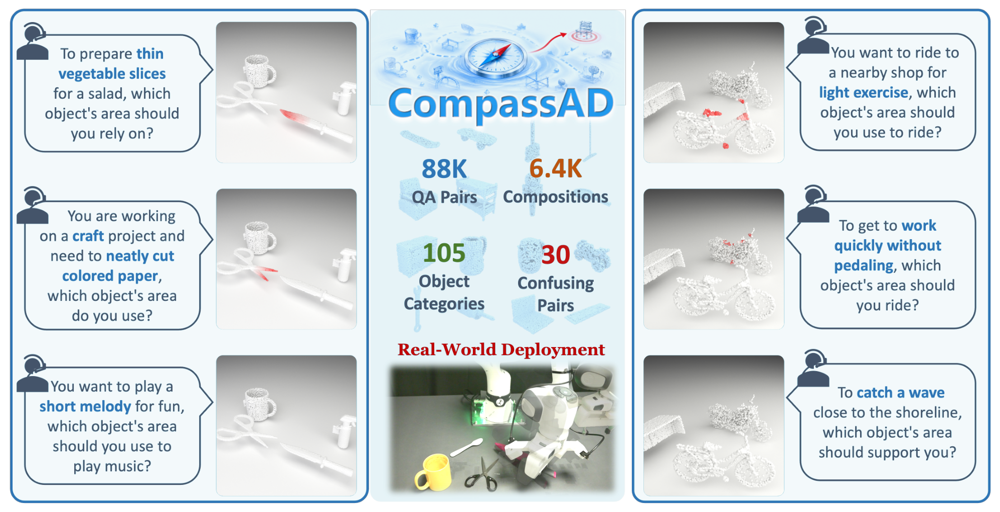
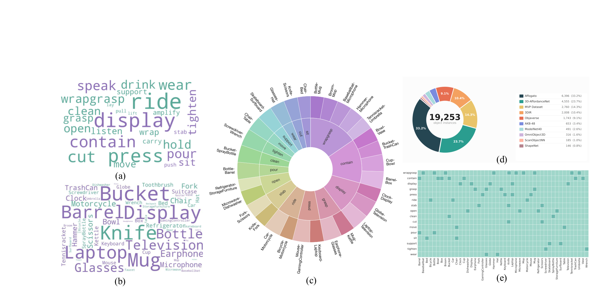
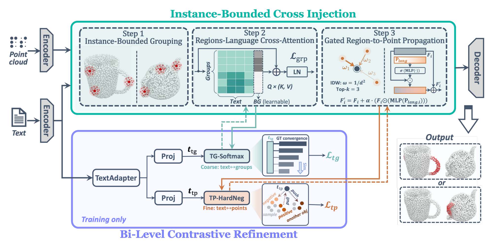
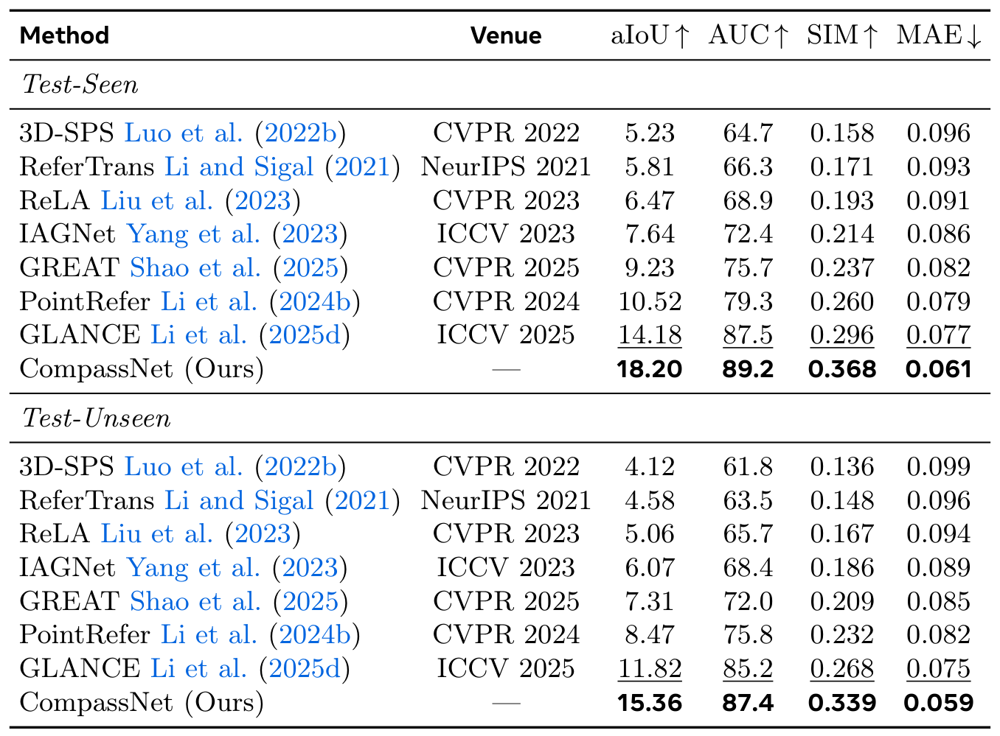
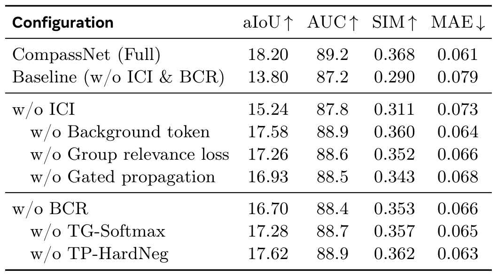
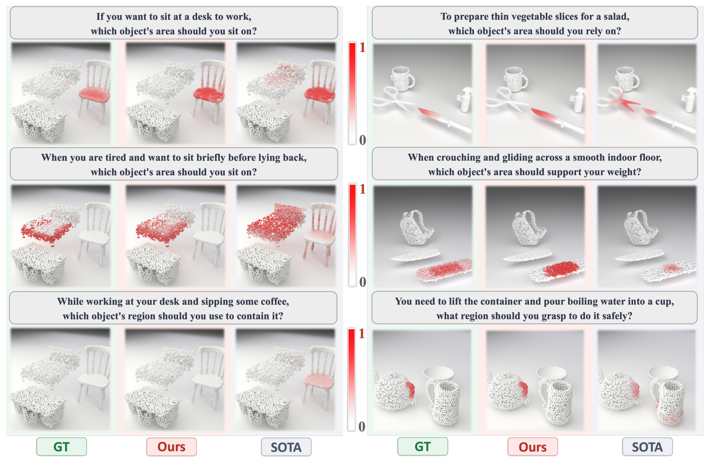
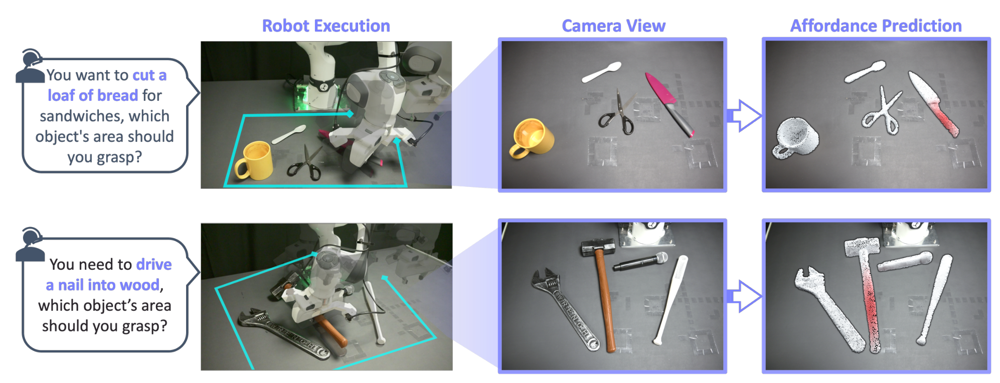

# CompassAD：功能竞争物体中的意图驱动三维可供性接地

## 核心信息

- 标题: CompassAD: Intent-Driven 3D Affordance Grounding in Functionally Competing Objects
- 标题翻译: CompassAD：功能竞争物体中的意图驱动三维可供性接地
- 作者: Jingliang Li、Jindou Jia、Tuo An、Chuhao Zhou、Xiangyu Chen、Shilin Shan、Boyu Ma、Bofan Lyu、Gen Li、Jianfei Yang
- 机构: 南洋理工大学 MARS Lab（新加坡），Gen Li 与 Jianfei Yang 为通讯作者
- 发表时间: 2026 年 5 月
- 发表渠道: arXiv 预印本（v2，cs.CV）
- arXiv: 2604.02060
- 论文链接: https://arxiv.org/abs/2604.02060
- 代码 / 项目: https://lorenzo-0-0.github.io/CompassAD
- 数据 / 资源: 论文自建基准 CompassAD，含 6,422 组多物体组合与 87,964 条查询；项目页是唯一公开入口，正文未给出独立的数据下载地址
- 论文类型: AI 方法（新任务设定 + 基准 + 配套模型）

## 原文摘要翻译

当被要求「切蛋糕」时，机器人必须在附近的剪刀中选中刀具，尽管两者都具备切割这一功能。真实场景中，多个物体可能共享同一种可供性，但只有在给定任务语境下才有一个是合适的，作者把这类情形称为混淆对（confusing pair）。然而现有三维可供性方法大多回避了这一挑战：它们评估孤立单物体，且查询里常常直接给出物体类别名。本文形式化了「意图驱动的混淆可供性接地」这一新的三维可供性设定，要求在多物体点云中、以隐式自然语言意图为条件，在正确的物体上预测逐点可供性掩码。为研究该问题，作者构建了 CompassAD，这是首个以隐式意图为核心、面向混淆多物体组合的基准，包含 30 组混淆对、覆盖 16 类可供性、6,422 组组合与 88K 以上查询—答案对。作者进一步提出 CompassNet 框架，包含两个针对该任务设计的专用模块：实例边界内交叉注入（ICI）把语言—几何对齐约束在物体边界之内，防止跨物体语义泄漏；双层对比精化（BCR）在几何组级与点级同时施加判别约束，锐化目标表面与混淆表面之间的区别。大量实验在已见与未见的查询上都取得了当前最优结果，并且在机械臂上的部署验证了该方法在真实混淆多物体组合抓取中的有效迁移。

## 创新点

1. **提出一个此前被回避的任务设定**：把「多个物体共享同一可供性时该选谁」从单物体评测的盲区里单独拎出来，定义为意图驱动的混淆可供性接地，并明确要求模型在无人可满足查询时输出空掩码。这个设定的价值不在于新增一个数据集，而在于它让「实例选错」与「区域定位不准」这两类误差可以被分开归因。

2. **构建受控混淆的基准 CompassAD**：30 组混淆对覆盖 16 类可供性，组成 6,422 组两到四物体的局部工作区，配套 87,964 条查询。关键在于三条构造约束——查询绝不含物体类别名、干扰物被强制要求不共享目标可供性、真值随查询而非随组合变化，这三点共同排除了位置记忆与类别名泄漏两条捷径。

3. **ICI 把跨模态融合限制在实例内部**：用半径图连通分量先切出物体实例，再在实例内部做区域—语言交叉注意力，并以可学习背景词元作为无解释内容的注意力出口。与「换更强的三维编码器」相比，这是一种结构性约束，代价极低但直接掐断误差源。

4. **BCR 用两个仅训练期的对比损失覆盖两个粒度**：TG-Softmax 在实例内部对区域做相对排序（而不是各自独立回归），TP-HardNeg 用平滑最难负例压制点级误激活。两者都不增加推理参数与计算量，部署端零开销。

5. **给出了从点云掩码到真机抓取的完整链路**：开放词表分割加单目深度反投影得到伪点云，CompassNet 输出可供性，再与 AnyGrasp 的抓取置信度相乘选抓。虽然只有两次演示，但它把「可供性预测」与「可执行动作」之间的接口写清楚了。

## 一句话总结

这篇论文把三维可供性从「单个物体上哪块区域能用」推进到「一组功能重叠的物体里该动哪一个」，并用实例边界约束加双层对比学习证明：在多物体混淆场景下，限制语言信号的传播范围比堆更强的编码器更有效。

## 研究问题

### 现有评测悄悄回避了什么

三维可供性研究的主流做法是在孤立物体上做部件级定位，从 3D AffordanceNet 到 LASO、GREAT、PointRefer 一脉相承。这类设定有两个隐含前提：场景里只有一个候选物体，且查询里往往已经点名了物体类别。真实工作台却不是这样——刀和剪刀都在桌上，两者都能切，查询只会说「我要切薄片」。此时模型的失败不是「切不准」，而是「切到剪刀上去了」，而单物体评测根本无法暴露这种错误。

作者把这种中间地带称为受控局部工作区：既不是单物体，也不是整场景。场景级路线（SceneFun3D 一族）能覆盖杂乱几何，但带来大量背景点与算力开销，且每条指令仍然默认指向唯一可识别的功能元素。

### 为什么不能靠把模型放大来解决

作者指出，把单物体方法直接搬到多物体输入上会暴露两种系统性失效。第一种是全局跨模态融合把查询语义扩散到整个点集，导致激活落到共享同一可供性的干扰物体上；第二种是即使选对了物体，预测区域仍然粗糙，而且当查询指向的功能没有任何物体具备时，模型依旧自信地亮起一片区域而不是弃答。这两类误差是串联的：实例选错则后续定位全部作废，因此任务要求联合解决选择与定位，误差不能靠后处理拆开修。

### 本文的问题陈述

给定点云 $P=\{p_i\}_{i=1}^{N}$ 与隐式意图查询 $Q$，学习映射

$$ \hat{y} = f_{\theta}(P, Q) \in [0,1]^{N} $$

其中真值随查询变化：同一组合 $P$ 上的两个不同查询可以对应完全不同的掩码。对无人可满足的负查询，真值为全零。这就要求模型同时具备三种能力——判断查询指向哪个实例、在该实例上定位功能区域、以及在没有任何候选时保持沉默。

## 数据与任务定义

### 组合的构成规则

每组组合由一个混淆对 $(o_a, o_b)$ 加上 $D \in \{0,1,2\}$ 个干扰物构成，因此物体数是 2 到 4。混淆对的定义是「共享至少一种目标可供性、在该功能下可互换、且往往在视觉或几何上相似」的两类物体，例如刀与剪刀（几何差异极大但都用于切割）、滑板与冲浪板（结构设计高度相似）。干扰物只负责制造杂乱几何，被强制要求不共享该对的目标可供性，从而把歧义严格限制在配对层面。

组合通过多阶段流程装配：逐物体归一化、随机空间摆放、槽位随机置换。这三步针对的是位置偏置、尺度偏置与上下文偏置三条捷径——如果固定「目标总在左边」，模型完全可以学会不看查询。

### 查询生成与复核

每条组合用两个结构化模板提示 GPT 生成查询，一个模板产出与可供性相关的正查询，另一个产出与可供性无关的负查询，两个模板都显式禁止出现任何物体类别名。候选查询先过自动过滤（拒绝名称泄漏、长度越界、组合内重复），再由受训标注者按三条标准独立复核：意图是否清晰、正查询的目标是否唯一或负查询是否确实不可满足、措辞是否自然，分歧按多数投票裁决。最后一关是让 GPT 只凭查询本身反推意图目标，反推失败的样本退回重新生成——这一关实际上是在检验「查询是否足以唯一确定答案」。

### 数据规模与覆盖

CompassAD 共 6,422 组组合、87,964 条查询，覆盖 105 个物体类别与 16 类目标可供性，底层点云来自既有三维可供性数据集并补充合成与真实扫描资源，合计 19,253 个物体实例。可供性与物体的共现矩阵呈现明显的多对多结构：每个物体支持多种可供性，每类可供性也对应多种类别，这正是意图级消歧在多物体场景下不可省的原因。

*图 1：任务示意。左栏同一组「杯子＋刀＋剪刀」在「切薄片」「剪纸」「演奏」三种意图下应激活不同区域，其中演奏意图下无人可满足、真值为空；右栏是滑板与冲浪板这组结构相似但语义依赖意图的混淆对；中栏给出基准规模与真机部署场景。*

### 评测划分与指标

评测沿用既有工作的四个指标：aIoU 为主指标，另有 AUC、SIM 与 MAE。划分分已见查询与未见查询两个测试集，后者用于检验语言泛化。需要注意的是，未见划分针对的是查询与物体类别的新组合，并不包含全新的可供性类型。

*图 2：基准总览。五个子图依次为可供性概念分布、物体类别分布、按目标可供性分组的混淆对层级、物体实例来源构成（共 19,253 个实例）、可供性与类别的共现矩阵；前两个子图显示明显长尾，最后一个子图显示多对多结构。*

## 方法主线

### 机制流程

1. **输入编码与实例切分**：输入是多物体点云与查询文本，分别送入 Uni3D 与 RoBERTa 得到逐点特征与词元特征；同时对原始三维坐标跑半径图连通分量，为每个点分配实例标签，得到物体级分组。
2. **实例内区域构造与语言注入**：在每个实例内部用最远点采样选出区域中心，每个中心聚合同实例内最近邻点形成区域并池化加 MLP 得到区域特征；区域特征通过多头注意力去查询文本（键值额外拼接一个可学习背景词元），把语言信息压进区域表示。
3. **门控回传得到逐点表示**：每个点向最近的三个增强区域做逆距离插值聚合，再以乘性门控调制原始点特征，输出仍然是逐点特征但已带上查询信息。
4. **解码与训练期判别**：逐点特征送入解码器得到可供性热图；训练时额外叠加分组相关性损失、区域级 TG-Softmax 与点级 TP-HardNeg，推理时后两者全部丢弃。

*图 3：CompassNet 整体结构。上方青色框是 ICI 的三步——实例分组、带背景词元的区域语言交叉注意力、门控回传；下方紫色框是仅训练期生效的 BCR，两条分支分别把文本适配到组级锚点与点级锚点，输出 TG-Softmax 与 TP-HardNeg 两个损失。右侧输出示意给出两种结果：激活目标物体上的把手，或在负查询下输出空掩码。*

### ICI 的第一个决定：先分组，再做注意力

标准跨模态融合把整组点当作一个点集处理，文本线索可以贴到任何几何上说得通的表面，包括共享同一功能的竞争物体。ICI 的做法是把物体边界当作前置条件而不是后处理约束：交叉注意力在每个实例内部独立计算，因此文本信号在构造上就无法跨越物体边界。

分组依据是原始三维坐标上的半径图连通分量。这一步刻意做得很轻——不训练、不依赖语义，只假设物体在空间中是可分的。区域则用最远点采样在实例内选中心，每个中心只聚合同实例内的最近邻点，保证没有区域横跨两个物体。区域特征由点特征均值池化后过一层 MLP 得到。

### ICI 的第二个决定：给注意力一个「无处可去」的出口

区域—语言交叉注意力的键值与值都额外拼接了一个可学习背景词元：

$$ \hat{G} = \mathrm{MHA}\left(G,\ [T; b_{bg}],\ [T; b_{bg}]\right) $$

这个设计的动机值得单独说。在负查询下，如果键值只有文本词元，注意力无处可逃，只能把某个语义词元的内容硬塞给区域，于是模型被迫在「没有一个物体合适」时仍然亮起一片区域。加入背景词元后，注意力可以把无法解释的内容路由到这个不绑定任何语义的槽位，模型因此有能力输出全零掩码。这是本文实现弃答的机制根源，而不是靠推理期阈值截断。

### ICI 的第三个决定：乘性门控而不是相加注入

逐点表示由最近的三个区域中心逆距离插值聚合得到，随后通过乘性门控调制原始点特征：

$$ \mathbf{f}'_i = \mathbf{f}_i + \alpha\left(\mathbf{f}_i \odot \sigma(\mathrm{MLP}(\mathbf{f}^{lang}_i))\right) $$

由于门控是乘性的，语言只能重加权点特征里已经存在的通道，无法凭空注入激活。作者明确说明这是为了让可供性预测锚定在几何上，同时又能感知查询。消融显示去掉门控回传掉 1.27 aIoU，是 ICI 三个子部件里跌幅最大的一个——说明「实例内分组」本身还不够，必须在点级把语言信号重新注入，否则区域级对齐无法落到逐点掩码上。

### BCR：两个粒度、两个方向

ICI 解决了「不跨物体」，但没有解决「在物体内部选哪块区域」，也没有解决「哪些点仍在混淆表面上误亮」。BCR 用两个仅训练期的损失补齐这两块。

TG-Softmax 在实例内部对区域做相对排序。它把全局文本向量经适配器投影成组级锚点，用余弦相似度打分，并以「区域内点真值的稠密程度」构造软目标：

$$ \mathcal{L}_{tg} = -\sum_{j=1}^{N_g} p_j \log \frac{\exp\left(\mathrm{sim}(t_{tg}, z_j)/\tau\right)}{\sum_{j'} \exp\left(\mathrm{sim}(t_{tg}, z_{j'})/\tau\right)} $$

其中软目标 $p_j$ 由区域平均真值取幂后归一化得到，$\gamma>1$ 用于锐化分布。它与 ICI 自带的分组相关性损失是互补关系而非重复：后者对每个区域独立地与自己的真值做二分类（绝对标定），前者让同一实例内的区域在一个 softmax 里相互竞争（相对排序）。

TP-HardNeg 针对的是点级假阳性的两个来源——落在错误物体表面上的点，以及同一物体上非功能区域却拿到高分的点。每个批次采样正样本点与来自这两类表面的负样本点，要求每个正样本与负样本的平滑最大值之间保持间隔 $m$。平滑最大值用温度 $\tau_h$ 下的对数求和指数近似最难负例，避免只盯单个极端点导致训练不稳。

### 训练目标与实现细节

总损失是热图监督加上三项辅助：

$$ \mathcal{L} = \mathcal{L}_{hm} + \lambda_{grp}\mathcal{L}_{grp} + \lambda_{tg}\mathcal{L}_{tg} + \lambda_{tp}\mathcal{L}_{tp} $$

热图监督沿用焦点损失。实现上点编码器采用 Uni3D 维度 512，文本编码器采用 RoBERTa，后接 Transformer 解码器；训练 15 个 epoch、批大小 96，权重衰减 $10^{-3}$，优化器为 AdamW 配余弦退火。

## 关键结果

### 主结果与强基线

七个代表基线全部在 CompassAD 上按同一划分、同一训练设置重训，图像条件或二维指代分割出身的方法统一走 LASO 的适配协议。CompassNet 在两个划分上全面领先。

*表 1：CompassAD 主结果。上段为已见查询，下段为未见查询，粗体为最优、下划线为次优，aIoU 为主指标。*

把两个划分按方法对齐后看，趋势比单看某一行更清楚：

| 方法 | 已见 aIoU | 未见 aIoU | 已见 SIM | 未见 SIM |
| 3D-SPS | 5.23 | 4.12 | 0.158 | 0.136 |
| GREAT | 9.23 | 7.31 | 0.237 | 0.209 |
| PointRefer | 10.52 | 8.47 | 0.260 | 0.232 |
| GLANCE | 14.18 | 11.82 | 0.296 | 0.268 |
| CompassNet | 18.20 | 15.36 | 0.368 | 0.339 |
| 相对 GLANCE 增益 | +4.02 | +3.54 | +0.072 | +0.071 |

三个观察值得记下来。第一，绝对水平极低：即使最好的 CompassNet，已见划分 aIoU 也只有 18.20，说明这个任务远未解决。第二，基线之间的跨度极大，从 5.23 到 14.18，说明该设定对方法结构非常敏感，不是靠调参能抹平的差距。第三，未见划分上 CompassNet 掉 2.84 aIoU，跌幅小于部分基线，语言泛化没有出现断崖，但也谈不上摘要里强调的那种稳健。

### 消融到底说明了什么

*表 2：已见划分上的消融。从完整模型出发，逐项移除模块及其子部件，所有变体训练设置一致。*

把绝对数值换算成相对完整模型的跌幅，模块之间的重要性排序一目了然：

| 配置 | aIoU | 相对完整模型跌幅 | SIM |
| 完整模型 | 18.20 | — | 0.368 |
| 去掉整个 ICI | 15.24 | −2.96 | 0.311 |
| 去掉背景词元 | 17.58 | −0.62 | 0.360 |
| 去掉分组相关性损失 | 17.26 | −0.94 | 0.352 |
| 去掉门控回传 | 16.93 | −1.27 | 0.343 |
| 去掉整个 BCR | 16.70 | −1.50 | 0.353 |
| 去掉 TG-Softmax | 17.28 | −0.92 | 0.357 |
| 去掉 TP-HardNeg | 17.62 | −0.58 | 0.362 |
| 无 ICI 与 BCR 底配 | 13.80 | −4.40 | 0.290 |

结论有两层。一层是作者主推的：ICI 的 2.96 是单项最大跌幅，支持「跨物体语义泄漏是主因」的判断。另一层是作者没有强调的：两个模块合计 4.40 的增益里，ICI 占 2.96（约三分之二），BCR 只占 1.50；而在 BCR 内部，TG-Softmax（0.92）明显比 TP-HardNeg（0.58）更重要。也就是说，真正难的是「在正确实例内挑对区域」，而不是「把点级边界磨得更细」——这与任务本身的两个误差层级是吻合的。

还有一个容易被忽略的数字：去掉背景词元只掉 0.62 aIoU，但它承担的却是弃答这个安全相关的功能。负查询的真值全为零，交并比在空集上要么无定义、要么几乎没有区分度，因此这类样本的贡献在主指标里被大幅稀释。0.62 很可能严重低估了该部件的真实价值，这是指标选择带来的盲区，见「局限」一节。

### 定性表现

*图 4：定性对照。每组三联图依次是真值、CompassNet、当前最优基线 GLANCE。左栏同一组合在不同意图下激活不同区域（椅子座面 vs 床面）；右栏覆盖三组典型混淆对——刀与剪刀、滑板与冲浪板、水壶与杯子，可以看到基线把激活铺到两个物体上，而本文方法集中在目标部件。*

左侧三行是本文任务设定的直接证据：同一堆点云，问「坐在桌边工作」时激活椅子座面，问「累了想躺一下」时激活床面，问「边工作边喝咖啡」时激活杯子。这三条查询之间唯一的差别就是意图，模型的输出随之改变，说明它确实在用文本而不是在用空间先验。

### 真机抓取

真机链路是：单张 RGB 图经 Grounded-SAM 做开放词表实例分割，Depth Anything V2 估计稠密度量深度。

掩码区域内反投影得到逐物体点云，最远点采样降到 2,048 点并归一化到单位球，拼成组合送入 CompassNet，输出的逐点可供性再映射回相机坐标系。

同一份点云交给 AnyGrasp 产生候选抓取位姿，最终抓取由「抓取置信度 × 预测可供性」的乘积选出。

*图 5：真机抓取。每行依次是机器人执行、相机视图与可供性预测。上行为「切面包」查询选中刀而非剪刀，下行为「钉钉子」查询选中锤子而非扳手，激活集中在目标把手处，其余物体接近零。*

## 深度分析

### 为什么实例边界约束比更强编码器更划算

把 ICI 与基线对比放在一起看，最有力的证据不是主结果表，而是基线内部的结构。GREAT 与 PointRefer 分别代表了「引入几何—意图协同推理」与「更强的视觉基础模型迁移」两条路线，aIoU 却只有 9.23 与 10.52；而 ICI 没有换编码器，只是把语言—几何交互的作用域从整组点收缩到单个实例，就带来了 2.96 的提升。这说明在该任务上，误差的主项来自信息流动的范围而不是表征能力——编码器再好，只要文本语义能自由扩散到相邻物体上，它就一定会被共享同一功能的干扰物拉走。

这一点也和「全局注意力在候选集语义重叠时会退化」的普遍直觉一致：当两个物体的功能向量几乎相同时，全局注意力的软分配必然把权重摊到两者上，而实例边界把这个问题变成了一个硬性的组合结构问题。

### 有效性的边界在哪里

ICI 的全部效力都挂在一个假设上：物体在三维空间里可分。半径图连通分量对遮挡与紧密堆叠非常敏感——如果两个物体在点云里连成一片，连通分量会把它们并成一个实例，边界约束随之失效，方法退化回全局融合。作者在局限里承认了这一点，但没有给出量化：遮挡到什么程度开始失效、紧贴放置的间距阈值是多少，都没有实验。

这一点对本方向的启示很直接：如果要把 ICI 迁移到桌面杂乱场景或 3DGS 重建结果上，实例分组的可靠性就是第一道关卡，可能需要换成学习式实例分割或引入二维分割先验做跨视图投票。

### 误差如何传导到真机抓取

真机链路上有四个误差源串联：分割掩码的边界误差、单目深度的尺度误差、伪点云只有部分视角导致的可供性预测偏移、以及 AnyGrasp 候选位姿本身的可行性。把可供性与抓取置信度相乘是一个简洁的耦合方式，但它假设两者可比，而实际上可供性分数是逐点概率、抓取置信度是位姿级分数，乘积的量纲与校准都没有讨论。

更关键的是，论文只用两次演示说明链路能跑通，没有报告成功率、试验次数与失败模式。从「能跑通」到「可靠」之间缺的是统计证据，因此这一部分应当被当作可行性展示而非性能证据。

### 复现注意点

复现上有三处需要留意。第一，附录缺失导致各模块学习率与梯度裁剪的具体值不可得，只有 15 epoch、批大小 96、权重衰减 $10^{-3}$ 与余弦退火是确定的，超参复现存在缺口。第二，半径图连通分量的半径阈值没有在正文给出，而这个值直接决定实例分组质量，是本方法最敏感的超参。第三，负样本采样策略（每批采样多少个正样本点、多少个来自错误物体与来自同物体非功能区域的负样本点）也未在正文量化，而 TP-HardNeg 的效果对采样比例相当敏感。

## 局限

### 作者自述的两条边界

第一条是实例可分性假设：方法要求物体实例在三维空间中可以被合理分开，严重遮挡或紧贴堆叠时实例分组会跨越多物体，从而削弱 ICI 依赖的边界约束。这是一条结构性局限，不是调参能解决的，因为分组发生在网络之前。

第二条是类别覆盖：CompassAD 的物体与可供性类别受限于既有三维可供性数据集，作者把「用生成式三维模型合成超出当前标注范围的组合」列为未来工作，等于承认当前 105 类物体、16 类可供性的覆盖不足以支撑开放词表结论。

### 论文未量化因而无法主张的部分

第一，弃答能力没有被单独测量。背景词元只贡献 0.62 aIoU，但负查询的真值全为零，交并比在空集上无定义或失去区分度，无法反映弃答是否正确；论文里查不到负查询子集上的弃答率、误激活率与空掩码精确率，因此「模型学会了在无人可满足时保持沉默」目前只有机制解释与定性图示支撑，缺少直接指标。

第二，真机部分没有成功率。两次演示覆盖了切与钉两类意图，但没有试验规模、失败案例与重复次数，不能支撑「有效迁移到真实抓取」这一较强表述。

第三，噪声鲁棒性完全缺失。真实点云有传感器噪声与缺失，而 CompassAD 的组合是干净装配出来的；论文没有做加噪、降采样或遮挡注入的鲁棒性实验，因此从基准到真机之间的性能落差有多大，读者无从判断。

第四，未见划分的「未见」程度有限。它覆盖的是查询与物体类别的新组合，不覆盖新的可供性类型，因此不能等同于开放词表泛化。若要在开放词表设定下使用，需要额外验证。

## 我的笔记

### 三个可以直接借用的设计

第一个是把跨模态融合限制在实例内部。这个约束的迁移成本极低——只要下游任务能拿到实例标签（点云聚类、二维分割反投影、SAM 类模型都可以），就能直接套用 ICI 的三步结构。对做 3D 可供性的工作来说，这是一个几乎免费的结构先验。

第二个是可学习背景词元。它把「弃答」从一个阈值后处理问题变成了一个注意力路由问题，比在推理期扫阈值干净得多，而且不引入额外分支。任何需要「找不到就输出空」的接地任务都可以复用。

第三个是乘性门控注入。语言只重加权已有通道、不新增激活，这个约束在几何先验强的三维任务里尤其重要，可以避免文本语义压过几何证据。相比常见的相加式融合，它更适合「几何为主、语言为辅」的场景。

### 用混淆对做误差解耦的实验范式

这篇论文最值得学的其实是基准设计而不是模型。把两个共享同一可供性的物体放在一起，就把「选错实例」和「选不准区域」这两类误差从一个混合指标里拆了出来，而且天然排除了类别名这条捷径。我之前的诊断实验里也遇到过类似问题——模型看起来准，但其实是靠物体类别名和位置先验在猜。用混淆对构造对照，可以一次性把这两条捷径堵住。

这一点与「命名目标部件后动作准确率大幅跳升」那类诊断结论是互补的：那类实验说明瓶颈在部件定位，本文则说明当候选物体不止一个时，还有一个更前置的实例选择瓶颈。两者结合可以得到一个更完整的分层诊断：先看实例选择，再看部件定位。

### 与在读工作的位置关系

在我整理的坐标系里，这篇落在「3D × 单步 × 多物体」这一格：输入是点云，任务粒度仍是单动作单目标，但候选物体从一个变成了一组。它与 [[AffordAny]] 这类开放词表单物体方法、与 [[3DAffordSplat]] 这类换表示的工作都不冲突——前者可以当它的编码器替换实验，后者可以当它的输入鲁棒性压力测试。

如果要在这一格上立题，最直接的空隙是：本文的混淆对只有两个物体共享功能，如果把干扰物也设成共享同一可供性的第三类物体（三重混淆），实例边界还能提供多少判别力？这可以直接做成一个消融，成本很低但结论会很有信息量。

### 一个可以立刻做的诊断实验

按本文的逻辑，误差分两层。可以用「给定正确实例」的上界实验来拆解：把真实实例标签喂给模型，只在目标实例内评测区域定位，再与完整流程对比。两者的差距就是实例选择误差的贡献；如果差距大，说明后续工作应该往实例分组与选择上投入，而不是继续卷区域分割精度。这个方法在本文里没有做，但完全可以用 CompassAD 复现，也是我认为最有价值的一个后续实验。

## 引用

- 原文：Li, Jingliang, et al. "CompassAD: Intent-Driven 3D Affordance Grounding in Functionally Competing Objects." arXiv:2604.02060, 2026. https://arxiv.org/abs/2604.02060
- 基准与单物体前作：Deng et al., 3D AffordanceNet, CVPR 2021；Li et al., LASO, CVPR 2024；Li et al., GLANCE, ICCV 2025
- 视觉基础模型迁移路线：Shao et al., GREAT, CVPR 2025；PointRefer, CVPR 2024
- 场景级可供性：Delitzas et al., SceneFun3D, CVPR 2024
- 相关笔记：[[AffordAny]]、[[3DAffordSplat - Efficient Affordance Reasoning with 3D Gaussians]]、[[EgoAfford - Task-Oriented Affordance Grounding via Egocentric Referring Segmentation]]、[[场景级Affordance Grounding-综述与对比]]
