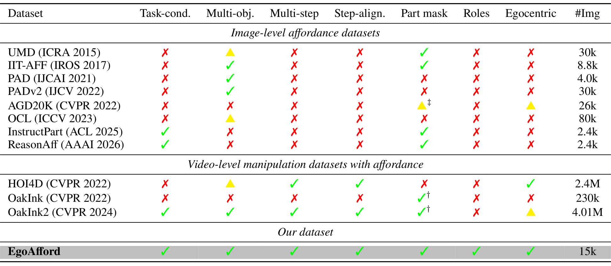
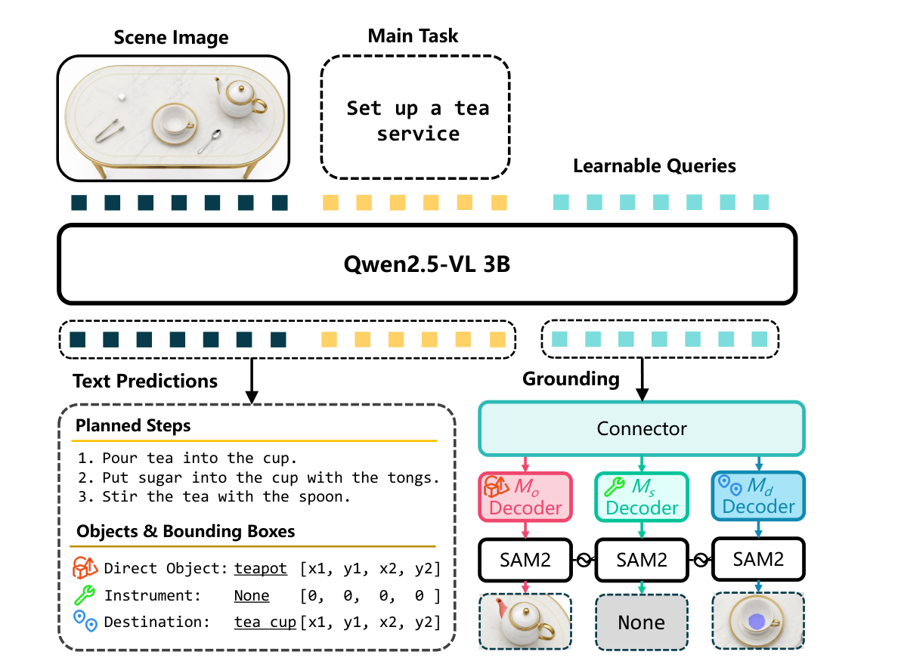
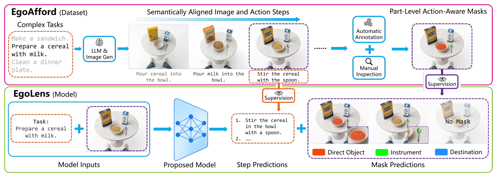
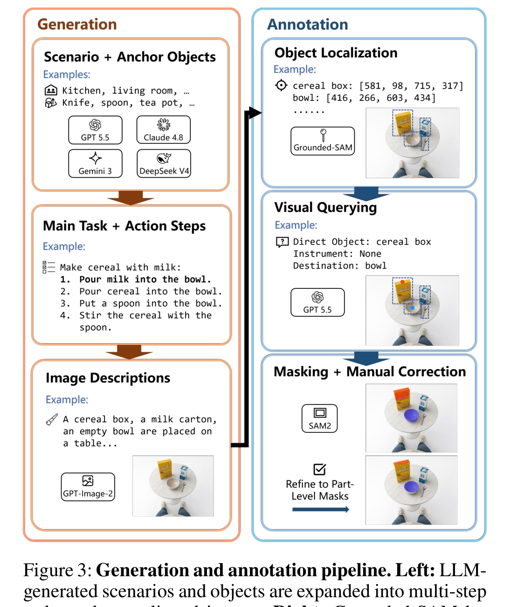
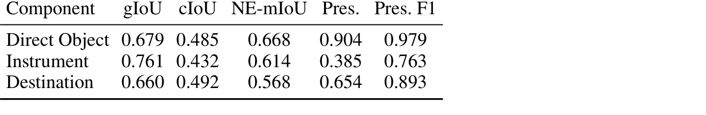
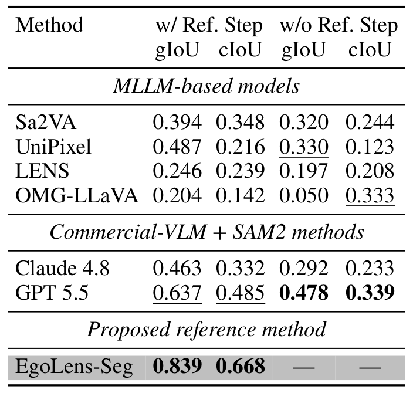
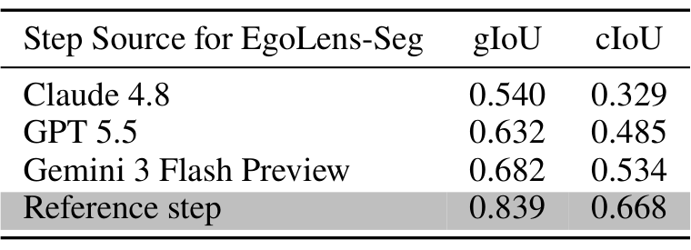
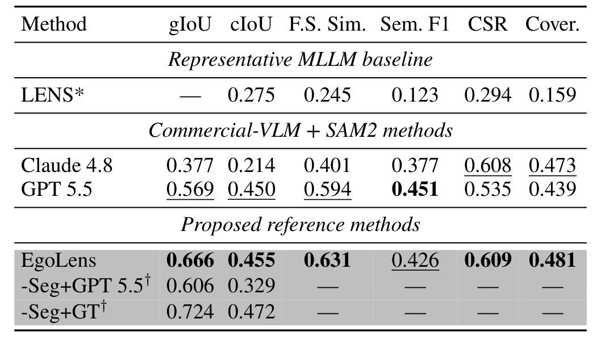
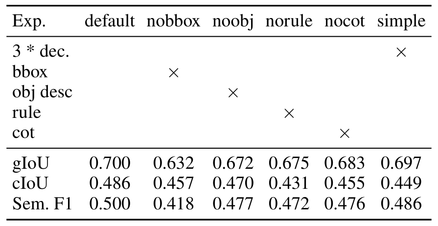
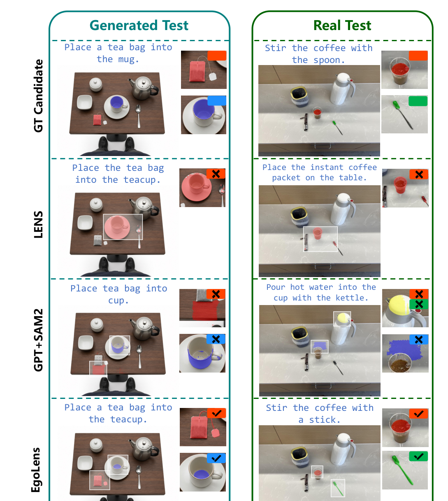

# EgoAfford: Task-Oriented Affordance Grounding via Egocentric Referring Segmentation

## 核心信息

- 标题: EgoAfford: Task-Oriented Affordance Grounding via Egocentric Referring Segmentation
- 标题翻译: EgoAfford：通过第一视角指代分割实现的任务导向可供性定位
- 作者: Xinyuan Guan, Feifan Chen, Xinyu Zhan, Fu-Cheng Zhang, Cewu Lu, Lixin Yang（末位为通讯作者）
- 机构: 上海交通大学；上海创智学院（Shanghai Innovation Institute）；Noematrix Ltd
- 发表时间: 2026-08-05
- 发表渠道: arXiv 预印本（arXiv:2608.04533v1, cs.CV）
- DOI: 暂无
- arXiv: 2608.04533
- 论文链接: http://arxiv.org/abs/2608.04533v1
- 代码 / 项目: https://egoafford.github.io
- 数据 / 资源: EgoAfford（15,537 图 / 2,000 场景）、EgoAfford-Real（102 图 / 26 任务）、参考模型 EgoLens（3B）
- 论文类型: 基准与数据集（配套参考模型）

## 原文摘要翻译

> 部件级可供性定位已经推进了对与原子动作相关联的功能性物体区域的定位。要把这一能力扩展到复杂任务，就需要把参与物体的语义角色、与任务状态对齐的视觉观测以及多步规划三者连接起来。
>
> 我们提出 EgoAfford，一个旨在连接这三方面的基准。给定一个第一视角观测和一个高层桌面任务，模型必须生成剩余计划，并对下一步动作中至多三个部件的功能性区域进行分割：直接对象、工具以及目标位置。
>
> 数据方面，它包含来自 2,000 个生成的多步场景的约 1.55 万张经人工核验的图像，组织为语义对齐、任务完整的图像序列；另有 EgoAfford-Real——102 张跨 26 个任务的手工拍摄图像。
>
> 我们进一步提出 EgoLens，一个带角色专用掩码解码器的 3B 多模态大语言模型，作为这一联合任务的域内参考模型。
>
> 对近期指代分割多模态大模型、商业视觉语言模型与分割模型的管线、以及 EgoLens 的评测，揭示了「下一步推断」与「动作角色条件化的部件定位」这两类互补的挑战。
>
> EgoLens 在生成观测与手工拍摄观测上都建立了强有力的参考性能。两者共同为在多步桌面任务中联合研究感知与规划提供了基础。项目页面见 egoafford.github.io。

## 创新点

1. **把多步可供性定位形式化为联合任务**：不是「给定指令 → 定位一个功能区域」，而是「给定任务目标 + 当前观测 → 先推断剩余计划，再对下一步的三个参与部件同时做部件级定位」。这一定义把可供性从孤立的对象-动作对，扩展到任务进度中的多对象协同。

2. **三分量角色体系与可缺失建模**：每一步被拆成**直接对象**（被操作的物体）、**工具**（作用于直接对象的手持物）、**目标位置**（接收物体或转移材料的位置或容器）。关键在于工具与目标位置**允许缺失**，且缺失被显式建模为全零掩码——这让「裸手动作」「原位动作」不再需要特殊处理。

3. **EgoAfford 数据集：把复杂任务拍成语义对齐的图像序列**：核心洞察是，要标注「多步任务的每一步之前的状态」，就必须有同一场景在多个时间点的图像，而现成数据集都不提供。论文用「多模型生成任务分解与场景状态描述 → 图像生成模型合成 → 人工筛选与掩码修正」的管线补上了这个空缺。

4. **量化了自动标注的天花板**：GPT-5.5+SAM2 自动管线在人工修正后的掩码上只有 **0.696 gIoU / 0.523 cIoU**。这个数字本身就是一个有价值的结论——即使有显式动作分解、目标框等额外监督信息，现成 grounding 管线仍不足以产出可直接训练的细粒度标注。

5. **EgoLens：用架构而非文本保证角色-掩码绑定**：把 LENS 的解码器复制成三个并行分支，每个分支对应一个动作组件。这样「哪个掩码对应哪个角色」由网络结构决定，而不是指望文本生成正确地产生对应数量的分割标记。

6. **把规划误差与定位误差显式分离的评测设计**：通过「给参考步 vs 不给参考步」「换不同来源的下一步」两组实验，作者量化了「下一步推断」这一环节究竟贡献了多少误差。

## 一句话总结

EgoAfford 把多步桌面任务中的可供性定位重新定义为「剩余规划生成 + 下一步直接对象/工具/目标位置的三分量部件级分割」这一联合任务，用 1.55 万张语义对齐的生成图像及人工核验掩码构建基准，并以 3B 的 EgoLens 建立参考性能（0.700 gIoU）。

## 研究问题

### 现行问题定义的两个具体缺陷

论文的出发点不是「可供性定位做得不够好」，而是**问题本身的定义太窄**。作者指出当前二维可供性定位的两条主线各有盲区。

**缺陷一：单目标。** 近期二维 formulations 仍以单目标为主——每个样本只定位一个动作条件化的功能区域，**没有显式区分多个参与物体的角色**。但现实中的动作天然是多参与的：倒水这个动作同时涉及水壶（直接对象）、水杯（目标位置），而「倒」这个动作的语义角色在两者之间传递。仅给一个掩码，模型就不必理解角色。

**缺陷二：单步。** 即使是被称为「扩展」的双手操作与场景级 formulations，预测的也是**给定**动作或指令下的可供性，而不是**以任务进度为条件**推断剩余流程。这带来一个实践上的断裂：真实场景中，人面对「准备茶水」这个任务时，需要先判断「现在该做哪一步」，然后才知道该看哪个部件。

### 论文的解法：同时补上角色与进度

作者的应对是同时在两个维度上扩展。在**动作维度**上，把每一步表示为三个关键组件（直接对象 / 工具 / 目标位置），并在部件级定位它们——这样不仅回答「哪里可供」，还回答「多个物体如何参与这个动作」。在**任务维度**上，要求规划：给定当前观测与任务目标，模型先推断剩余流程，再定位紧邻的下一步三个组件。

这两个维度合起来，就形成了本文所称的「任务导向可供性定位」。EgoAfford 与 EgoLens 共同构成这个基准与参考方法。

## 数据与任务定义

### 三角色标注定义

给定第一视角桌面图像 $I$ 与自然语言任务描述 $T$，模型需要输出两样东西：用自然语言表述的动作步骤序列 $\{T_1, \dots, T_n\}$，以及下一步动作对应的三个掩码 $\{M_o, M_s, M_d\}$。

| 角色 | 符号 | 定义 | 缺失条件 |
|---|---|---|---|
| 直接对象 | $M_o$ | 被操作的物体，无论裸手还是通过工具 | 几乎总存在 |
| 工具 | $M_s$ | 手持并作用于直接对象的物体 | 裸手动作时缺失 |
| 目标位置 | $M_d$ | 转移动作的目标位置或容器 | 无材料转移时缺失 |

**部件级而非物体级**是关键的语义决定：掩码圈出的是**功能部件**，例如刀的刀刃、水壶的壶嘴，而不是它们所在的整个物体。论文对**把手**给了专门规定：把手区域一般不进掩码，**除非该把手本身承担了超出「提供抓握」之外的功能**。

理由是一条语义分工：把手的抓取可供性由**类别级先验**给出——拿任何一把刀都要抓把手，这个判断不需要看当前动作是什么；而功能部件承载的是**动作特定**的信息。既然抓取语义能从类别先验推出，就没必要让它混进像素级评测。

需要区分清楚的是：这是一条**标注粒度的约定，不是数据构造时的类别过滤**。数据集里刀、锅、勺子的图像当然含把手像素，论文也未按物体类别排除任何数据；被排除的只是「把手区域是否算作该组件的功能部件」这一点。

**三条附加规则**补齐了日常动作中的边界情形。当被操作的物质位于容器内（如锅里的水）时，**容器被标为直接对象**。携带材料的「负载工具」（如舀着糖浆的勺子）**作为工具标注，且连同其承载的材料**。当多个实例共享同一语义时，**要求分割全部实例**——因为动作可能在任一实例上执行。

这三条规则看起来琐碎，但正是它们让协议能覆盖真实桌面操作的复杂性：一个全零掩码的「正确答案」必须建立在这些规则被严格执行的基础上，否则空掩码的评价就失去了意义。

### 数据构建：三阶段生成管线

要标注「多步任务的每一步之前的状态」，就需要**同一个场景在多个时间点的图像**，且每张图都含任务所需的全部物体、步与步之间语义状态一致。作者指出据其所知没有任何现成数据集提供这类图像，因此自建生成管线。

**阶段一：任务种子生成。** 让每个大模型想象不同场景下的多样物体作为锚点物体。该过程用**四个不同的大模型重复**以提升多样性。
- Gemini 3 Flash Preview
- GPT 5.5
- DeepSeek V4 Pro
- Claude Opus 4.8

**阶段二：任务分解与场景状态描述。** 对每个锚点物体及其场景，让大模型生成若干复杂任务及步骤分解；再提示它枚举该任务所需的全部物体，并为每一步撰写「该步执行前」的场景状态文本描述，逐一说明在场每个物体的位置与状态。

**阶段三：图像合成与人工筛选。** 状态描述送入图像生成模型。**大部分图像由 GPT-Image-2 生成**（生成质量优先），早期验证阶段由 FLUX-2[dev] 生成的部分图像保留在最终数据集中。生成图像经过**人工筛选**，状态不一致的图像用人工修正的场景描述重新生成，或标记为无效数据。

### 标注管线：大模型自动提案 + 人工修正

**输入**是生成阶段产出的每一步动作的组件列表。**流程**分三步：Grounded-SAM 为每个列出的物体生成定位框；标注大模型（GPT-5.5）把每个动作组件链接到对应框，并在框内于功能部件上放置一个点提示；SAM2 从点提示生成细粒度部件级掩码，作为自动标注。

**关键判断：自动标注只作提案，绝不直接用作训练标签。** 理由是大模型的幻觉与空间定位能力有限。作者用数字支持这一判断——修正前，GPT-5.5+SAM2 管线相对最终人工修正掩码仅达到：

$$\text{gIoU} = 0.696,\qquad \text{cIoU} = 0.523$$

即使管线已获得额外支撑信息（显式动作分解、物体框等），现成定位方案仍不足以产出可靠的细粒度标注。人工标注者需核验组件-角色对应关系，并通过用修正后的点重新提示 SAM2 来检视和精修每一个提议掩码。

> [!tip] 对我自己项目的启发
> 「先量测自动管线相对人工的上限，再决定它只作提案」这个次序值得抄。我在做 3D 可供性数据时也打算用 Grounded-SAM/SAM 类模型做自动标注，这条 0.696/0.523 就是预期落点——低于 0.7 就不要指望直接训练。

### 数据规模与划分

**规模**：EgoAfford 共 15,537 张图像，来自 2,000 个生成场景。

| 划分 | 场景数 | 任务数 | 图像数 | 步/任务 | 物体/场景 | 多分支状态占比 | 平均候选数 |
|---|---|---|---|---|---|---|---|
| Train | 1,900 | — | 15,049 | 7.92 | 5.74 | —（单一参考路径） | — |
| Test（生成） | 100 | — | 488 | 4.88 | 4.93 | 44.9% | 1.85 |
| Real | — | 26 | 102 | 3.92 | 3.92 | 48.0% | 1.89 |

划分在**场景级**进行：同一场景的所有步骤归入同一划分。测试集比训练集短得多（4.88 vs 7.92 步），作者解释这种紧凑性也让多候选下一步标注与真实场景布置变得可行。

**词汇与语义多样性**这部分数据统计值得单独看，因为它说明了生成数据在多大程度上避免了模式坍缩。元数据含 **4,123 个唯一物体名**与 **391 个唯一动词**；经 spaCy 聚类后对应 **1,188 个物体类型**与 **357 个动作类型**。**Top-10 物体概念仅占物体出现次数的 19%**（对应动作动词为 54%），单例概念分别占两个词表的 **35%** 与 **22%**。语料含 **7,399 个不同的动作-物体对**，共现矩阵显示高频动作与不同物体概念组合，而非映射到单一主导类别。角色画像显示系统性但非排他的语义结构：勺、布、刀等工具类概念主要作为**工具**，而碗、盒、托盘、锅等容器类概念经常充当**目标位置**。

**物体长尾明显比动作长尾宽得多**。这符合直觉——「切」这个动作可以作用在大量不同物体上，而不同物体的功能部件形状各异。这正是部件级定位比物体级定位更有价值的地方。

### 评测协议：三分裂 + 多参考答案

**三种评测设定**（每种隔离基准的一个侧面）：

| 设定 | 输入 | 考察 |
|---|---|---|
| 全任务 | 图像 + 高层任务 | 完整联合能力（规划 + 定位） |
| 参考步分割 | 图像 + 高层任务 + **参考下一步** | 隔离细粒度定位，排除下一步推断 |
| 仅任务分割 | 图像 + 高层任务 | 完全无参考，从任务与图像推断动作相关组件 |

后两种纯分割设定中，每个开源多模态大模型基线被**分别查询三个组件，每个样本三次前向**。

**多参考答案标注（本文最具评测价值的设计）。** 一个任务状态往往允许多个可执行的下一步。作者定义了「可采纳候选」（admissible candidate）：在当前状态下可执行、且推进任务的动作，**包含对粗粒度动作的前置细化**（例如「打开盖子」是「倾倒」的前置）。用专门的标注工具，**两名标注员独立**标注每个评测状态的候选描述及对应角色掩码，**保留两者提议的并集**。

训练观测只保留一条参考路径；但为规划评测，每个评测任务还额外关联一组关于其参考步骤的**成对先后约束**。自动提出的约束在计分前经人工审核。

### 指标设计

**分割指标**以 **gIoU** 与 **cIoU** 为主。gIoU 是测试集上逐掩码交并比的平均；cIoU 是全局累加的交集与并集之比。

**空掩码处理是这个指标设计中最需要注意的部分**。对 gIoU：若真值为空，则预测**也为空**时该掩码交并比定义为 1，否则为 0。对 cIoU：空-空配对**对交集与并集都不作贡献**，而误报只贡献到并集。

作者指出这一约定下两个指标捕捉互补能力：**gIoU 强调正确识别组件（包括识别出「没有」）**，**cIoU 反映整体像素级分割精度**。评测时，在标注的可采纳下一步候选中，**选择使 gIoU 最高的那个真值**。

此外报告 **NE-mIoU**（non-empty mIoU），只在对应组件**真值存在**的样本上平均交并比，用以暴露空掩码识别对聚合分数的贡献（详见关键结果）。

**规划指标**用一个现成的交叉编码器（Sentence-BERT）计算预测步骤与参考剩余计划之间的成对语义相似度，然后用**匈牙利算法**求最大权一对一匹配。语义打分规则：配对相似度**超过阈值 $\tau = 0.6$** 才计入贡献，未匹配步骤与低于阈值的配对贡献零。

由此得到三个指标：**语义精度**对所有预测步骤平均；**语义召回**对所有参考步骤平均（亦即**覆盖率**，强调规范参考计划中的步骤是否被包含）；**语义 F1** 为二者调和平均。

这一设计使得：**冗余预测降低精度，遗漏步骤降低召回，重复预测无法复用同一参考步骤**。
此外还报告两个指标，英文名与缩写见下表。
**首步相似度**是第一个预测步骤与所选真值掩码候选对应的可采纳下一步描述之间的交叉编码器相似度。
**约束满足率**使用上述阈值化一对一匹配，**一条先后约束只有在两端步骤都被匹配且出现在标注的相对顺序中时才被满足**；它是被满足约束占全部有效约束的比例，无剩余约束的状态记 1 分。

| 指标 | 英文名 | 计算方式 |
|---|---|---|
| 语义精度 | Semantic Precision | 对所有预测步骤平均匹配得分 |
| 语义召回 | Semantic Recall | 对所有参考步骤平均匹配得分 |
| 语义 F1 | Semantic F1 | 语义精度与召回的调和平均 |
| 覆盖率 | Coverage Score | 等同语义召回 |
| 首步相似度 | First Step Similarity | 首步预测与所选真值候选描述的相似度 |
| 约束满足率 | Constraint Satisfaction Ratio (CSR) | 被满足约束占全部有效约束的比例 |

*Table 5：与既有可供性数据集和操作数据集的定性对比。✓、▲、✗ 分别表示在严格基准层面下的完全支持、部分支持与不支持。维度包括任务条件化、多物体、多步骤、步态对齐、部件掩码、角色、第一视角与图像数。† 表示是 3D 物体-部件分割而非逐图 2D 掩码；‡ 表示是点导出的可供性热图而非二值掩码。*

对照这张表可以看到一个清晰的分界：**图像级数据集通常有任务条件化或部件掩码，但普遍缺少多步任务的步态对齐观测**；**视频级数据集时间监督丰富，但每一步不与显式物体角色和逐图部件掩码绑定**。EgoAfford 是表中唯一在七个维度上全勾的——但也应注意到，† 与 ‡ 标注说明部分既有数据集的「部件掩码」并非同类标注，这张对比表的口径是作者自定的。

## 方法主线
### 机制流程

1. **输入**：场景图像 $I$ 与主任务 $T$，加上可学习定位查询，一起送入 **Qwen2.5-VL 3B** 骨干（图像转视觉标记，任务文本转语言标记，查询作为额外可学习输入）。
2. **骨干前向**：骨干同时输出两路——**文本预测**（剩余计划的思维链式推理轨迹 + `<answer>` 中的结构化答案：剩余步骤列表与三个组件的名称和边界框）与 **查询隐状态**（供掩码解码使用）。
3. **掩码解码**：查询隐状态经连接器后送入**三个并行的角色专用解码器**（$M_o$ / $M_s$ / $M_d$ 各一支），每个解码器输出 **SAM2 提示嵌入**。
4. **输出**：三个 SAM2 分别预测直接对象、工具、目标位置的部件级掩码；缺失组件输出全零掩码。文本侧同时输出剩余计划。

### 为什么选 LENS 而不是分割标记范式

作者选择以 **LENS** 架构为基础，理由是它的两个性质：**基于查询的解码**允许**单次前向预测多个掩码**；其设计**保留了规划所需的语言建模能力**。

作者明确点出与 `<SEG>` 标记范式（LISA、Sa2VA 等）的关键差异：后者**依赖文本生成的正确性来决定掩码数量**，因此不适合三分量形式化——如果模型少输出一个分割标记，评测协议就无从下手。这正是主结果表中开源基线被标星号的根本原因。

### 架构改造：三分支角色专用解码器

具体改造是**把解码器复制成三个并行分支，每支对应一个动作组件**。base 架构的查询隐状态先经过一个 **4 层 transformer** 与一个解码器产生 SAM2 提示嵌入，SAM2 据此预测最终掩码：

$$\text{查询隐状态} \xrightarrow{\text{四层转换器 + 三分支解码器}} \text{提示嵌入} \xrightarrow{\text{掩码预测}} \{M_o, M_s, M_d\}$$

这一改造的核心意图是：**使每个掩码与其角色的语义绑定成为架构性的，而不是从文本推断的**。这句话值得反复读——它意味着即使语言侧输出混乱，三个掩码的槽位也是稳定的。

*Figure 4：EgoLens 架构。给定场景图像与主任务，Qwen2.5-VL 骨干同时生成剩余计划与下一步动作组件的文本预测。可学习定位查询经三个角色专用解码器，条件化 SAM2 预测直接对象（$M_o$）、工具（$M_s$）与目标位置（$M_d$）的部件级掩码。*

*Figure 2：EgoAfford 与 EgoLens 总览。EgoAfford 通过将复杂任务分解为动作步骤、生成对应的语义对齐图像与部件级掩码标注来构建数据集。给定第一视角观测与复杂任务，EgoLens 预测剩余计划，并在部件级定位下一步动作的直接对象、工具与目标位置。*

### 数据生成与标注管线

*Figure 3：生成与标注管线。左：大模型生成的场景与物体被扩展为多步任务和步态对齐的图像。右：Grounded-SAM 定位物体，GPT-5.5 选择角色特定的点提示，SAM2 产生部件级掩码。所有样本都经过人工审核。*

### 训练目标

**统一提示模板**包含任务描述与输出格式约束。模型响应由两部分构成：`<think>` 标签内的**思维链式规划轨迹**，以及 `<answer>` 内的**结构化答案**（剩余动作步骤 + 下一动作的三个组件，每个组件表示为文本名称与边界框）。

一个容易被忽略但很关键的设计：**训练时规划轨迹以参考剩余步骤实例化，作为语义前缀被教师强制**。这些标记**被排除在语言建模损失之外，但仍然对因果 transformer 和后续的掩码查询可见**。

> [!warning] 这个设计的微妙之处
> 规划轨迹不参与语言损失，意味着模型**没有被训练去生成**好的轨迹；但它对掩码查询可见，意味着**定位质量依赖轨迹提供的中间语义**。消融实验证实了这一点：去掉思维链轨迹后三项指标全降。这实际上是一种辅助监督——用不监督语言输出的中间表征来提升定位。论文对此的解释很准确：「轨迹提供了对定位有用的中间语义」。

**分割损失**沿用 LENS 的做法：监督非空掩码用交叉熵与 Dice 损失之和；**空掩码仅用交叉熵监督**（Dice 对空目标无定义）。设 $P$ 与 $E$ 分别为三组件掩码集中非空与空目标的集合：

$$\mathcal{L}_{\text{seg}} = \sum_{i \in P} \left( \mathcal{L}_{\text{BCE}}^{(i)} + \mathcal{L}_{\text{Dice}}^{(i)} \right) + \sum_{i \in E} \mathcal{L}_{\text{BCE}}^{(i)}$$

总损失为：

$$\mathcal{L} = \lambda_{\text{lm}} \mathcal{L}_{\text{lm}} + \lambda_{\text{seg}} \mathcal{L}_{\text{seg}}, \qquad \lambda_{\text{lm}} = \lambda_{\text{seg}} = 1.0$$

### 实现细节

初始化自 **Qwen2.5-VL-3B + SAM2**。优化器为 **AdamW**，学习率 **3×10⁻⁵**。训练 **40 epoch**，使用 **8 张 H200**，单卡批量 **16**，梯度累积 **4** 步，训练耗时约 **12 小时**，随机种子固定为 **42**。所有训练与测试图像为 **1024×768**。

## 关键结果

### 全任务主结果

评测的四个开源指代分割多模态大模型使用官方权重，分别是 **Sa2VA-InternVL3-8B**、**UniPixel-7B**、**qwen2p5_reasonseg_cot**（对应 LENS），以及 7B 骨干的 **OMG-LLaVA**。
另有两个诊断变体：商用视觉语言模型负责规划、动作分解与视觉查询，由 SAM2 从预测的点与框出掩码；以及 **EgoLens-Seg**（仅分割变体，从给定动作步预测三组件掩码）。

| 方法 | gIoU | cIoU | 首步相似度 | 语义 F1 | 约束满足率 | 覆盖率 |
|---|---|---|---|---|---|---|
| **多模态大模型类** | | | | | | |
| Sa2VA\* | — | 0.466 | 0.277 | 0.386 | 0.261 | — |
| UniPixel\* | — | 0.225 | 0.151 | 0.241 | 0.179 | — |
| LENS\* | — | 0.245 | 0.123 | 0.294 | 0.159 | — |
| OMG-LLaVA\* | — | 0.001 | 0.055 | 0.231 | 0.057 | — |
| **商用模型 + 分割** | | | | | | |
| Claude 4.8 | 0.360 | 0.249 | 0.491 | 0.372 | 0.514 | 0.402 |
| GPT 5.5 | 0.476 | 0.339 | 0.621 | 0.444 | 0.500 | 0.424 |
| Gemini 3 Flash Preview | 0.553 | 0.219 | 0.680 | 0.537 | 0.609 | 0.556 |
| **参考方法** | | | | | | |
| **EgoLens** | **0.700** | **0.486** | 0.666 | 0.500 | **0.624** | **0.566** |

\* 标记的模型无法可靠地在单次前向返回全部三个角色特定掩码。

**三个关键读数**如下。
第一，**EgoLens 在分割上全面领先**：0.700 gIoU / 0.486 cIoU，相比最强商用管线（GPT 5.5，0.476）**gIoU 提升 14.7 个百分点**，且用的是紧凑的 3B 骨干。
第二，**规划侧并非全面领先**：Gemini 3 Flash Preview 在首步相似度（0.680 对 0.666）与语义 F1（0.537 对 0.500）上排第一；EgoLens 拿到最高约束满足率与覆盖率，第二高的首步相似度与语义 F1。
第三，一个**反直觉现象**：Gemini 的 gIoU 排第二（0.553）但 cIoU 最低（0.219）。
这说明 Gemini 的**样本级一致性**不如 EgoLens——前者逐样本平均，后者全局累加；即它经常在某些样本上完全失手，但成功的样本掩码质量高。

**关于开源基线的行为**，作者在附录中给出了额外的定性观察：Sa2VA 在开源基线中保留了最强的规划分数；OMG-LLaVA 频繁无法返回掩码，导致因缺少真值候选匹配而使首步相似度接近零。

### 非空目标的组件级分析

由于工具与目标位置可选，聚合 gIoU 可能因正确预测空掩码而受益。EgoLens 的组件级拆解如下：

| 组件   | gIoU      | cIoU  | NE-mIoU   | 存在率   | 存在性 F1 |
| ---- | --------- | ----- | --------- | ----- | ------ |
| 直接对象 | 0.679     | 0.485 | 0.668     | 0.904 | 0.979  |
| 工具   | **0.761** | 0.432 | 0.614     | 0.385 | 0.763  |
| 目标位置 | 0.660     | 0.492 | **0.568** | 0.654 | 0.893  |

*Table 7：EgoLens 在全任务上的组件级分析。非空平均交并比（NE-mIoU）仅在对应组件真值存在的样本上计算。Pres. 为真值存在率，Pres. F1 为存在性预测得分。若某组件的二值掩码含至少一个正像素即视为存在。*

**工具的 gIoU 最高（0.761），但它只在 38.5% 的样本中存在**——说明它的分数大量受益于「正确识别出无工具动作」。
然而 **NE-mIoU 0.614 说明真正需要工具时仍有实质定位能力**，所以总体性能不能仅归因于空掩码识别。
**直接对象是最可靠被检测与定位的组件**，非空平均交并比 0.668，存在性得分 0.979。
**目标位置的非空平均交并比最低（0.568）**，作者归因为「空间目标区域边界本身模糊」这一固有困难；值得注意的是它的 cIoU 反而最高（0.492），因为目标位置（如桌面、碗内区域）往往是大面积区域，交并比在大区域上更宽容。
**工具的存在性得分仅 0.763，是三组件中最弱的**，这意味着模型在「该不该用工具」这个判断上仍有明显改进空间——这是一个比 gIoU 更能反映实用性的指标。

### 分离下一步推断与定位

*Table 3：仅掩码任务上的比较。EgoLens-Seg 专门用于从给定动作步做分割，因此在没有参考步时不适用。*

| 方法 | 有参考步 gIoU | 有参考步 cIoU | 无参考步 gIoU | 无参考步 cIoU |
|---|---|---|---|---|
| Sa2VA | 0.394 | 0.348 | 0.320 | 0.244 |
| UniPixel | 0.487 | 0.216 | 0.330 | 0.123 |
| LENS | 0.246 | 0.239 | 0.197 | 0.208 |
| OMG-LLaVA | 0.204 | 0.142 | 0.050 | 0.333 |
| Claude 4.8 | 0.463 | 0.332 | 0.292 | 0.233 |
| GPT 5.5 | 0.637 | 0.485 | 0.478 | 0.339 |
| **EgoLens-Seg** | **0.839** | **0.668** | — | — |

在参考步条件下，所有方法接收**相同的标注下一步动作**，开源基线被分别查询三个组件。**EgoLens-Seg 达到最优的 0.839 gIoU / 0.668 cIoU**，比次优的 GPT 5.5（0.637）高出 20 个百分点。**去掉参考步后，每个基线的 gIoU 都下降**，说明下一步推断仍是显著的误差来源。

进一步，固定分割器、只改变下一步来源（附录 E.2）：

| EgoLens-Seg 的下一步来源 | gIoU | cIoU |
|---|---|---|
| Claude 4.8 | 0.540 | 0.329 |
| GPT 5.5 | 0.632 | 0.485 |
| Gemini 3 Flash Preview | 0.682 | 0.534 |
| 参考步（oracle 上界） | 0.839 | 0.668 |

*Table 8：下一步来源对 EgoLens-Seg 的影响。参考步结果为 oracle 上界。*

这张表把误差传播量化得非常干净：**从 GPT 5.5 的 0.632 到参考步的 0.839，差距 0.207 就是「下一步预测不准」带来的损失**；而剩余的 $1 - 0.839$ 则是细粒度定位本身的困难（即使给了正确答案）。作者的解读是：「该差距量化了来自下一步预测的误差传播，而剩余的 oracle 误差反映了细粒度定位本身的困难。」

### EgoAfford-Real 零样本迁移

未在真实图像上训练或调参：

| 方法 | gIoU | cIoU | 首步相似度 | 语义 F1 | 约束满足率 | 覆盖率 |
|---|---|---|---|---|---|---|
| LENS\* | — | 0.275 | 0.245 | 0.123 | 0.294 | 0.159 |
| Claude 4.8 | 0.377 | 0.214 | 0.401 | 0.377 | 0.608 | 0.473 |
| GPT 5.5 | 0.569 | 0.450 | **0.594** | **0.451** | 0.535 | 0.439 |
| **EgoLens** | **0.666** | **0.455** | 0.631 | 0.426 | **0.609** | **0.481** |
| -Seg + GPT 5.5† | 0.606 | 0.329 | — | — | — | — |
| -Seg + GT† | 0.724 | 0.472 | — | — | — | — |

*Table 2：EgoAfford-Real 上的零样本评测。无真实图像用于训练。-Seg 表示 EgoLens-Seg 模型。† 表示 EgoLens 的仅分割变体，不与其他模型比较。*

**三个有信息量的对比**。
**对比最强商用管线**：gIoU 高 9.7 点（0.666 对 0.569），但 **cIoU 几乎持平**（0.455 对 0.450）。作者的解读很准确：这提示 EgoLens 的样本级预测更一致，而商用管线在总体像素重叠上仍有竞争力。**这两个指标的差值模式正是迁移鲁棒性的诊断信号**。
**约束满足率实质并列**（0.609 对 Claude 的 0.608），但 GPT 5.5 在语义 F1 上仍最强。
**生成域到真实域的落差温和**：两个交并比从 0.700/0.486 只降到 0.666/0.455，说明生成的 EgoAfford 与实拍的 EgoAfford-Real 之间**剩余迁移差距不大**。这个结论对「用生成数据训练可行」是个有力支持——但要注意真实集只有 102 张图 26 个任务，统计效力有限。
**仅分割变体的对照再次确认误差传播**：把 GPT-5.5 预测的下一步换成真值步后，两个交并比从 0.606/0.329 提升到 0.724/0.472。真实观测上下一步推断仍是重要误差源，而且这里暴露了一个更高的分割上限（0.724）——比 EgoLens 全模型的 0.666 还高，再次印证「用规划换定位」的成本。

### 消融：模型设计到底带来了什么

*Table 4：EgoLens 组件设计的消融研究。bbox 指用来识别随后被解码为掩码的区域所用的框坐标预测。*

| 实验 | gIoU | cIoU | Sem. F1 |
|---|---|---|---|
| default（三分支 decoder，全设计） | **0.700** | **0.486** | **0.500** |
| nobbox（去框坐标预测） | 0.632 | 0.457 | 0.418 |
| noobj（去文本组件名称） | 0.672 | 0.470 | 0.477 |
| norule（去显式任务规则） | 0.675 | **0.431** | 0.472 |
| nocot（去教师强制规划轨迹） | 0.683 | 0.455 | 0.476 |
| simple（三分支 → 单共享 decoder） | 0.697 | 0.449 | 0.486 |

这是全文最有信息量的消融，因为各项设计**影响的指标不同**，说明它们各自负责不同的事情。

**框坐标预测影响最大**：gIoU 绝对下降 **6.8 点**，语义 F1 下降 **8.2 点**。这支持了「从 LENS 继承的基于框的空间接口对动作条件分割的重要性」——也是全文最大的单项贡献。
**去显式任务规则导致最大的 cIoU 下降（5.5 点）**：说明显式规则对像素级定位特别重要；gIoU 只掉 2.5 点而 cIoU 掉 5.5 点，这个差值本身很能说明问题——规则主要约束的是掩码的**边界质量**而非**语义对错**。
**去文本组件名称**使 gIoU 降 2.8、cIoU 降 1.6。作者指出这些名称派生自大模型生成的动作组件分解，**尽管不构成额外的人工标注，却为把每个掩码绑定到动作角色提供了有用的语义监督**。
**去思维链轨迹**使三个指标分别下降 **1.7 / 3.1 / 2.4**；虽然教师强制的标记被排除在语言损失外，但它对因果转换器与掩码查询仍可见——退化说明它提供了有用的中间语义。
**共享单解码器变体**得到 0.697 gIoU（仅 −0.003）、0.449 cIoU（−3.7）、0.486 语义 F1（−0.014）。作者的这个结论很克制也很准确：这表明任务特定监督贡献了大部分整体性能，而角色专用解码器主要改善像素级掩码质量。

### 定性对比

*Figure 5：EgoLens 与基线方法的定性比较。GT Candidate 显示由多参考评测选中的真值掩码集及其对应的动作描述。*

作者对图中所列案例的解读：**LENS** 要么预测出与匹配真值候选不一致的下一步，要么产生与所需动作组件对齐很差的掩码；**商用管线**能推断出合理动作，但**不精确的空间提示可能把 SAM2 引向邻近物体或背景区域**。**EgoLens** 能把下一步预测与匹配候选对齐，并定位到对应的功能部件，**尽管其掩码仍可能过粗或不完整**。

## 深度分析

### 为什么这些设计有效：把误差按来源拆开看

这篇论文最值得学习的方法论是**它对误差来源的拆解是显式的**。把三张表串起来看：

$$
\underbrace{0.839 - 0.682}_{\text{规划误差} \; 0.157} + \underbrace{1 - 0.839}_{\text{定位固有困难} \; 0.161} = 0.318
$$

这个分解告诉我们两件事：**规划误差与定位困难量级相当**（0.157 对 0.161），而 EgoLens 全模型的 0.700 gIoU 正落在这个分解的中间偏后位置。换句话说，要继续提升这个基准上的性能，**同时需要更好的规划与更好的部件定位，而不是只优化一头**。

### 空掩码约定如何塑造了工具的分数

组件级分析里有个容易误读的现象：**工具的 gIoU（0.761）高于直接对象（0.679），但它的非空平均交并比（0.614）反而低于直接对象（0.668）**。

原因在指标约定：工具只存在于 38.5% 的样本中。在其余 61.5% 的样本里，工具真值为空，只要模型正确输出空掩码就获得满分。**这个高分主要是「知道何时不该用工具」的能力，而不是「知道该用哪个工具」的能力**。作者用两个数字把这一点摆清楚了：非空平均交并比 0.614（真有工具时）与存在性得分 0.763。

**这个陷阱是通用的**：任何带「可缺失组件」的可供性数据集，只要用「空-空得 1」的约定，聚合交并比就必然被存在率低、且缺失容易判断的组件抬高。因此**报告非空平均交并比与存在性得分不是锦上添花，而是这类指标的必要配套**。这一点对我在三维可供性里设计指标很有用——工具与目标位置的缺失在三维场景里同样普遍（扫地时没有簸箕、擦拭时没有抹布）。

### 候选式评测的乐观偏差

多参考答案标注是本文评测设计的亮点，但也是结论边界所在。评测时「在标注的可采纳候选中选择使 gIoU 最高的真值」——这意味着两件事。**优点**是合法的任务分支不会被误判为错误，这在「一个状态允许多个下一步」的桌面任务里是必需的，否则指标会惩罚合理的替代解。**代价**是这是一个**乐观上界**：假设候选数均值 1.85，则模型只要在两个候选中「碰对」一个就能拿到最高分。测试集有 44.9% 的状态是多分支的，这意味着相当比例的样本上模型享有近 2 选 1 的红利。

论文对此是坦白的——它把候选数明确报了出来（测试 1.85 / 真实 1.89），并把「多参考答案评测在候选中选择使 gIoU 最高的真值，属乐观上界式的匹配协议」写进边界。做跨论文比较时，这个协议与其他数据集的结果**不可直接类比**。

### 三分支解码器的收益该怎么看

架构贡献（三个角色专用解码器）常被当作论文的主要卖点，但消融给出的图景更微妙：

| 变体 | gIoU 变化 | cIoU 变化 |
|---|---|---|
| 三分支 → 单共享 | −0.003 | −3.7 |

**语义层面的绑定（gIoU）几乎无损地转移到了任务特定监督上；专用分支的贡献集中在像素质量**。作者本人的表述是准确的：「任务特定监督贡献了大部分整体性能，而角色专用解码器主要改善像素级掩码质量。」

这意味着：如果要复现或移植这个架构，**三分支带来的实际收益是实打实的但幅度有限（约 3.7 点 cIoU）**，而且它伴随三倍解码头带来的参数与计算开销。这个取舍在 3D 场景里会更复杂——三个 SAM2 式解码分支在 3D 上意味着更大的显存与更慢的推理。这是我认为这篇论文对 3D 可供性迁移最有价值的一条工程判断。

### 与 3D 可供性的关系

论文本身是纯 2D 的，但它的**角色化协议**对 3D 可供性有直接的迁移价值。当前 3D 可供性工作（3D AffordanceNet、LASO、HAMMER、PIAD 等）大多在「物体-动作」对上操作，通常单个物体对应单个功能区域；而现实操作本质上是多物体的。EgoAfford 的三分量定义可以直接映射：

| EgoAfford | 3D 场景中的对应 |
|---|---|
| 直接对象 $M_o$ | 被操作的物体（若物质在容器内，容器为 $M_o$） |
| 工具 $M_s$ | 手持工具的三维部件（承载材料时含材料） |
| 目标位置 $M_d$ | 目标容器/承载面/空间区域 |

**最有价值的不是数据本身，而是那套协议细节**：部件级而非物体级、把手区域一般不入掩码的规则、空掩码约定、三条附加规则、以及多分支候选标注。这些在 3D 里完全成立，且现有 3D 数据集（论文表 5 中的 † 项）恰恰缺少这种语义绑定。

论文的未来工作一节也指向同一方向，且给出了一个具体设想：一旦直接对象、工具与目标位置被识别并定位，它们就为**可复用的操作技能**提供了显式的、有空间依据的参数。
高层智能体可以调用 `pour(source, destination)` 或 `cut(target, tool)` 这样的函数，低层控制器处理具体运动并返回观测用于重规划。
作者将其定位为端到端世界动作模型或视觉-语言-动作策略的一种智能体式替代方案。

### 作者自己承认的与没有承认的

论文的 Limitations 节很克制，值得完整引用其边界。**数据侧**，EgoAfford 主要是生成的、无关杂乱物少于自然环境，视觉保真度与场景复杂度存在域差距；静态图像评测不捕捉运动可行性、接触动力学与闭环成功。**模型侧**，EgoLens 用单一有效路径与教师强制规划轨迹训练，因此对替代解的监督有限，自生成计划中的错误可能在推理中累积。

还有两条作者在别处承认、但 Limitations 节未展开的：**EgoAfford-Real 只有 102 张图 26 个任务**，零样本迁移结论的统计效力有限；**主表中开源基线的 gIoU 被剔除**，因此「开源基线定位能力究竟如何」这个问题在本基准上其实没有答案——我们只能知道它们的 cIoU 和规划分数。

## 局限

### 数据侧

**生成域差距**是首要问题：EgoAfford 主体为生成数据，无关杂乱物少于自然环境，视觉保真度与场景复杂度均有差距。EgoAfford-Real（102 图 / 26 任务）规模太小，虽然证明了迁移可行，但不足以刻画真实域的困难分布。**静态图像评测的固有局限**在于不覆盖运动可行性、接触动力学与闭环成功率；对于「这个部件定位对不对」能回答，对于「这个动作能不能成功执行」完全无法回答。**单路径训练监督**方面，训练观测只保留一条参考路径（因此训练集的分支统计不适用），模型对替代解的监督有限。

### 模型侧

**教师强制带来的训练-推理落差**是最实质的问题：训练时规划轨迹由参考剩余步骤实例化并教师强制；推理时**不提供任何参考计划或动作步**，模型需从图像与任务描述自回归生成规划轨迹与结构化答案。**自生成计划中的错误可能在推理过程中累积**——这是一个在静态评测中被低估的风险，因为评测只看第一步和整体集合。**三分支架构的开销与收益不对称**如前所述，专用分支的收益主要在像素级（cIoU 3.7 点），而语义绑定的收益大部分由任务特定监督提供。

### 评测协议侧

**候选式匹配的乐观偏差**不容忽视：取使 gIoU 最高的候选作为真值，使指标偏乐观，跨论文比较需留意。**开源基线的 gIoU 缺失**方面，作者的处理在方法上正确（避免把缺失预测计为空输出而抬高分数），但代价是主表无法回答「开源指代分割模型在本基准上的定位能力如何」。

### 我对本笔记结论边界的一般性提醒

不要把「EgoLens 0.700 gIoU 优于 GPT 5.5+SAM2 的 0.476」外推成「3B 模型优于商业大模型」。这个比较是在**特定的三分量协议、特定的数据分布、特定的开源接口**下成立的；论文自己就指出商用管线的短板在**空间提示精度**而非规划能力（Gemini 的规划分数全面领先）。一个换成更强定位前端的商用管线，结果可能完全不同。

## 我的笔记

### 与我关注方向的关系

**最直接的关联**：这篇论文的「多角色 + 可缺失 + 部件级」标注协议，是我一直在找的 3D 可供性缺失的那一层。现有的 3D 可供性工作（HAMMER、GREAT、PIADv2、LASO）基本都在做「物体 → 功能区域」的单体映射，而真实操作的语义是**多物体的**：切（刀=工具、食材=直接对象、砧板=目标位置）、倒（水壶=直接对象、杯=目标位置）。EgoAfford 把这个结构显式建模出来了。

**可以直接搬的三件事**。
第一是**空掩码约定、非空平均交并比、存在性得分这三件套**：任何含「可缺失组件」的可供性数据集都必须报告这三项，否则聚合交并比必然被缺失识别能力抬高。我在设计三维多角色协议时应该把它们写进评测脚本。
第二是**「参考步对无参考步」和「换下一步来源」两组误差分离实验**：这在任何联合任务（如语言驱动的三维可供性定位）里都适用——我可以构造「给定动作对推断动作」的对照，定量分离规划误差与定位误差，这比只报联合指标有信息量得多。
第三是**自动标注管线先自测上限**：商用组合拿到 0.696 gIoU 就足以决定「只作提案」；我在三维里用现成定位方案时也应先测这个数。

### 对 Splat and Distill / 3D-native HOI 方案的启发

论文的未来工作提到的 `pour(source, destination)` 与 `cut(target, tool)` 这类函数调用范式，本质上是**用显式的角色化定位替代端到端动作模型的隐式绑定**。
这对我在做的三维高斯泼溅与视觉基础模型蒸馏路线是有意义的：如果蒸馏出来的三维表征能稳定给出「直接对象 / 工具 / 目标位置」三个角色的部件掩码，那它就提供了一个**结构化的、可被高层策略直接消费的动作接口**，而不只是一个可供性热图。

具体来说，一个值得试的实验是：**用三分量角色解码头替换我现有的单目标可供性头，然后看多角色结构是否真的带来三维场景下的增益**。
参考这篇论文的消融预期——如果我的任务特定监督已经足够强，专用分支可能只带来边界质量（交并比）的小幅提升；但如果我的训练数据存在**多物体共现但缺乏角色标注**的情况，那么角色专用分支带来的**样本级一致性**提升（论文中商用管线在两个交并比指标上的差值模式所反映的）可能比我预期的更明显。

### 值得追问的问题

**三分量角色搬到三维的可行性**是首要问题：掩码换成三维部件掩码或热图之后，「把手区域一般不入掩码」这条规则还成立吗？三维里功能部件承担超出抓握之外功能的情况更常见（如壶柄本身是倾倒时的着力点），这条例外的判定标准需要重新界定；同时功能部件的边界定义也更模糊（例如壶嘴与壶身的过渡区）。**教师强制的代价究竟多大**论文承认自生成计划误差会累积，但没给定量；可以构造实验让模型用**自己生成的第一步**去驱动 EgoLens-Seg，然后逐步加长自生成前缀，看 gIoU 随步数如何衰减。**目标位置的非空平均交并比最低（0.568）是否真的是边界模糊导致的**，可以引入层级标签（区域与子区域之分）或区域级度量，看改进空间有多少。
**商用管线换更强定位前端会怎样**也值得一测：论文说其短板是空间提示精度，如果把 GPT-5.5 的输出框直接换成框提示自动分割，或换成开放集定位模型加分割模型的组合，0.476 的 gIoU 会涨到多少？这直接关系到「3B 专用模型与商业管线组合」的取舍。
最后，**多分支候选标注的成本**也需要估计：两名标注员独立标注加取并集，如果任务平均有 1.85 个候选，这个标注成本随任务步数线性增长；测试集只做到 4.88 步，更长任务（如 7.92 步的训练集）的候选标注是否可行？

## 引用

> Guan, X.; Chen, F.; Zhan, X.; Zhang, F.-C.; Lu, C.; Yang, L. *EgoAfford: Task-Oriented Affordance Grounding via Egocentric Referring Segmentation*. arXiv:2608.04533, 2026. https://arxiv.org/abs/2608.04533v1
>
> 项目主页：https://egoafford.github.io

**本文引用的关键对比工作**（按其在论文中的角色）：

- **可供性数据集**：UMD Part Affordance、IIT-AFF、ADE-Affordance、PADv2、AGD20K、3D AffordanceNet、LASO
- **开放语言驱动的可供性**：AffordanceLLM、InstructPart、RoboAfford++、RAGNet、WorldAfford、SeqAfford
- **指代分割与多模态大模型**：RefCOCO/RefCOCO+/RefCOCOg、MAttNet、LAVT、CRIS、LISA、PixelLM、GSVA、GLaMM、OMG-LLaVA、Sa2VA、LENS、UniPixel
- **其他基础组件**：SAM2、Grounded-SAM、Sentence-BERT、Qwen2.5-VL

**关联笔记**：[[3D Affordance Grounding]] · [[InstructPart]] · [[HAMMER]] · [[PIAD]] · [[SeqAfford]]