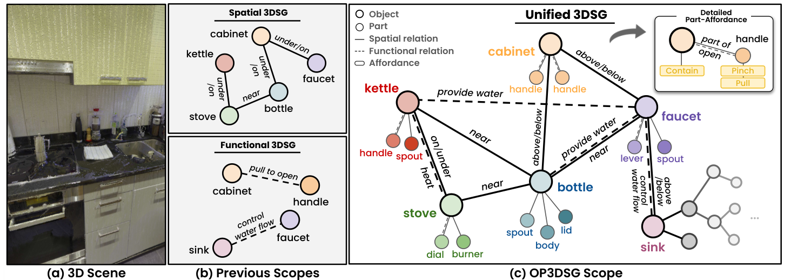
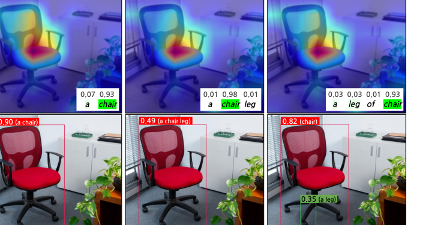
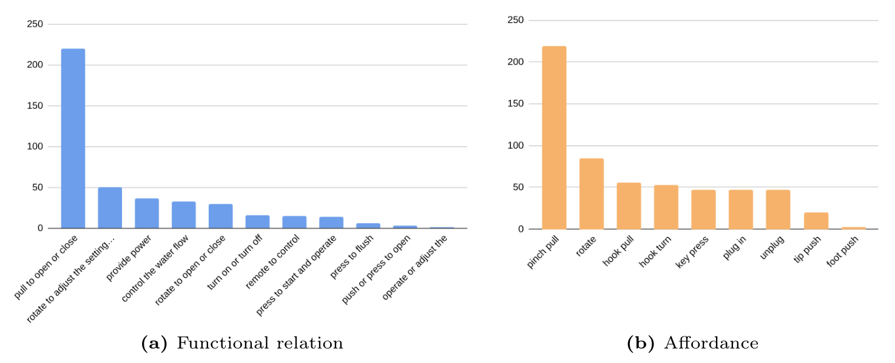
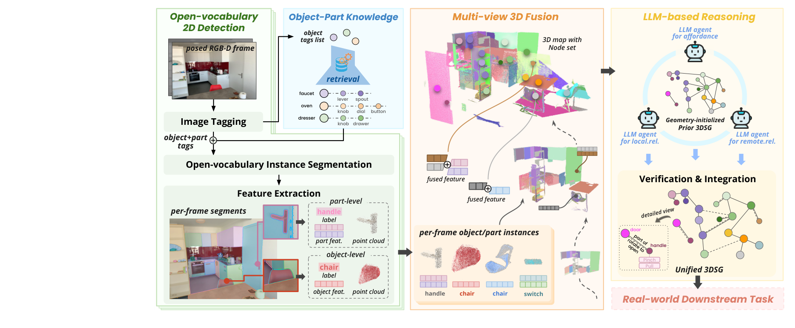
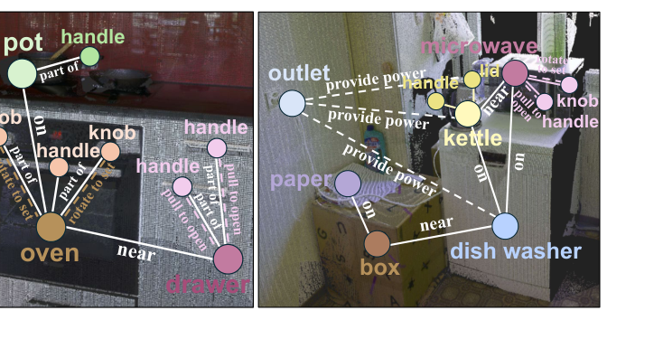
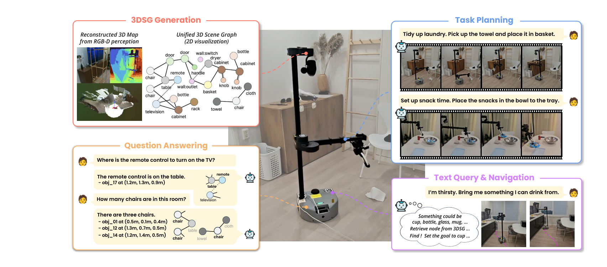

# OP3DSG：面向真实环境的开放词表部件级三维场景图生成

## 核心信息

- 标题: OP3DSG: Open-Vocabulary Part-Aware 3D Scene Graph Generation for Real-World Environments
- 标题翻译: OP3DSG：面向真实环境的开放词表部件级三维场景图生成
- 作者: Yirum Kim、Ue-Hwan Kim（通讯作者）
- 机构: 光州科学技术院（GIST），韩国
- 发表时间: 2026 年
- 发表渠道: ECCV 2026（Lecture Notes in Computer Science）
- DOI: 10.1007/978-3-032-37450-9_5
- arXiv: 2606.29786v2
- 论文链接: https://arxiv.org/abs/2606.29786
- 代码 / 项目: https://k2room.github.io/OP3DSG
- 数据 / 资源: 自建基准 UniGraph3D，由 FunGraph3D 与 SceneFun3D 合并并按统一标注规范重标注；正文未给出独立的数据下载入口
- 论文类型: AI 方法（新任务形式化 + 基准 + 免训练框架）

## 原文摘要翻译

三维场景图（3DSG）为三维环境提供了一种紧凑而结构化的抽象。尽管基础模型的发展已经使开放词表的三维场景图生成成为可能，现有方法仍然以物体为中心，且只编码了有限的关系信息——这限制了它们在对细粒度理解有要求的真实场景中的适用性。我们提出 OP3DSG，一个开放词表的部件感知三维场景图生成框架，它构建的统一图同时建模物体、可交互部件、空间关系、功能关系与可供性。OP3DSG 将物体—部件知识引导的检测与部件感知的三维融合结合起来，以保留细小且与交互相关的构件，并采用几何初始化的先验图配合基于大语言模型的精炼，在减少虚假关系预测的同时实现高效的图构建。为系统评估统一三维场景图的构建，我们提出 UniGraph3D，一个面向部件级感知与多层级关系推理设计的基准。实验结果表明 OP3DSG 取得了当前最优性能，并证明它在多种真实机器人任务中可以作为有效的感知主干。

## 创新点

1. **把「统一三维场景图」形式化为一个可评测的任务**。此前空间图只到物体级、功能图只到部件与功能边，两者互不相通。本文定义节点集为物体节点与部件节点之并，边集为空间边与功能边之并，每个节点再附带一组可供性标签。这个定义的价值不只是多加一类节点，而是让「哪个部件可动」「这个部件支撑什么功能」这两件事第一次落在同一张图上，从而支持部件级的目标分解。

2. **用知识引导控制实体空间，正面处理开放词表部件检测的塌陷问题**。作者先做诊断：用 CLIP 与开放集检测器做预实验，发现部件提示的注意力仍然集中在物体词元上，即便检出部件也置信度很低。对策不是换更大的检测器，而是用一张人工整理的物体—部件知识表，按检测到的物体名逐个生成条件化部件提示，再统一送进在部件级数据上预训练的检测器。这一步保留了物体识别的开放词表性质，只在提示层面注入先验。

3. **部件关联显式引入颜色分布特征**。物体关联靠几何最近邻比与语义余弦，部件则额外算三组颜色直方图的卡方距离：色彩命名、CIELAB 的 a\*b\*、对立色空间。作者的理由很实在——一个物体可能由多种材质组成，但一个部件通常材质单一，因此颜色与纹理在跨视图关联上比语义更稳。

4. **几何初始化先验图把关系推理从全对枚举压到邻域候选**。节点一多，朴素做法要对所有节点对调用大模型，复杂度随规模平方增长且幻觉增多。本文先用几何构造一张先验图：中心距 1 米内为邻居，按相对几何配置赋空间关系，部件与物体之间再用词法包含做父子匹配。大模型在这一步只承担验证与精炼，不承担从零生成。

5. **三个分工智能体加验证门控**。局部关系、远程关系、可供性三类推理拆成三个独立智能体并行执行，每个智能体在推理前先做一遍几何一致性校验，过滤掉与节点标签、包围盒尺寸、中心坐标矛盾的关系。消融显示这一拆分是全文收益第二大的一步：合并成单次调用后功能三元组从 51.1 掉到 20.7。

6. **UniGraph3D 与标签规范化**。把两个来源数据集合到统一标注规范下，把 21 类与 25 类功能关系合并压缩成 11 类规范标签，补齐部件级空间边与逐节点可供性标注。规范化的动机很实际：同一物理交互在原始数据里有「调节档位」「调节温度」「调节档位或温度」等多种写法，在 top-K 检索协议下会被当成不同类别，直接压低所有方法的分数。

## 一句话总结

这篇论文把三维场景图的节点粒度从物体下沉到部件，并通过「知识库约束提示 + 颜色辅助关联 + 几何先验图 + 分工智能体」这套组合，证明在免训练前提下统一图可以被稳定构建；它同时也诚实地暴露了一个落差——语义层面能召回八成以上部件，几何层面能切准的却只有两成多。

## 研究问题

### 空间图与功能图各缺一半

三维场景图的两条主线各有取舍。空间路线把物体当节点、空间关系当边，早期工作依赖点云检测与几何一致性，后续工作用二维基础模型把它推进到开放词表设定，例如把几何特征与视觉语言表征对齐到同一空间、或用免训练的多视图关联管线搭图。但这类方法的节点始终停在物体级，遇到按钮、把手、旋钮这类细小构件就丢失，而这些恰恰是具身操作真正要碰的地方。

功能路线的做法相反，它把可交互部件显式建模，用视觉语言模型或大模型给每个节点生成语言描述，再推理功能关系。问题在于它基本不编码空间结构，部件感知也偏弱，而且逐节点生成描述的做法计算开销很大，图构建时间被拉长。

两条路线各自成立，但拼不成一个完整的场景表示。作者的切入点正是在这里：一张图里同时有物体、部件、空间边、功能边与可供性。

*图 1：三种表示范围的对比。左栏是原始三维场景；中栏上下分别为只编码物体与空间关系的空间图、只编码部件与功能关系的功能图；右栏是本文提出的统一图，物体节点与部件节点以「属于」边相连，同时带有空间关系（实线）与功能关系（虚线），每个节点还挂着可供性标签，右上角放大框给出「门把手—拉开」这一部件级可供性与抓握类型的对应。*

### 部件提示会塌陷到物体级

论文用一组预实验把问题钉死。用 CLIP 分别以「一把椅子」「一条椅子腿」「椅子的一条腿」为提示计算注意力，三张热力图几乎一模一样，注意力都压在椅子这个词元上；词元权重表也印证了这一点，在「椅子的一条腿」里，腿的权重只有 0.01，椅子的权重是 0.93。

换成开放集检测器同样不行。三个提示给出的框都是整把椅子，置信度 0.90、0.82、0.49；只有当提示里真的出现「腿」这个更短的短语时，才勉强检出一个 0.35 的腿部框，而同一帧里椅子的置信度仍是 0.82。

*图 2：部件检测的预实验。上排是三种提示下的注意力热力图与词元权重，可看到权重几乎全部落在「椅子」上；下排是开放集检测器的输出，三种提示都给出物体级包围框，仅在最具体的提示下多出一个置信度 0.35 的部件框。*

这组证据说明瓶颈不在语义理解：模型知道「椅子腿」是什么，只是没有把它定位出来。因此后续改进必须发生在感知与关联层面，而不是换更强的语言先验。这也解释了为什么后面「同模型换更强语言主干」的对照里，基线的部件指标几乎不动。

### 统一之后推理空间爆炸

第二个难点是规模。物体节点变成物体加部件之后，节点数大致翻倍，而关系推理的朴素做法是枚举所有节点对，代价随节点数平方增长。更要紧的是，让大模型在一个很长的候选列表上自由发挥，虚假边会明显增多：它会给出物理上不成立的功能关系，也会漏掉需要跨房间知识才能补上的依赖。

作者的对策是把几何当成先验而不是把坐标直接塞进提示词：先由多视图融合得到的地图构造一张先验图，把稳定的空间邻接与父子层次固化下来，再让大模型在这张图上做受约束的精炼。

## 数据与任务定义

### 输入输出与图的形式化

输入是一段带位姿的 RGB-D 序列 $\{I_t, D_t\}_{t=0}^{T}$，输出是一张统一图 $G=(V,E)$。节点集分成两类：

$$ V = V_o \cup V_p $$

其中 $V_o$ 是物体节点，$V_p$ 是可交互部件节点（按钮、把手、座椅面等）。每个节点 $v$ 还附带一组可供性标签 $A_v$，取值为旋转、捏拉、指尖推、钩拉、钩转、脚踏、按键、插电、拔电这类物理交互原语。

边集同样分成两类：

$$ E = E_s \cup E_f $$

$E_s$ 是空间关系边（在上面、在旁边、属于），$E_f$ 是功能关系边（开关、控制水流、遥控、供电）。值得注意的是「属于」被归到空间边里，因此物体—部件层次并不需要额外的数据结构，直接在边集里表达。

### UniGraph3D 的构建

基准由 FunGraph3D 与 SceneFun3D（经功能关系补充标注的版本）合并而成。作者强调不是简单拼接：标注者重新检查了原始标注，发现大量不一致与歧义，例如「旋转以调节档位」与「旋转以调节温度」在物理上往往是同一个动作，却被算作两个类别；「控制」与「控制水流」也有重复。这些在 top-K 检索协议下会被当成不同的正确答案，从而系统性压低所有方法的分数。

处理方式是合并同义与歧义表达，把两个数据集的功能关系标签归并为 11 类规范形式。可供性沿用原数据集的 9 类定义，逐节点可挂多个。此外新增了物体—部件之间的显式空间关系边。

合并后的规模如下：

| 数据集 | 物体节点 | 部件节点 | 空间边 | 功能边 | 可供性 |
| --- | --- | --- | --- | --- | --- |
| ReplicaSSG | 786 | 0 | 309 | 0 | 0 |
| FunGraph3D | 146 | 201 | 0 | 228 | 0 |
| SceneFun3D† | 105 | 212 | 0 | 195 | 212 |
| UniGraph3D | 251 | 414 | 357 | 425 | 554 |

这张表本身就说明了问题：两个来源数据集都没有空间边，SceneFun3D 有可供性但 FunGraph3D 没有，只有合并重标注之后才凑齐五种要素。规模上 UniGraph3D 只有 251 个物体与 414 个部件，属于小规模基准，跨场景泛化的结论需要谨慎。

标签分布高度不均衡。功能关系里「拉开或关闭」一类占了 220 条左右，而「供电」「控制水流」只有三四十条，尾部若干类别不足 10 条；可供性里捏拉占 220 条左右，脚踏推只有个位数。这意味着按类别平均的指标会很难看，而按样本平均的指标会被头部类别主导。

*图 7：UniGraph3D 的标签分布。左栏是 11 类功能关系的出现频次，头部「拉开或关闭」约 220 条，尾部「操作或调节」不足 5 条；右栏是 9 类可供性的频次，捏拉约 220 条，脚踏推接近 0。两侧都呈明显长尾。*

### 评测口径

节点评测采用检索式协议：一个预测节点被算作正确，需要它与某个真值节点有非零的三维交并比，并且真值标签在按余弦相似度排序的候选里进入前 K。节点召回就是按此标准被检索到的真值节点比例。

边评测要求更严：一个三元组（头节点—关系—尾节点）要算命中，三个部分必须各自在前 K 内被检索到，关系本身再用句向量余弦匹配。这里作者改用了 Sentence-BERT 而不是原来的 BERT，理由很直接：原协议没法正确处理关系短语这种多词表达。

可供性的评测只看短语相似度，与节点标签无关；此外还单独报告了一个不考虑关系标签、只看节点对是否对上的关联指标。

### 基线改造方式

由于没有现成方法能做统一图，作者对两个代表方法做了扩展：给 ConceptGraph 加上部件与功能关系的提示推理（记为星号），给 OpenFunGraph 加上空间关系推理（记为双剑标记），两者都补上可供性推理。为公平起见还报告了把语言主干换成更新的 GPT-5 的版本（记为加号）。FunGraph 与 KeySG 只建模物体间或物体内部关系，直接参与比较但不做扩展。

这个改造方式值得留意：基线是被提示词「补齐」到统一任务上的，而不是原生支持。因此表里的差距既包含方法本身的差距，也包含「原生设计 vs 事后打补丁」的差距。

## 方法主线

### 机制流程

整条链路可以拆成四步，每步的输入与输出都很清楚。

1. **二维检测与反投影**。输入单帧 RGB，先用图像打标签模型得到物体候选标签；对每个物体标签查知识库，取出该物体可能的可交互部件，与物体标签合并成提示列表；再把提示列表送进在部件级数据上预训练的开放词表检测器，配合分割模型得到实例掩码；掩码反投影到三维并变换到全局坐标系，得到每个实例的点云。
2. **特征提取**。输入每个实例的掩码与点云，物体实例从检测器识别头抽区域级语义特征（与图文对比学习的文本空间对齐）；部件实例在此基础上额外算一组颜色分布特征，做法是先做白平衡，剔除高光的过曝低饱和像素，再在三个颜色空间上各取归一化直方图并拼接。
3. **多视图增量融合**。输入新一帧的实例与地图里已有节点，物体按几何最近邻比加语义余弦做贪心关联，部件在此之上再加颜色分布相似度；关联成功后语义特征按累计次数做加权平均，点云做下采样并集，颜色直方图按指数滑动平均更新；若最高相似度低于阈值则新建节点。
4. **先验图构造与大模型精炼**。输入融合后的地图，先按中心距 1 米建邻域边、按相对几何赋空间关系、按词法包含建父子边，得到几何初始化先验图；再把先验图分别送给局部关系、远程关系、可供性三个智能体，每个智能体先做几何一致性校验，再输出关系与可供性；最后统一做验证与整合，得到统一图，供问答、任务规划、文本查询导航等下游任务使用。

*图 3：框架总览。左侧绿框是开放词表二维检测，包含图像打标签、知识库检索部件提示、开放词表实例分割与特征提取；中间橙色框是多视图三维融合，逐帧实例被增量并入全局地图并更新特征；右侧黄色框是大模型推理，先验图并行送入三个智能体，经验证与整合输出统一图，最后对接真实下游任务。*

### 物体—部件知识引导的实体空间控制

这一步的形式很简单，但作用很大。设打标签模型给出物体候选标签集合 $C^o_t$，预构建的知识库 $K$ 把每个物体标签映射到一组合理的可交互部件：

$$ C^p_t = \bigcup_{c \in C^o_t} K(c) $$

最终的提示列表是两者并集 $C_t = C^o_t \cup C^p_t$。举例来说，检到「烤箱」就补上「烤箱按钮」「烤箱门」「烤箱把手」，检到「柜子」就补上「柜子把手」「柜子抽屉」。

关键在于这个知识库只在提示层面起作用，不改变物体识别本身的开放词表性质：模型仍然可以识别知识库之外的物体，只是那些物体不会自动获得部件提示。原文把这个设计描述为「补偿部件识别不足的一种简单而有效的知识注入方式」。

这个设计的隐含代价是：知识库的覆盖范围直接决定了部件召回的上限。论文对知识库的条目数、覆盖的物体类别数均未做说明，知识库之外的物体上的退化实验也缺失。这一点在后面「局限」里还会再提。

### 部件级特征：语义之外补颜色

物体关联用语义就够了，部件不行。作者给出的理由是一个结构性观察：一个物体可能由多种材质拼成，但一个部件通常材质单一，因此颜色与纹理在跨视图关联上更稳定。

颜色特征的第一步是剔除高光像素。对部件掩码 $m^p_{t,i}$，先在 HSV 空间里筛出同时满足「高饱和」与「低亮度」的像素作为镜面高光，剩下的像素构成有效集合：

$$ \Omega_{t,i}=\{(x,y)\mid m^p_{t,i}(x,y)=1,\ S(x,y)>\tau_S,\ V(x,y)<\tau_V\} $$

第二步是在有效集合上分别统计三组归一化直方图，再首尾拼接。三组直方图依次对应色彩命名、感知均匀的色度平面，以及对立的红绿与蓝黄两轴：

$$ f^{c}_{t,i}=\big[\,H^{\mathrm{cn}}(\Omega_{t,i}),\ H^{\mathrm{ab}}(\Omega_{t,i}),\ H^{\mathrm{opp}}(\Omega_{t,i})\,\big] $$

三组直方图各管一件事：色彩命名对光照变化不敏感，适合粗粒度判别；色度平面那一组把亮度剥离，适合比较色相；对立色那一组对红绿与蓝黄的对比更敏感。选这三组而不是单一红绿蓝直方图，本质上是在用多个颜色视角对冲白平衡误差。

### 多视图三维融合的三项相似度

物体关联的相似度是几何与语义之和：几何用最近邻比衡量点云重叠，语义用 L2 归一化描述子的余弦并仿射到 $[0,1]$。

$$ S^{o}(i,j)=s^{g}(i,j)+s^{s}(i,j) $$

部件关联多一项颜色分布。颜色差异用三个直方图上的卡方距离加权求和，再取倒数映射到相似度；总体相似度是几何语义项与颜色项的凸组合：

$$ S^{p}(i,j)=w^{p}\big(s^{g}(i,j)+s^{s}(i,j)\big)+(1-w^{p})\,s^{c}(i,j) $$

其中 $w^p$ 在实现里取 0.4，也就是颜色项占六成权重。这个取值说明作者认为颜色在部件关联里比几何语义更重要——考虑到部件点云往往稀疏且重叠少，这个判断是合理的。

关联策略是贪心在线分配，不做全局最优匹配。好处是支持流式处理，代价是在遮挡严重或视角跳变时可能一次错配、后续持续错配。特征更新用累计次数做加权平均，点云做下采样并集，颜色直方图按指数滑动平均并做 L1 归一化：

$$ f^{s}_{t,j}\leftarrow\frac{n_{t-1,j}\cdot f^{s}_{t-1,j}+f^{s}_{t,i}}{n_{t-1,j}+1} $$

这三个更新规则各对应一种失效模式：语义平均抑制单帧噪声，点云并集保证覆盖完整，直方图滑动平均让颜色特征跟上缓慢的光照变化而不被单帧突变带偏。

### 几何初始化先验图

先验图的构造没有任何学习成分，全是几何与词法规则。

节点侧：每个节点的标签由检测标签的多数投票决定，位置取点云中心与包围盒尺寸。边侧分两步。第一步按距离建候选：三维中心距在 1 米以内的节点对成为邻边候选，物体—物体对按相对几何配置赋空间关系（在上面、在旁边之类）。

第二步处理物体与部件的父子关系。一个部件节点可能同时靠近多个物体节点，此时按语义邻近做剪枝：只保留物体标签文本被包含在部件标签文本中的那条边，其余剪掉。这个启发式之所以成立，是因为部件候选本来就是以物体为条件生成的——「柜子把手」这个标签里天然含有「柜子」。论文明确说这个做法与前面的知识引导是同源的，二者互相强化。

剪枝规则简单，但它同时承担了两个功能：建立连贯的父子层次，以及抑制错误的挂接。代价是依赖标签字符串的构造规范，如果部件标签不带物体前缀，这条规则就会失效。

### 三个推理智能体与验证门控

三个智能体共享同一张先验图，分工按关系的空间跨度划分。

局部关系智能体负责物理相连的物体—部件对上的功能关系，例如「旋钮—拉开—柜子」。它不遍历全部节点对，而是在单次提示里对整个先验图的物体—部件关联做推理，因此节点数增加时调用次数不增加。

远程关系智能体负责功能相关但空间远离的实体对，例如「电视—开关—遥控器」。这类关系靠的是模型预训练的世界知识，而不是几何邻接，所以先验图在这里的作用是筛出「可能可遥控」的候选集合，再让模型在候选内判定关系，避免在全对空间里乱猜。

可供性智能体为每个节点预测可行的物理交互。对部件节点，推理时还会附带其所属物体的标签与几何属性，使预测带有上下文——同一个「把手」，在柜子上是拉开，在门上是钩转。

三个智能体在推理前都要做一遍几何锚定校验：检查待判定的关系是否与节点标签、包围盒尺寸、中心坐标一致。不一致的关系被直接过滤，不进入模型推理。这一步是把「大模型当生成器」改成「大模型当验证门控的精炼器」的关键，也是「减少幻觉」这一说法在机制上的落点。

### 实现与超参

全流程免训练，部件都是现成模型：图像打标签用 RAM，开放词表检测用在大规模部件数据集上预训练的 VLPart，实例掩码用SAM模型，关系与可供性推理用 GPT-5。

可调参数不多但都影响结果：高光剔除的饱和度阈值取 0.1、亮度阈值取 0.9；颜色三通道权重依次为 0.2、0.4、0.4；部件相似度里几何语义项权重取 0.4；先验图邻域半径固定 1 米。论文没有给这些参数的敏感性分析，这是个可复现性上的缺口。

## 关键结果

### 节点与可供性

下表的前三与前五分别指召回率取前三名与前五名。最后一行是本文方法。

| 模型              | 物体前三 | 物体前五 | 部件前三 | 部件前五 | 总体前三 | 总体前五 | 可供性前三 | 可供性前五 |
| --------------- | ---- | ---- | ---- | ---- | ---- | ---- | ----- | ----- |
| ConceptGraph*   | 45.4 | 51.8 | 17.6 | 21.5 | 28.1 | 32.9 | 2.3   | 3.8   |
| ConceptGraph*++ | 53.4 | 61.4 | 16.7 | 19.6 | 30.5 | 35.3 | 4.9   | 5.2   |
| FunGraph        | 68.5 | 73.7 | 28.3 | 39.1 | 43.5 | 52.2 | 40.3  | 40.8  |
| FunGraph++      | 68.9 | 73.7 | 28.5 | 40.3 | 43.8 | 52.9 | 40.4  | 40.8  |
| OpenFunGraph    | 56.2 | 64.5 | 49.3 | 51.0 | 51.9 | 56.1 | 13.7  | 16.1  |
| OpenFunGraph++  | 62.2 | 69.3 | 51.7 | 52.4 | 55.6 | 58.8 | 32.1  | 33.9  |
| KeySG           | 74.1 | 76.5 | 52.4 | 54.1 | 60.6 | 62.6 | 25.8  | 30.5  |
| OP3DSG          | 84.9 | 93.2 | 83.6 | 86.2 | 84.1 | 88.9 | 76.7  | 83.2  |

三个观察值得单独说。

第一，部件节点的提升是断层式的。最强基线 KeySG 的部件召回是 52.4，本文是 83.6，差 31.2 个百分点。物体节点也有提升（74.1 到 84.9），但幅度只有前者的一半左右。这与方法设计一致：部件是本文重点处理的对象。

第二，换更强语言主干救不了部件指标。ConceptGraph 从 GPT-4 换到 GPT-5 后，物体召回涨了 8 个点，部件召回反而降了 0.9；OpenFunGraph 换主干后部件召回只涨 2.4 个点，可供性倒是涨了 17.8 个点。这组对照把「瓶颈在感知」这个论断坐实了：语言模型再强，前提是它拿到的节点是对的。

第三，可供性的提升幅度最大，最强基线 FunGraph 是 40.3，本文是 76.7，差 36.4 个百分点。作者的解释是可供性推理主要依赖节点标签与语言先验，一旦部件识别正确、物体—部件挂接稳定，语言侧的推理就变得非常有效——不需要逐节点生成图像描述。这个解释与消融结果一致。

### 关系三元组

| 模型              | 关联前三 | 关联前五 | 功能前三 | 功能前五 | 功能前十 | 空间前三 | 空间前五 | 空间前十 |
| --------------- | ---- | ---- | ---- | ---- | ---- | ---- | ---- | ---- |
| ConceptGraph*   | 4.2  | 5.2  | 5.9  | 6.6  | 8.5  | 1.7  | 1.7  | 2.2  |
| ConceptGraph*++ | 7.7  | 8.7  | 11.5 | 12.7 | 19.8 | 2.8  | 3.1  | 7.3  |
| FunGraph        | 9.6  | 13.3 | 0.0  | 0.0  | 0.0  | 21.0 | 29.1 | 47.6 |
| FunGraph++      | 9.8  | 13.9 | 0.0  | 0.0  | 0.0  | 21.6 | 30.5 | 47.9 |
| OpenFunGraph‡   | 38.2 | 41.9 | 36.9 | 40.2 | 45.2 | 35.9 | 39.8 | 43.1 |
| OpenFunGraph‡++ | 45.1 | 48.7 | 41.9 | 45.9 | 51.8 | 44.5 | 48.2 | 49.9 |
| KeySG           | 12.9 | 17.1 | 0.0  | 0.0  | 0.0  | 28.3 | 37.5 | 47.1 |
| OP3DSG          | 53.1 | 66.9 | 51.1 | 64.5 | 74.8 | 52.4 | 66.9 | 77.3 |

表格里功能关系那三列全是 0.0，很说明问题：FunGraph 与 KeySG 完全不建模功能关系，在统一任务上直接归零。这不是它们的方法差，而是任务设定不同带来的必然结果——原论文里它们压根没打算预测功能边。这种基线在统一基准上的分数只能当参照，不能当作能力对比。

真正可比的对手是 OpenFunGraph 系列。本文在功能三元组上领先 9.2 个百分点（R@3），在空间三元组上领先 7.9 个百分点；关联节点指标从 45.1 提到 53.1，领先 8 个百分点。三类指标的领先幅度相当，说明收益不是只在某一类边上突增，而是整体图质量提升。

另一个细节是 R@10 上本文优势收窄（77.3 对 49.9）。这符合检索指标的常规行为：候选放宽后，弱基线也能靠数量凑上一些命中。反过来说，本文的优势主要体现在高精度区间。

### 消融

| 变体       | 物体前三 | 部件前三 | 功能前三 | 空间前三 | 可供性前三 |
| -------- | ---- | ---- | ---- | ---- | ----- |
| 完整模型     | 84.9 | 83.6 | 51.1 | 52.4 | 76.7  |
| 去掉知识引导   | 76.9 | 45.9 | 15.5 | 12.6 | 30.7  |
| 去掉颜色分布特征 | 84.9 | 79.0 | 40.2 | 41.7 | 64.8  |
| 去掉先验图    | 84.9 | 83.6 | 47.1 | 47.6 | 74.7  |
| 合并三个智能体  | 84.9 | 83.6 | 20.7 | 19.3 | 40.8  |

四行消融反映四种不同的失效机制，值得逐个看。

去掉知识引导的跌幅最猛：部件召回从 83.6 掉到 45.9，功能三元组从 51.1 掉到 15.5，空间三元组从 52.4 掉到 12.6。注意空间指标跌得比功能指标更狠——这说明部件一旦检不出来，连带着物体与部件之间的父子边也建不起来，空间边的分母结构就塌了。这是「上游一个环节错，下游全链条失真」的典型证据。

去掉颜色分布特征的影响分成两层：部件召回只掉 4.6 个点，但功能三元组掉 10.9 个点、可供性掉 11.9 个点。也就是说，颜色特征对「检出多少部件」影响不大，对「部件关联得对不对」影响很大。部件关联错位会直接污染下游关系与可供性，因为关系推理的输入就是这些关联。

去掉先验图（换成扁平的节点属性列表）的跌幅中等：功能与空间三元组各掉 4 个点左右。这一行说明结构约束的价值——节点集合完全一样，只是组织方式从图变成列表，模型的表现就退了一档。反过来说，收益不是来自「多给了信息」，而是来自「信息以什么形式给」。

合并三个智能体的跌幅第二猛：功能三元组从 51.1 掉到 20.7，可供性从 76.7 掉到 40.8。作者给的原因有两个：幻觉增多，以及输入范围变大导致上下文过载。这一行与第 5 个创新点直接对应，也说明「推理空间分解」不是工程优化，而是精度手段。

### 严格几何阈值下的定位

| 模型            | 物体 IoU | 物体 IoP | 部件 IoU | 部件 IoP | 总体 IoU | 总体 IoP |
| ------------- | ------ | ------ | ------ | ------ | ------ | ------ |
| ConceptGraph* | 30.7   | 27.5   | 4.1    | 1.2    | 14.1   | 11.1   |
| FunGraph      | 49.8   | 57.8   | 15.7   | 8.9    | 28.6   | 27.4   |
| OpenFunGraph  | 38.2   | 30.3   | 15.0   | 5.8    | 23.8   | 15.0   |
| KeySG         | 50.6   | 59.4   | 30.4   | 23.4   | 38.0   | 37.0   |
| OP3DSG        | 63.7   | 61.8   | 25.8   | 13.0   | 40.2   | 31.4   |

主表的节点召回只要求非零交并，等于一个很宽松的空间一致性过滤。把阈值提到交并比 0.10、预测覆盖率 0.25 之后，排名出现了局部反转：本文的部件节点掉到 25.8 与 13.0，反而低于 KeySG 的 30.4 与 23.4。

物体层面本文仍然领先（63.7 对 50.6），总体指标也领先（40.2 对 38.0），但部件层面的劣势是真实存在的。作者的解读是表面融合本身难以精确定位小构件：小部件的点云稀疏，多视图做并集时容易被邻域点稀释，包围盒因此偏大。

两个指标的分工也值得记下来：交并比同时惩罚漏覆盖与中心偏移，预测覆盖率只看预测框有多少落在真值框内、主要惩罚过度膨胀。本文在交并比上掉得比预测覆盖率更多，说明它的部件框偏大且中心有偏移——典型的「框住了但框大了」。

### 定性结果

*图 4：两个场景区域上的统一图可视化。左图以烤箱为中心，烤箱连接多个旋钮、把手，并通过「拉开」「旋转调节」等功能边连到抽屉；右图以微波炉、水壶、洗碗机为中心，出口、纸张、盒子等物体通过「供电」「在上面」「靠近」等边与它们相连。*

定性图的价值在于展示层次：同一个物体下面挂着多个部件节点，部件与物体之间是「属于」边，物体与物体之间是空间边，功能边则跨越空间距离连接功能相关的实体。这种混合结构在以往的空间图或功能图里都看不到。

### 真实机器人应用

*图 5：四类真实机器人应用。左上是从 RGB-D 重建得到的三维地图与二维可视化的统一图；右上是用自然语言指令驱动的任务规划，指令被拆成多步并在机械臂上执行；左下是场景问答，问题涉及计数、定位与部件级区分；右下是文本查询与导航，用户表达的是功能需求而非物体名。*

平台是 Stretch3 移动机械臂配 RealSense D435i 相机。四类任务的接入方式各不相同，但共用同一张图：

问答类任务把整张图作为上下文交给大模型，回答计数、位置、关系与部件区分四类问题。这里能看出统一图的实际好处——问「遥控器在哪」时，模型可以用「电视—遥控—控制」这条功能边定位，而不是靠物体共现的先验。

任务规划类任务把高层指令拆成部件级子目标。论文举的例子是把「整理衣物」拆成抓取毛巾、放入篮子，执行靠开源动作执行器。真正体现统一图价值的是那种需要操作部件的指令，比如「打开微波炉」需要先定位把手再执行拉开，而纯物体级图只能定位到微波炉整体。

文本查询与导航类任务处理的是不含物体名的功能型需求，比如「我渴了，给我能喝的东西」。系统在物体与部件两级检索候选节点，用选中节点的三维坐标生成导航目标，路径规划用 A\* 算法。

这三类任务都是定性演示，没有成功率、耗时或重复次数的统计。

### 效率

| 模型           | 峰值显存     | 视觉语言调用  | 大模型调用 |
| ------------ | -------- | ------- | ----- |
| ConceptGraph | 11.43 GB | 约 10N   | 大于 N  |
| OpenFunGraph | 11.90 GB | 远大于 10N | 大于 N  |
| OP3DSG       | 8.08 GB  | 无       | 大于 3  |

这里的 N 是节点数。基线的方法论是给每个节点挑出观测到它的前 10 个视角，逐个生成图像描述，再用大模型精炼描述、最后再调一次大模型建图，所以调用量随节点数线性增长。本文不做任何图像描述，检测阶段直接产出部件，建图阶段只有三次以上的大模型调用。

显存降低主要来自不用加载视觉语言模型（论文说基线的显存统计还不含这一部分，实际差距会更大）。调用量从线性增长变成常数，这一点对规模扩展更关键：节点数翻倍时，基线的成本翻倍，本文几乎不变。

## 深度分析

### 收益为什么在感知端

论文最有说服力的一组证据不是主表，而是「换更强语言主干」的对照。ConceptGraph 换成 GPT-5 后物体节点涨了 8 个点、部件节点反而降了 0.9；OpenFunGraph 换主干后部件只涨 2.4 个点。

这组对照的逻辑很干净：如果瓶颈在语言推理，换更强的语言模型应该全面提升；实际观察到的是「物体涨、部件不涨」，说明部件这一层的输入本身就有问题——节点没检出来，语言模型再强也无从推理。作者由此把改进重心放在检测与融合，而不是提示工程，这个判断被消融进一步确认。

同样的逻辑也解释了可供性为什么涨得最多（40.3 到 76.7）。可供性本质上是「标签到动作」的映射，属于语言模型的强项；一旦输入标签正确，它就能给出高质量答案。所以这条链路里语言模型确实重要，但它是乘数而不是加数——乘数再大，被乘数为零结果还是零。

### 语义命中与几何命中是两件事

把主表与严格阈值表放在一起看，会得到一个对后续工作很有用的结论：部件召回 83.6 与部件交并比 25.8 之间的巨大落差，意味着「知道有个把手在那里」和「把把手切准」是两个难度差一个量级的问题。

这个落差在检索式评测里是隐形的。因为节点只要与真值有非零交并就算命中，一个过度膨胀的包围盒很容易满足这个条件。要暴露问题必须主动收紧阈值，这也解释了作者为什么要单独做这张敏感性表——它其实是在自我批评。

从我自己的经验看，这个落差对下游任务是致命的。如果要用图上的部件节点去驱动抓取，包围盒偏大意味着抓取位姿会落在物体表面之外；如果要用它做可供性标注，偏大的框会把邻接部件一起圈进去。所以「部件级的稠密几何」和「部件级的语义存在性」必须分开评估。

### 误差如何在图上传导

消融表里最有信息量的一行是「去掉知识引导」：部件召回掉 37.7 个点，功能三元组掉 35.6 个点，空间三元组掉 39.8 个点。三者的跌幅几乎一致，说明误差在图上不是衰减而是等幅传导。

原因在结构上：空间三元组要求三个部分都被检索到，其中一个部分是部件节点，部件检不出来，这条边必然不成立。功能三元组同理。因此节点层的错误会被边层以乘法方式放大——这是「统一图」这种表示的固有脆弱性，也是它相对纯物体级图的代价。

反过来看，「去掉颜色分布特征」这一行展示了另一种传导：部件召回只掉 4.6，但关系与可供性掉 10 个点以上。这里误差不是来自「节点缺失」，而是来自「节点挂错」——部件被关联到了错误的物体上，节点还在，但父子边错了，下游关系跟着错。两种传导机制不同，修法也不同：前者要提升检测，后者要提升关联。

### 与三维可供性路线的关系

这篇论文里的可供性是节点属性，而不是稠密掩码。这个选择决定了它与三维可供性分割路线的分工：后者回答「这个物体的哪些表面可以被这样操作」，前者回答「这个场景里哪个部件承担这个功能」。

两者不冲突，甚至可以串起来。一个自然的分工是：先用统一图做场景级的部件检索与功能推理，定位到具体部件后，再在部件点云上跑稠密可供性分割，得到可抓取区域。这个两级结构能同时解决「选哪个部件」与「抓哪个位置」两个问题，而目前的单级方法往往只能顾一头。

另一个值得迁移的点是「命名部件」的诊断范式。本文的预实验本质上是在测「当提示里点名部件时，模型能不能定位到」，结论是不能。这与另一条独立发现（只要在提示里命名目标部件，动作准确率就会大幅跳升）互为补充：后者说明命名部件有巨大收益，前者说明模型自己做不到这件事。两者合起来正好论证了「知识库注入部件名」这个设计的必要性。

### 复现注意点

第一，知识库是黑盒。论文只说「经验性地整理以覆盖室内常见物体—部件关系」，没有给条目数、类别清单或构造流程。这意味着完整复现部件召回这一项基本不可能，只能自己重建一份知识库，结果会有偏差。

第二，模型版本敏感。检测器是 VLPart、打标签是 RAM、掩码是SAM模型、推理是 GPT-5 的具体快照（gpt-5-2025-08-07）。大模型版本更新会改变关系推理的输出风格，而评测用句向量匹配，风格变化会直接影响分数。

第三，阈值的敏感性未知。邻域半径 1 米、颜色权重 0.4、高光阈值 0.1 与 0.9 都是给定值，没有扫参曲线。在自己的数据上复现时需要重新调，尤其是邻域半径——它直接决定远程关系能覆盖多大空间范围。

第四，评测脚本比模型更难复现。top-K 检索、句向量匹配、标签规范化三者叠加，任何一环的实现细节（用哪个句向量模型、相似度阈值、并列名次如何处理）都会影响绝对数值。

## 局限

第一，场景规模与多样性有限。所有实验都在室内单房间数据上，UniGraph3D 只有 251 个物体与 414 个部件。论文没有跨房间、跨楼层或室外场景的实验，也没有做跨数据集的零样本迁移，因此「真实环境」这个词的覆盖范围实际上比标题暗示的要窄。

第二，部件几何定位是明确的短板。严格阈值下部件交并比 25.8、预测覆盖率 13.0，都低于 KeySG。作者承认表面融合难以精确定位小构件，但没有给出误差来源的分解——是二维检测框不准、反投影失真，还是多视图并集时点云被稀释，读者无从判断。也没有尝试用部件级三维分割替换「二维掩码反投影」这条链路。

第三，知识库是人工整理的，且未公开。这既是方法有效的前提，也是它最大的不可复现点。更要紧的是，知识库在未见物体类别上的退化幅度缺一组对照数字，因此该方法向新场景迁移时的衰减曲线仍然是未知的。

第四，真实机器人部分只有定性演示。四类任务都有视频与截图，但没有任务成功率、执行耗时、重复次数或失败案例分析。考虑到标题强调「真实环境」，这部分证据强度不足。

第五，评测口径偏宽松。节点匹配只要求非零交并，关系匹配用句向量余弦，语义近似但几何错位的预测会被算作命中。作者自己用严格阈值表暴露了这个问题，但主表仍然是宽松口径，跨论文比较时需要注意。

第六，标签规范化在提升公平性的同时也抹掉了信息。「旋转调节档位」与「旋转调节温度」被合并成一类之后，模型不再需要区分「调什么」，而这对下游任务可能是关键信息。这是评测便利性与任务真实性之间的取舍，论文没有讨论。

## 我的笔记

### 这篇在坐标系里的位置

按「输入模态 × 任务粒度」这套坐标，它落在「三维 × 多层级」这一格：输入是 RGB-D 序列重建出的点云地图，输出不只是某个物体的某块区域，而是一张带层次与关系的图。与 GEAL 这类单物体可供性方法相比，它把「上下文」从物体内部扩展到了场景结构；与场景级可供性综述里那类工作相比，它多了一层部件节点。

它与我更关心的多角色可供性问题的交集在于部件节点。EgoAfford 那篇把下一步操作拆成直接对象、工具、目标位置三个角色，本质上是在问「哪个部件扮演哪个角色」。统一图的部件节点加功能边，其实提供了同一问题的图结构版本：角色可以由「节点类型 + 边类型 + 可供性标签」三元组表达。这是一个可以直接借用的表示思路。

### 三个可以直接借用的做法

第一个是低成本诊断先行的习惯。本文在提出方法之前先做了两组预实验，用注意力图与检测置信度证明「部件提示会塌陷」。这个实验几乎不花算力，但把后续所有设计的合法性都建立了。我如果在三维可供性上想论证「瓶颈在部件定位」，完全可以照搬这个范式：固定查询、只改提示里是否点名部件，看定位精度跳多少。

第二个是「把大模型从生成器降级为验证器」。先验图负责生成候选，大模型只做过滤与精炼，这个结构同时解决了幻觉与成本两个问题。它的前提是能构造一个可靠的几何先验——在三维数据上这个条件通常成立，因此这套结构对三维任务比对二维任务更适用。

第三个是双口径评测。主表用宽松口径保证可比性，另开一张严格阈值表暴露真实几何质量。这个做法看起来只是补一张表，实际上是在防止自己被自己的指标骗。任何做三维密集预测的工作都应该这样做。

### 一个可以立刻做的实验

按这篇的逻辑，部件级误差可以拆成三层：检不出、挂错物体、框不准。本文的消融覆盖了前两层（知识引导对应第一层，颜色特征对应第二层），第三层只用严格阈值表间接暴露，没有做归因。

一个直接的拆解办法是：把真值部件框喂进融合与推理环节，跳过检测误差，看关系与可供性指标能恢复到多少。恢复得多，说明瓶颈在检测；恢复得少，说明瓶颈在关联或推理。这个上界实验成本很低，结论却可以直接决定后续投入方向。

### 与另一条诊断线索的合并

「命名部件后动作准确率大幅跳升」那条结论说明：模型的知识没问题，定位有问题。本文的预实验用另一种方式得到同样结论：CLIP 的注意力权重在部件提示下依然集中在物体词元上。

两条线索合并起来，可以得到一个更强的论断：当前这一代视觉语言模型在部件级 grounding 上是系统性失效的，而不是个案。这为「显式注入部件先验」这类方法提供了统一解释，也提示后续工作应该把部件定位当成独立子问题处理，而不是期待端到端模型自己学会。

## 引用

- 原文：Kim, Yirum, and Ue-Hwan Kim. "OP3DSG: Open-Vocabulary Part-Aware 3D Scene Graph Generation for Real-World Environments." ECCV 2026, LNCS. DOI: 10.1007/978-3-032-37450-9_5；arXiv:2606.29786. https://arxiv.org/abs/2606.29786
- 项目页：https://k2room.github.io/OP3DSG
- 空间场景图基线：Gu et al., ConceptGraphs, ICRA 2024；Koch et al., Open3DSG, CVPR 2024
- 功能场景图基线：Rotondi et al., FunGraph, IROS 2025；OpenFunGraph（SceneFun3D 的功能关系扩展版）
- 数据来源：Delitzas et al., SceneFun3D, CVPR 2024
- 部件检测基础：Sun et al., VLPart（在 LVIS 与 PACO 上预训练）；Kirillov et al., Segment Anything, ICCV 2023
- 相关笔记：[[3DAffordSplat - Efficient Affordance Reasoning with 3D Gaussians]]、[[AffordAny]]、[[EgoAfford - Task-Oriented Affordance Grounding via Egocentric Referring Segmentation]]、[[场景级Affordance Grounding-综述与对比]]、[[GEAL - Generalizable 3D Affordance Learning with Cross-Modal Consistency]]
