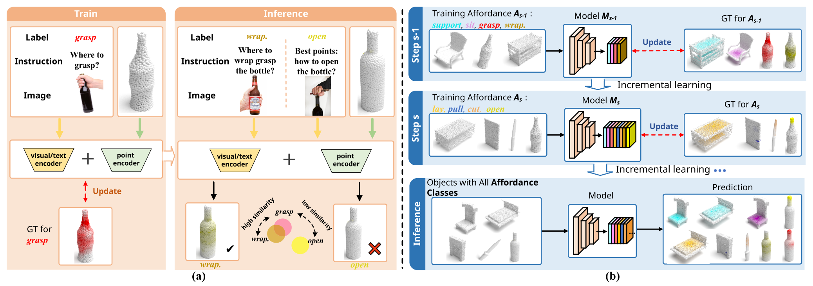
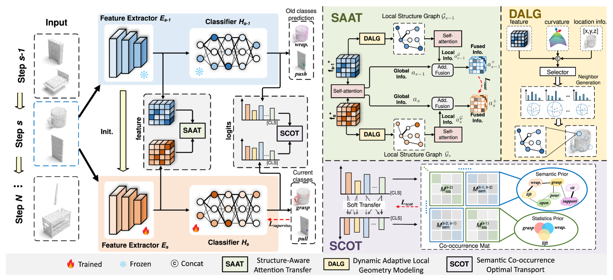
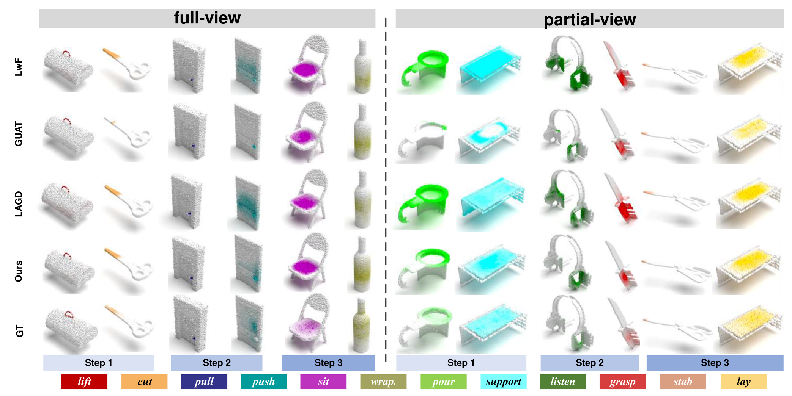
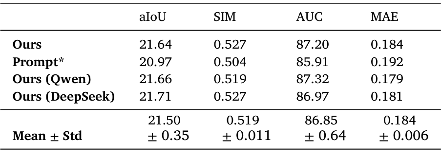
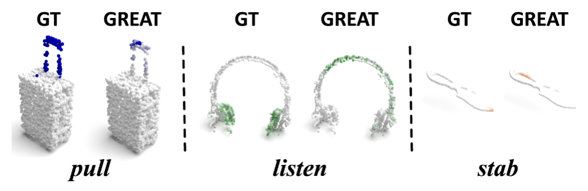
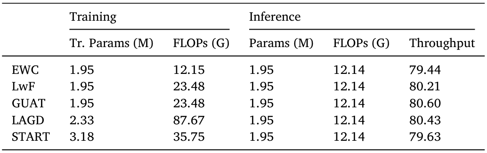

---
tags:
  - papers/机器学习
  - 三维可供性
  - 持续学习
  - 点云
aliases:
  - START
  - 结构语义协同感知迁移
date: 2026-10-07
doi: 10.1016/j.eswa.2026.133773
---

# START：面向增量三维可供性定位的结构与语义协同感知迁移

## 核心信息

- 标题：START: Structural-semantic collaborative perception transfer for incremental 3D affordance grounding
- 标题翻译：START：面向增量三维可供性定位的结构与语义协同感知迁移
- 作者：Pengyi Zhao、Hongchen Luo、Jiao Wang
- 机构：东北大学信息科学与工程学院
- 发表时间：2026-07-29 在线发表；卷期年份为 2027
- 发表渠道：Expert Systems With Applications，333，133773
- DOI：10.1016/j.eswa.2026.133773
- 论文链接：[出版社 DOI](https://doi.org/10.1016/j.eswa.2026.133773)
- 代码 / 项目：[作者代码库](https://github.com/zhao-py/start)
- 论文类型：人工智能方法论文

## 原文摘要翻译

三维可供性定位旨在识别物体上支持潜在交互的区域，在具身人工智能中连接感知与行动。近期方法探索通过文本或视觉线索进行定位，但其泛化能力仍局限于与已学习类别在几何或语义上相似的可供性类别，因此难以部署到新可供性不断出现的开放世界环境。为此，本文引入增量三维可供性定位这一新任务，目标是在缓解遗忘的同时持续获取新的可供性知识。然而，目标区域细粒度、不规则的特点，以及可供性纠缠，即共享区域中标签相互重叠，对现有增量学习方法提出了独特挑战。为应对这些挑战，本文提出 START，即结构与语义协同感知迁移，一个用于增量可供性定位的统一框架。具体而言，本文设计结构感知注意力迁移模块，将动态局部几何关系图与全局上下文结合，以处理可供性区域的不规则几何并保留细粒度结构知识。此外，为缓解可供性重叠导致的遗忘，本文开发语义共现最优运输模块，利用语义与统计共现矩阵在旧模型和新模型之间进行软知识对齐。大量实验表明，START 优于现有先进模型。

## 创新点

1. **将可供性定位改为类别增量学习问题。** 新类别带着训练标注按步骤到来，模型更新后必须定位全部已学类别；研究重点从未见类别推断转向新增知识与旧知识保留的平衡。
2. **结构感知注意力迁移 SAAT。** 用特征、坐标和曲率为不同锚点选择不同邻域尺度，再以局部关系约束全局注意力迁移。它要保留的是功能区域的细粒度结构，而非仅保持整幅点云的特征相似性。
3. **语义共现最优运输 SCOT。** 步内共现来自标注热图，跨步骤关系来自离线语言模型辅助推理。由共现关系构造运输代价，允许相关旧可供性之间软匹配，避免把多标签区域强行当作互斥类别。
4. **从定位延伸到交互验证。** 除三种类别划分和两种视图外，还检查五步学习、跨数据集、新物体和仿真抓取；这些实验拓宽证据范围，但不足以证明真实机器人终身学习能力。

## 一句话总结

START 用自适应几何关系保留“区域在哪里”，用共现先验引导的最优运输保留“区域支持哪些相关动作”，在只有当前步骤标注的持续训练中缓解旧可供性遗忘。

## 研究问题

### 为什么普通分类或语义分割增量学习不够

可供性是物体支持的动作或交互，例如抓握、倾倒、按压。瓶口可能同时支持打开与倾倒，门的同一局部区域也可能支持推和拉。一个点允许多个功能标签，因此“新类别出现”不意味着旧类别在该区域变成负例。

另一个困难是空间形态：支撑面宽而平，把手细窄且弯曲，某些交互区域离散分布。固定尺度的几何蒸馏可能在细区域混入无关点，在宽区域又缺少足够上下文。普通输出逐类对齐也不能显式表达相关功能之间的联系。（原文第 1–3 页）

### 与开放词汇定位的区别

开放词汇方法通常根据文本或视觉提示推断未训练类别；START 假设新类别的标注数据随后可用，并更新模型。因此二者回答不同问题。START 的优势首先是**在有新增监督时怎样更新并保留旧知识**，不能直接读作更强的零样本推理。

*图 1：开放词汇推断与增量更新的协议差异。右侧持续接收新类别监督，最后预测所有已学类别。*

## 数据与任务定义

### 输入、标签与测试范围

输入是物体点云；输出是每点、每类别的可供性响应热图。3D AffordanceNet 包含 **22,949 个实例、23 个物体类别、18 种可供性**，每个点云具有 18 张标注热图。（第 6 页）

设第 $s$ 步新增类别集合为 $\mathcal A_s$，训练数据为 $D_s$。

样本上可以存在过去、当前和未来类别，但当前训练只提供 $\mathcal A_s$ 的标签。测试时模型预测 $\bigcup_{t=1}^{s}\mathcal A_t$，不是只测最后一步新类别。

旧模型为 $M_{s-1}=H_{s-1}\circ E_{s-1}$，当前模型由它初始化，再用当前数据更新。

论文描述的主线通过旧教师、结构迁移、预测迁移和保存的先验保持知识，未在该主线中引入旧原始样本回放。复现时需核查数据加载器对旧类标签的屏蔽，避免把“未标注”错误处理成“不存在”。

### 类别顺序与指标

| 协议 | 顺序 | 三步类别数量 | 用途 |
|---|---|---|---|
| S1 | 数据集默认顺序 | 8–6–4 | 较多基类的默认设置 |
| S2 | 标签字母顺序 | 7–6–5 | 模块消融的主要设置 |
| S3 | 随机打乱 | 6–6–6 | 检查顺序及基类数量影响 |
| 五步设置 | 论文表 9 顺序 | 8–3–3–2–2 | 更长增量序列 |

全视图提供完整表面；部分视图只观察部分表面。aIoU 衡量区域交并比，SIM 衡量响应分布相似性，AUC 衡量点级区分能力，三者越高越好；MAE 衡量预测与真实热图的绝对误差，越低越好。表 2、3 的分组列是**完成全部步骤后，各步骤类别组的表现**，不能当作训练过程中每一步的即时成绩。

### 训练配置

| 项目 | 论文设置 |
|---|---|
| 骨干 | 所有方法均用 DGCNN |
| 优化器 | SGD，动量 0.9，权重衰减 $10^{-4}$ |
| 批量大小 | 16 |
| 学习率 | 基础步 0.01，增量步 0.005；余弦退火 |
| 训练轮数 | 基础步 150；每个增量步 100 |
| 损失权重 | 监督、SAAT、SCOT 分别为 1、1、5 |
| 锚点比例 | $r=0.25$ |
| 融合与阈值 | $\alpha=0.25$，$\tau=0.475$ |
| 候选邻居数量 | 8、10、12、14、16 |
| 硬件与随机种子 | 两张 NVIDIA 3090；43、2026、6202 |

增量基线共享相同基础模型、划分与训练流程。论文声称点云分辨率一致，但正文实现段没有给出明确点数，不能自行补成常见默认值。（第 7 页）

## 方法主线

### 机制流程

1. **输入当前点云，生成教师与学生表示。** 冻结旧模型；当前模型由旧模型初始化并适配输出类别。点云送入两者，得到用于旧知识保持的特征和预测，以及用于当前类别监督的预测。
2. **将几何知识送入 SAAT。** 结合响应增强全局特征，采样锚点并自适应构建局部关系，将局部结构融合进全局注意力；融合表示送入新旧模型之间的均方误差约束。
3. **将旧类预测与共现先验送入 SCOT。** 保存的步内统计与离线跨步语义关系构成共现矩阵，经平滑转成代价；逐点运输目标送入知识保持损失。
4. **联合更新学生并用于下一步或部署。** 当前标签的监督损失与两个迁移损失共同优化学生；下一步学生成为旧教师，部署时仅保留更新后的特征提取器和分类器。

*图 3：左侧教师冻结、学生更新；右侧分别为几何注意力迁移与共现关系引导的预测迁移。*

### SAAT：用局部结构约束全局迁移

首先以可供性响应调制点特征，突出功能区域；增强特征通过查询、键和值投影生成全局自注意力。随后用最远点采样选择 $M=rN$ 个锚点。选择器接收锚点特征、三维坐标和曲率，决定锚点的邻居数量 $K_m$。局部关系聚合相对坐标及邻居与锚点的特征差，因此同时编码空间形态与表示变化。（第 4 页）

局部图也经过注意力计算，形成 $a^{\mathcal G}$。

定义旧、新全局注意力差 $\Delta a=a_{s-1}-a_s$，论文式（3）的融合与迁移可以写为：

$$
a^+_{s-1/s}=(1-\alpha)a_{s-1/s}+\alpha\,\operatorname{MLP}(\Delta a\oplus a^{\mathcal G}_{s-1/s}),\qquad
\mathcal L_{\mathrm{saat}}=\operatorname{MSE}(a^+_{s-1},a^+_s).
$$

这里 $\oplus$ 表示拼接。迁移对象既不是孤立局部图，也不是单纯全局注意力，而是经过局部结构条件化的全局表示。选择器的离散邻居选择怎样训练、曲率怎样估计、不同表示的维度如何对齐，需要结合实现确认，正文没有完整交代。

### SCOT：共现先验如何变成迁移代价

**步内统计先验。** 在过去步骤可获得标签时，从同一对象的每点热图统计两个功能的重叠。若 $P_{i,n,p}$ 表示第 $n$ 个物体第 $p$ 点的功能 $i$ 标注响应，式（6）为：

$$
M_{\mathrm{sta}}^{(s')}(i,j)=
\frac{\sum_{n,p}P_{i,n,p}P_{j,n,p}}{\sum_{n,p}P_{i,n,p}}.
$$

它是以类别 $i$ 为条件的共现强度，分母不同意味着矩阵一般不对称。各步骤子矩阵沿对角线保存，因此不需要在后续重新访问旧标签才能使用这些统计。

**跨步语义先验。** 因跨步骤标签不同时可见，不能直接统计跨块共现。论文把此前已学可供性标签送给 GPT-4o，得到“支持某动作的区域也可能支持其他相关动作”的关系文本，再由 CLIP 文本编码和余弦相似度生成跨步子矩阵。小于 $\tau$ 的条目屏蔽，跨步块对称填入。（第 5 页）

共现矩阵进行低秩近似，再把原矩阵与近似矩阵相加以平滑先验。随后按最大值归一化形成关系不相似表示，运输代价是不同类别对应行向量的平方欧氏距离。重要的是，代价比较的是类别的**关系轮廓**，并非只比较类别名称是否相同。低秩平滑的降噪效果由消融支持，但不能保证语言模型关系必然正确。

### 运输约束与联合训练

给定教师与学生在对应旧类空间中的点级概率分布 $a,b$，SCOT 求满足边缘约束的非负运输计划。用标准记号重述论文式（5）、（8）：

$$
\min_{T\geq0}\;\langle C,T\rangle+\epsilon\sum_{j,k}T_{jk}(\log T_{jk}-1),
\qquad T\mathbf1=a,\quad T^\top\mathbf1=b.
$$

Sinkhorn 算法求熵正则运输解，再对批内样本和点平均得到 $\mathcal L_{\mathrm{scot}}$。相关类别代价较低，知识便能在多个相关旧可供性之间软对齐。这里需要区分：任务热图本身是多标签输出，而 OT 要求合法分布；论文用预测记号描述输入，复现必须确认实际归一化、温度和类别切片方式，不能直接把任意原始逻辑值当作概率边缘。

基础步只使用焦点损失与 Dice 损失；后续步骤的总目标为：

$$
\mathcal L_{\mathrm{total}}=
\lambda_{\mathrm{su}}(\mathcal L_{\mathrm{focal}}+\mathcal L_{\mathrm{dice}})
+\lambda_{\mathrm{sa}}\mathcal L_{\mathrm{saat}}
+\lambda_{\mathrm{sc}}\mathcal L_{\mathrm{scot}}.
$$

语言模型只在离线先验构建时调用，训练与推理不需要逐样本查询它；推理也不保留教师、运输优化或跨模型结构对齐。（第 6、11 页）

## 关键结果

### 主结果：保留旧类的同时学习新类

以下为表 2、3 中全部步骤结束后的全类别 aIoU（%）。START 的误差项是三次独立随机种子的标准差。

| 方法 | 全视图 S1 | 全视图 S2 | 全视图 S3 | 部分视图 S1 | 部分视图 S2 | 部分视图 S3 |
|---|---:|---:|---:|---:|---:|---:|
| FT | 12.42 | 12.25 | 13.97 | 8.22 | 7.68 | 10.09 |
| EWC | 16.86 | 18.46 | 19.15 | 17.45 | 17.11 | 18.90 |
| LwF | 19.89 | 19.22 | 21.72 | 18.68 | 16.87 | 18.43 |
| GUAT | 15.94 | 16.52 | 17.22 | 13.98 | 15.99 | 17.47 |
| LAGD | 18.11 | 20.38 | 19.61 | 18.04 | 18.34 | 17.54 |
| START | **20.91 ± 0.16** | **21.43 ± 0.19** | **23.12 ± 0.29** | **19.35 ± 0.12** | **20.73 ± 0.21** | **21.90 ± 0.29** |
| JT 全量联合训练 | 24.62 | 24.83 | 24.86 | 23.10 | 22.99 | 23.26 |

相对最佳增量基线，START 的提升分别是全视图 **1.02、1.05、1.40 个百分点**，部分视图 **0.67、2.39、3.00 个百分点**。论文“4%–15%”属于相对增幅的概括，不能误写成提升 4–15 个百分点。JT 可同时使用全部训练数据和标签，适合作为参照；START 仍有差距，因此不能说它已经消除遗忘。

*表 2：全视图完整结果。整体 aIoU 最优不代表每个类别组或每项指标均最优，例如 S1 第二组交并比低于 GUAT；S2 总体曲线下面积高于 LwF，但第一组的该指标更低。*

> [!figure] Table 3 — 部分视图主结果
> 建议位置：关键结果 / 主结果：保留旧类的同时学习新类
> 放置原因：核对遮挡条件下各类别组与四项指标。
> 当前状态：保留占位；自动提取的表格候选未通过视觉质量检查，主要 aIoU 已转写在上表。
> 论文原图编号：Table 3，第 7 页。

*图 5：完成三步后的定位示例。热图显示部分遮挡和细窄区域的差异，但定性图只支持案例解释，不能替代总体指标。*

### 模块消融：语义增益较大，结构迁移形成补充

表 4 使用全视图 S2，数值为该消融实验本身的结果。

| 配置 | 第一组 aIoU | 第二组 aIoU | 第三组 aIoU | 全类 aIoU | 全类 SIM |
|---|---:|---:|---:|---:|---:|
| FT | 7.69 | 5.33 | 26.93 | 12.25 | 0.456 |
| FT + SAAT | 10.92 | 7.43 | 25.87 | 13.91 | 0.502 |
| FT + SCOT | 20.02 | 15.09 | 25.71 | 19.96 | 0.517 |
| START | 19.72 | 20.13 | 26.13 | **21.64** | **0.527** |

SCOT 单独带来 7.71 个百分点增益，SAAT 单独带来 1.66 个百分点；在 SCOT 上加入 SAAT，第二组提高 5.04 个百分点，总体再提高 1.68 个百分点。第一组略从 20.02 降至 19.72，说明互补体现在整体权衡，不能解读成各组单调改善。（第 8 页）

> [!figure] Table 4 — 模块消融
> 建议位置：关键结果 / 模块消融：语义增益较大，结构迁移形成补充
> 放置原因：追溯两模块的独立作用与联合效果。
> 当前状态：保留占位；未提取到可靠独立表图，数值已转写。
> 论文原图编号：Table 4，第 8 页。

*图 6：左侧展示结构迁移对局部功能区域的作用，右侧展示共现关系及相关标签的预测。PCA 可视化不等同于定量证明类间可分性。*

### 控制实验：增益是否仅来自额外先验

| S2 全视图变体 | 全类 aIoU | 对完整方法的差值 |
|---|---:|---:|
| 完整 START | 21.64 | 0 |
| SAAT 去曲率 | 20.60 | −1.04 |
| SAAT 固定邻居 8、无输入线索 | 19.88 | −1.76 |
| SAAT 仅全局迁移 | 19.87 | −1.77 |
| SAAT 仅局部迁移 | 19.76 | −1.88 |
| SCOT 去低秩近似 | 21.15 | −0.49 |
| SCOT 去语义先验 | 19.87 | −1.77 |
| SCOT 去统计先验 | 19.16 | −2.48 |
| 直接编码标签，省去关系推理 | 18.57 | −3.07 |
| LwF 加相同共现先验 | 19.20 | −2.44 |
| 用共现加权 KL 替代 OT | 19.39 | −2.25 |

这些控制实验支持三点：自适应局部与全局融合优于各自单用；统计与语义先验互补；相同先验并不能通过简单权重自动获得完整方法的效果。表 2 的 LwF S2 总体为 19.22，表 6 的 LwF 加先验为 19.20，两者几乎相同，但论文没有为这个微小差值提供显著性检验。（第 9 页）

> [!figure] Table 5 — 结构迁移控制实验
> 建议位置：关键结果 / 控制实验：增益是否仅来自额外先验
> 放置原因：核查曲率、动态邻域与局部全局融合的贡献。
> 当前状态：保留占位；未提取到可靠独立表图，关键数值已转写。
> 论文原图编号：Table 5，第 9 页。

> [!figure] Table 6 — 语义运输控制实验
> 建议位置：关键结果 / 控制实验：增益是否仅来自额外先验
> 放置原因：比较同先验与不同迁移目标，区分信息和机制贡献。
> 当前状态：保留占位；未提取到可靠独立表图，关键数值已转写。
> 论文原图编号：Table 6，第 9 页。

### 外部先验、长序列与跨数据集

*表 7：修改提示词得到 20.97；改用 Qwen 3、DeepSeek v3 分别为 21.66、21.71，默认方法为 21.64。21.50 ± 0.35 汇总的是这些变体，不能误认为表 2 随机种子的重复实验。*

五步学习中，GUAT、LAGD、START 的总体 aIoU 为 **7.48、10.83、15.23**。START 比较领先，但较三步表现下降；其中穿戴为 0.33、推动为 3.50，显示仍有很难学好的类别。（表 9，第 11 页）

> [!figure] Table 9 — 五步增量学习
> 建议位置：关键结果 / 外部先验、长序列与跨数据集
> 放置原因：同时检查全类均值和低性能类别，判断长期遗忘。
> 当前状态：保留占位；未提取到可靠独立表图，关键数值已转写。
> 论文原图编号：Table 9，第 11 页。

*图 10：动态邻域、跨数据集更新与新物体泛化。跨数据集从 18 类 3D AffordanceNet 更新到 PIADv2 的 6 个新类别，START 的旧类、新类、全类 aIoU 分别为 15.34、40.05、21.52；新物体 aIoU 为 9.82，虽领先 LAGD 的 8.09，但绝对值仍低。*

### 开放词汇与监督增量的比较边界

表 8 中 LASO、GEAL、GREAT 在八个未训练可供性上的平均 aIoU 为 2.9、4.5、5.1。

START 为 23.8。该结果说明新类别监督更新的实际价值，但因为 START 训练过新增类别，而对照依靠泛化，不能据此断言 START 的零样本能力更强。（第 10 页）

> [!figure] Table 8 — 开放词汇协议比较
> 建议位置：关键结果 / 开放词汇与监督增量的比较边界
> 放置原因：核对不同监督条件下的八类表现。
> 当前状态：保留占位；表格候选未通过视觉质量检查，平均指标已转写。
> 论文原图编号：Table 8，第 10 页。

*图 9：GREAT 对拉、听和刺的未训练类别预测示例；用于说明特定失败情形。*

### 仿真交互和计算成本

仿真在 PyBullet 中使用验证集的 18 个杯子和 41 个瓶子，分别测试抓握与环抱抓握。各方法共享控制器、物体姿态、动作参数、规划与成功标准；选取热图响应最高的 5 个点，以质心作为交互区域，稳定抓住物体视为成功。（第 12 页）

| 方法 | 抓握成功率 | 环抱抓握成功率 | 两任务平均 |
|---|---:|---:|---:|
| GUAT | 38.89% | 73.17% | 56.03% |
| LAGD | 61.11% | 82.93% | 72.02% |
| START | 61.11% | 87.80% | 74.46% |

START 的平均值比 LAGD 高 2.44 个百分点，但杯子抓握相同，主要差异来自瓶子的环抱抓握。论文平均值是两任务百分比的算术均值，不是 59 个物体合并后的总体成功率。样本较少且未报告置信区间，不能据此宣称真实机器人可靠性显著提升。

> [!figure] Table 11 — 仿真操作成功率
> 建议位置：关键结果 / 仿真交互和计算成本
> 放置原因：保留定位结果到交互收益的证据来源。
> 当前状态：保留占位；未提取到可靠独立表图，完整数值已转写。
> 论文原图编号：Table 11，第 12 页。

*表 10：START 训练可学习参数 3.18M、计算量 35.75G；推理参数 1.95M、计算量 12.14G、吞吐 79.63 样本/秒。相较 LwF 的 23.48G 训练计算有额外成本，相较 LAGD 的 87.67G 更低。推理主干相同，所以部署成本近似不变；训练显存及墙钟时间没有在这张表中给出。*

## 深度分析

### 为什么语义关系迁移的独立增益更大

多标签重叠广泛存在于各类物体，相关动作在共享区域竞争表示。SCOT 对这类普遍问题建立多对多对齐；SAAT 的收益则更依赖具体几何，细把手、窄边缘和散点区域比宽支撑面更需要局部结构保留。这解释了表 4 中 SCOT 单独增益更大，以及两者结合后第二组明显提高的模式。它是实验一致的机制解释，不能当作已验证的因果分解。

### 共现先验既是知识，也是偏差来源

步内统计受训练对象分布影响，语义推理受提示词和语言模型影响。相同名称或相似语言关系不等于相同物理功能；低秩平滑可能抑制噪声，也可能弱化少见但真实的关系。表 6、7 支持当前标签集上的收益与一定稳健性，却没有证明在任意新动作、长尾类别或新环境中均可靠。

跨步语义块在多步后更重要。第 2 步之前只存在一个旧步骤，跨旧步骤的语义关系尚少；第 3 步及以后才能充分体现多个旧步骤之间的关系补全。复现应逐步检查矩阵维度和类别索引，避免将不同步骤标签对应错位。

### 原文数值需要分别引用

表 2 主实验全视图 S2 的 START 为 **21.43 ± 0.19**；表 4–7 的默认消融为 **21.64**，表 7 AUC 为 87.20、MAE 为 0.184。主实验 S2 的相应值为 87.19、0.185。原文未明确解释这些结果的运行口径差异。本笔记分别引用，未将消融值冒充三种子均值；这一差异应在复现中向代码配置或作者说明求证。

### 证据能支撑到哪里

主表支持给定划分、骨干与训练预算下的总体改进；消融支持模块之间存在互补；相同先验与加权 KL 对照使“增益只是额外信息”这一解释不充分。真实扫描仅给定性图，仿真则提供两个抓取任务的数值。它们尚不能覆盖动态场景、真实力学接触、闭环规划和长期在线更新。

## 局限

1. **几何相似不等于功能相同。** 图 13 的帽顶被误认为支撑区域，因为它与桌面有相似平面几何。保留几何知识仍可能保留错误的功能联想。
2. **关键区域缺失会导致漏检。** 部分视图笔记本没有足够按压区域证据，模型无法准确定位。局部结构迁移不能恢复完全不可见的物理信息。
3. **长序列遗忘没有解决。** 五步均值仍下降，穿戴等类别绝对性能极低；没有无限序列、重复学习或大量新类别的验证。
4. **需要新增标注与可靠先验。** 新类别自动发现、无监督更新和真实交互反馈不属于当前已证明能力。
5. **复现参数不完整。** 正文没有完整给出点数、数据划分细则、曲率实现、选择器可微策略、运输归一化与熵参数、Sinkhorn 迭代及低秩截断秩；不应在笔记中编造。
6. **统计与部署证据有限。** START 主表报告三种子标准差，部分消融、对照与操作成功率缺少对应不确定性；推理吞吐受论文测量条件限制，不能直接换算成目标设备速度。

## 我的笔记

### 可复用的设计思路

对于多标签持续学习，知识保持对象可以从“每个类别独立保持输出”扩展到“保持类别之间的功能关系”。如果空间目标细而复杂，再加针对局部几何的迁移，可能比提高通用蒸馏权重更有效。迁移模块只参与训练这一设计也值得复用：复杂的知识保持过程不必增加最终部署模型负担。

关联主题：[[三维可供性定位]]、[[持续学习]]、[[灾难性遗忘]]、[[知识蒸馏]]、[[最优运输]]、[[点云局部几何]]。这些是知识库关联入口，本次没有另建术语笔记。

### 复现顺序与检查点

1. 固定 18 类名称与顺序、训练验证测试索引、点采样及视图生成，再复现相同基础模型和 FT；检查损失只使用当前类别标注。
2. 加入 SCOT，保存每步统计块、提示词、语言模型版本、关系文本、CLIP 配置及最终矩阵。核对旧类切片、概率归一化、代价归一化和运输边缘约束。
3. 加入 SAAT，确认锚点共享或对应方式、曲率估计、候选邻居选择梯度与注意力维度，逐项复现表 4–6。
4. 用三个固定种子复现主表并记录逐步旧类与新类表现；单独记录墙钟时间和峰值显存，然后才扩展到五步、跨数据集与仿真。

### 后续研究问题

- 不同强度错误共现先验下，运输会在哪些类别产生负迁移？能否依据模型置信度调整关系强度？
- 比较同先验下的 OT、加权 KL 与独立多标签蒸馏时，收益来自关系结构还是分布约束？
- 几何近似但物理功能不同的物体上，加入材质、接触或交互反馈能否纠正帽顶支撑误判？
- 更长序列中，统计矩阵是否需要遗忘或校准？怎样同时保存长尾关系并避免过时先验累积？
- 在相同新类监督预算下，开放词汇骨干与 START 的增量机制能否结合，比单独比较两种协议更有解释力？

## 引用

Zhao, P., Luo, H., & Wang, J. START: Structural-semantic collaborative perception transfer for incremental 3D affordance grounding. *Expert Systems With Applications*, 333 (2027), 133773. 在线发表于 2026-07-29。[论文 DOI](https://doi.org/10.1016/j.eswa.2026.133773)。

[作者代码库](https://github.com/zhao-py/start)。本笔记依据用户提供的 14 页正式 PDF；代码链接来自论文，尚未核验代码实现。文中页码均为 PDF 页码；“我的笔记”及明确标注的复现判断属于阅读分析。
