# UniAfford: Token-Routed Multitask Learning for Generalizable 2D-3D Affordance Perception

## 核心信息

- 标题：UniAfford: Token-Routed Multitask Learning for Generalizable 2D-3D Affordance Perception
- 标题翻译：UniAfford：面向可泛化 2D-3D 可供性感知的词元路由多任务学习
- 作者：Yuhao Liu、Yiming Zhong、Hanqing Wang、Shaocheng Yan、Yuhang Zhang、Wenzhou Lyu、Ziyang Ding、Wei Zhang、Xue Zhao、Jin Pan、Yuexin Ma、Xinge Zhu
- 机构：上海科技大学、山东大学、引望智能、香港科技大学（广州）、香港中文大学、武汉大学
- 发表时间：2026-09-29（arXiv 第一版）
- 发表渠道：arXiv 预印本（计算机视觉），页面标注 Preprint
- arXiv：2609.37264
- 论文链接：https://arxiv.org/abs/2609.37264
- 代码 / 项目：项目页 https://4dvlab.github.io/UniAfford/ ，正文与附录均未给出代码仓库地址
- 数据 / 资源：UniAfford-Data，由 RAGNet、ReasonAff（二维）与 PIADv2、AGPIL（三维）重新组织；含轻量子集与全量两版
- 论文类型：AI 方法类（多任务训练范式、统一架构、整合型数据集）

## 原文摘要翻译

可供性感知的目标是定位支撑具身交互的可操作区域，但二维与三维可供性定位长期作为两个彼此独立的问题发展，任务定义、监督格式、数据集与评测协议都不相同。这种割裂限制了对可迁移物体—可供性语义的学习，使其难以跨视觉空间与几何空间共享。

作者提出通用多任务训练范式“任务词元路由”：它把上下文隐状态路由到任务专属分支，而不要求语言头生成预定义的任务标记；被路由的状态由分支专属目标直接监督，从而让稠密预测损失塑造共享的多模态大模型表征。作者把该范式实例化为 UniAfford，一个面向可泛化二维与三维可供性感知的统一框架。

同时作者构建 UniAfford-Data：在共享的物体—可供性分类体系下整合像素级二维标注、点级三维标注与语言指令，并通过语义级二维—三维配对支持异构监督。UniAfford 以多模态大模型作为共享语义中枢，用模态感知的路由产生图像可供性查询与点云可供性查询。

这两类查询分别条件化一个 SAM 式像素解码器与一个基于 SONATA 的点云解码器，从而支持仅图像、仅点云或成对多模态输入下的二维、三维与联合推理。实验显示：在不对目标基准做任何训练或微调的情况下，模型在两个模态上都具备强零样本泛化；在模态隔离的训练与评测协议下取得分支级最先进性能。

消融验证了路由、二维—三维联合监督与解码器耦合的作用，而语言头诊断显示被路由的隐状态携带了有意义的物体—可供性语义。

## 创新点

- **把任务路由从“生成任务标记”里拆出来**：以往 LISA 类接口依赖语言头生成一个指定分割词元，再取该位置的隐状态，任务分派因此与词表生成耦合、并受语言监督约束。本文改成在上下文隐状态上直接做三类判别（文本、图像、点云），路由标签由位移后的响应目标派生，锚点位置从语言建模损失中剔除。意义在于：像素级与点级损失可以顺着查询投影回传到共享大模型表征，而不只是训练一个“生成标记的词元”。
- **数据侧用语义级伪配对替代实例级对齐**：UniAfford-Data 把 RAGNet、ReasonAff 的像素掩码与 PIADv2、AGPIL 的点级标注统一到 162 个物体类别与 162 个可供性类别之下，仅在“物体类别 + 可供性类别”同时匹配时组装伪配对样本，两个观测各自保留原始空间标注。意义在于：不必新采集实例对齐数据，就能把来源不同的两批标注放进同一个训练任务。
- **架构侧证明“一个共享大模型 + 一个极轻路由”足以支撑两个输出空间**：二维侧用 SAM 式热图提示，三维侧用 SONATA 式余弦相似度做逐点打分；路由自身只有 1.38 GFLOPs、0.07 至 0.08 毫秒。意义在于：多任务接口的开销几乎可以忽略，昂贵的是共享骨干，这为后续增加更多稠密分支留出空间。

## 一句话总结

UniAfford 把二维与三维可供性当成同一个语义任务的两个空间出口：用共享的 Qwen3-VL 产生上下文状态，用学习出来的轻量路由把状态分派给图像与点云两条稠密预测分支，从而让像素级与点级监督同时塑造同一套可供性语义。

## 研究问题

可供性感知在两个社区里各自演化。二维侧受益于大规模图像与图文监督，却没有显式几何；三维侧给出空间落点，却依赖昂贵稀疏的点级标注。已有的跨模态工作（IAGNet、GREAT）多是把图像线索融合进点云分支，本质上仍是“输入融合 + 单一输出空间”，并没有把像素级与点级学习真正统一；数据集、监督格式、架构与评测协议依旧分裂。

论文把问题压缩成一个可操作的提问：能否在一个共享框架里，用异构监督同时学习可迁移的物体—可供性语义，并且在不对目标基准做任何训练或微调的前提下跨基准泛化？

这个问题被拆成三组可检验的假设，后文所有实验都围绕它们组织：

- **H1 零样本迁移**：联合训练后的模型能否在分布外基准上直接落地。
- **H2 分支能力**：把两条分支拆开单独训练、单独评测，架构本身是否仍然足够强。
- **H3 设计有效性**：路由、联合监督、解码器耦合各自贡献多少，路由后的隐状态是否真带有可供性语义。

## 数据与任务定义

### 任务形式化

给定一条指令 $X$、一张 RGB 图像 $I$、一个点云 $P$（或任意组合），模型输出两个空间中的定位结果：

$$
(\hat{Y}^{2D}, \hat{Y}^{3D}) = f_\theta(X, I, P)
$$

其中 $X$ 指定物体类别 $\mathrm{obj}$ 与可供性类别 $\mathrm{aff}$。训练样本包含指令、观测、类别标签与两套空间标注，不可用的模态与对应输出直接省略：每条分支只在其观测与标注都存在时才被监督。这个“可缺省”的设定是后面能做异构训练的前提——仅图像样本只激活二维损失，仅点云样本只激活三维损失，成对样本同时激活两者。

### UniAfford-Data 的构成

数据不是新采集，而是把四个已有来源重新组织到同一套语义索引下：二维监督来自 RAGNet（约 27.3 万样本）与 ReasonAff（约 2.5 千样本）的像素级可供性掩码；三维监督来自 PIADv2 与 AGPIL 的点云与点级标注。归一化后得到 162 个物体类别、162 个可供性类别、2.5 万个二维样本与 6.9 万个三维样本，同时带文本、二维、三维三种标注形态。

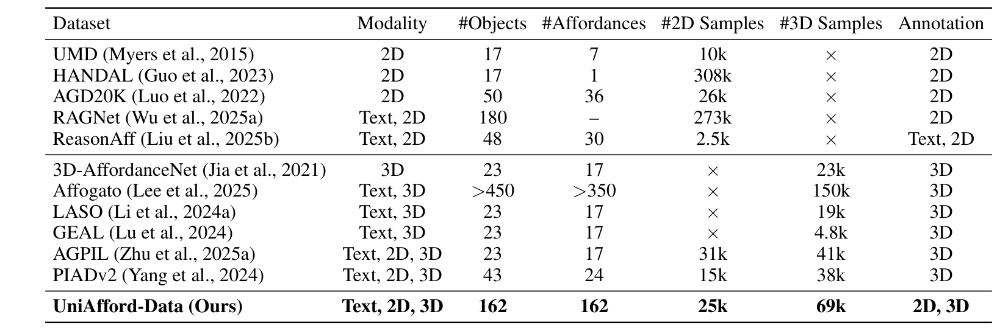
*表 1｜与现有可供性数据集的横向对比：只有 AGPIL、PIADv2 与本数据集同时提供二维和三维标注，而本文的物体与可供性类别数（162/162）明显更大。论文原图表编号：Table 1*

表 1 的读法值得留意，按标注形态分三组看：

- 纯二维组：UMD、HANDAL、AGD20K，样本量从 1 万到 30 万不等，但只有掩码。
- 文本加二维组：RAGNet 约 27.3 万、ReasonAff 约 2.5 千，物体数分别 180 与 48。
- 纯三维组：3D-AffordanceNet、Affogato、LASO、GEAL，样本量 4.8 千至 15 万。

也就是说，本文的增量主要是“覆盖面”——语义索引更宽，而不是标注密度更高；物体数 162 已是同表最大，但每个组合的平均样本数并不占优。

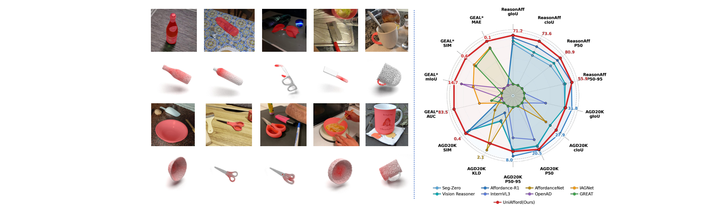
*图 1｜左侧是共享分类体系下的像素级与点级标注示例，右侧是 UniAfford 在零样本与模态隔离两种评测下的雷达图。论文原图编号：Figure 1*

### 语义级伪配对

配对规则只有一条：物体类别与可供性类别同时相同。对任一组合，取一张已标注图像与一个已标注点云，组成一条训练样本：

$$
S^{pair}=\big(X(\mathrm{obj},\mathrm{aff}),\, I_i,\, P_j,\, \mathrm{obj},\, \mathrm{aff},\, Y^{2D}_i,\, Y^{3D}_j\big)
$$

关键性质是：$I_i$ 与 $P_j$ 属于不同物理实例，不需要共享几何、视角或空间坐标。每条观测保留自己原始的空间标注，二维分支由自己的掩码监督，三维分支由自己的点级标注监督；配对既不迁移掩码也不施加像素到点的对应约束。

这样做的代价是失去几何一致性监督，收益是把“语义统一”与“几何对应”解耦，使异构标注源可以立即联合使用，而不必等待实例对齐的新数据。

### 指令模板与路由监督

每条样本都需要一条指定物体与可供性的指令。有人工描述时直接沿用，没有时用固定模板。原始模板是两段式对话：

> Locate the {aff} affordance region of the {obj}.

> In the 2D image, the {aff} affordance region of the {obj} is ``; in the 3D point cloud, it is `<pc-aff>`.

模板刻意把“条件提示”和“被监督的目标”分开：第一段是输入问题，第二段既含普通语言目标，也含两个锚点。路由标签按位移后的响应目标派生——若某位置的下一个目标是图像锚点或点云锚点，该位置就标成对应分支，其余有效位置标为文本；而锚点位置本身被显式排除在语言建模损失之外，只提供路由监督。

这一处细节是整套方法能成立的关键。如果锚点也参与语言损失，语言头会把它们学成普通词表目标，路由就又退回了“生成标记”的老路。

## 方法主线

### 机制流程

1. **输入与多模态编码**：指令走分词器、图像走 SigLIP、点云走预训练 SONATA 编码器，三路结果按可用模态拼成共享前缀送入被 LoRA 微调的骨干，得到自回归响应。
2. **状态收集**：解码到第 $t$ 步时，取最后一层隐状态 $h_t$ 用于下一个词元预测，同时把整段响应状态收成矩阵 $H$，作为待路由的候选集合。
3. **模态感知路由与查询组装**：路由头对每个有效位置输出三类分布，训练用软概率、推理用最大值取硬指派；被判为图像或点云的位置再经分支投影得到查询向量，按自回归顺序拼成两条查询序列并加填充掩码。
4. **双解码器与联合损失**：图像查询与 SAM 编码器的稠密特征做归一化余弦相似度得到粗热图，再作为掩码提示交给 SAM 解码器输出像素得分；点云查询与点特征做同样的相似度对齐，直接输出逐点得分。两条稠密损失按可用性门控，与语言损失、路由结构损失一起反传。

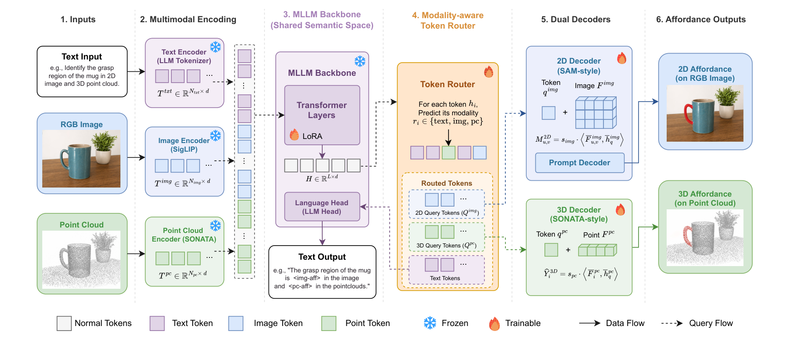
*图 2｜UniAfford 的六段流水线：文本、图像、点云分别编码后拼成共享前缀，大模型产生响应状态，路由按模态分派，双解码器分别输出图像上的二维可供性与点云上的三维可供性。论文原图编号：Figure 2*

### 统一多模态编码

三条通路共享同一套输入空间：

$$
T^{txt}=E^{mllm}_{txt}(X),\quad T^{img}=E^{mllm}_{img}(I),\quad T^{pc}=E^{mllm}(P)
$$

文本走分词器，图像走 SigLIP 加投影层，点云走预训练编码器加投影层。前缀条件化后逐词元自回归：

$$
h_t=\mathrm{MLLM}\big(T^{in}, U_{<t}\big)_{last},\qquad H=[h_1;\dots;h_L]
$$

其中 $U_{<t}$ 是已生成序列，$L$ 是解码长度。这里有个容易忽略的分工：点云在大模型侧被编码一次（为了语义），在三维解码器侧又被独立的 SONATA 编码器编码一次（为了空间细节），两者不共享权重。

### 模态感知路由

对每个有效响应状态，路由头给出类别分布，并用负无穷屏蔽不可用分支的得分：

$$
z_t=g_r(h_t),\qquad p_t=\mathrm{softmax}(\tilde{z}_t),\qquad r_t=\arg\max_{c} p_{t,c}
$$

软概率提供可微的路由监督，硬指派用于逐分支挑选状态。随后两个分支投影把被选中的状态映射进各自的查询空间：

$$
q^{img}=g_{img}(h_t),\qquad q^{pc}=g_{pc}(h_t),\qquad Q^{b}=[\,q^{b}_t \mid r_t=b\,]
$$

路由的“可用性”有两层含义，必须区分：训练时图像分支要求图像与掩码都在，点云分支要求点云与点级标注都在；推理时只看观测是否存在，不需要标注，文本分支始终可用。实现上还有三个不同的掩码——响应有效位掩码（哪些位置可被监督与选取）、分支可用性掩码（哪些分支可选）、查询填充掩码（变长查询如何批处理）。三者在代码里极易混淆，对齐时必须各司其职。

训练里还有一个工程细节：当存在有效标注、但路由没能在锚点位置给出该分支指派时（零查询情形），路由损失会重罚这类错分；为保证稳定，训练时该位置的隐状态会被强制回退给下游解码器。推理时这套补偿关闭，解码器只按预测出的查询数被激活。

### 双解码器：相似度式对齐

二维侧先由 SAM 编码器得到稠密图像特征，与路由查询做投影后的归一化相似度，得到空间网格上的粗热图：

$$
M^{img}_{u,v}=s_{img}\big\langle \mathrm{Norm}(\phi_{img}(F^{img}_{u,v})),\ \mathrm{Norm}(\gamma_{img}(q^{img}))\big\rangle
$$

热图缩放到 SAM 的提示分辨率后编码成稠密掩码提示，再交给掩码解码器细化：

$$
\hat{Y}^{2D}=D_{2D}\big(F^{img},\, E_{pmt}(M^{img})\big)
$$

三维侧用同构形式，但直接输出逐点得分：

$$
\hat{Y}^{3D}_i=s_{pc}\big\langle \mathrm{Norm}(\phi_{pc}(F^{pc}_i)),\ \mathrm{Norm}(\gamma_{pc}(q^{pc}))\big\rangle,\quad i=1,\dots,N
$$

这种“把查询当向量、用余弦相似度与稠密特征对齐”的做法，与把查询当提示词拼进解码器形成对照；后文消融显示两者差距极大，是本文最不能省的部件之一。

### 训练目标

总损失把语言建模、两路稠密预测与路由放在一起，稠密项用可用性指示变量门控：

$$
\mathcal{L}=\lambda_{txt}\mathcal{L}_{txt}+m_{2D}\mathcal{L}_{2D}+m_{3D}\mathcal{L}_{3D}+\mathcal{L}_{router}
$$

$$
\mathcal{L}_{router}=\lambda_r\mathcal{L}_{route}+\lambda_e\mathcal{L}_{exist}+\lambda_s\mathcal{L}_{sparse}
$$

二维稠密损失是焦点损失与 Dice 的组合，三维是二分类交叉熵与 Dice 的组合；路由分类项是位置掩码后的交叉熵，另有两个结构项作用在软路由概率上。为了在样本级约束“分支有没有被激活”和“分到多少查询”，论文用噪声或估计分支激活度、用期望计数估计查询量：

$$
a_b=1-\prod_{t\in\Omega_r}(1-p_{t,b}),\qquad c_b=\sum_{t\in\Omega_r}p_{t,b}
$$

$$
\mathcal{L}_{exist}=\sum_{b}\mathrm{BCE}(a_b, y^{b}_{avail}),\qquad \mathcal{L}_{sparse}=\sum_{b}\mathrm{SmoothL1}(c_b, \tau_b)
$$

权重按初始梯度量级经验设定：路由分类项 1.0、存在项 0.5、稀疏项 0.01。稀疏项权重刻意压得很小，只作为防止路由坍缩的温和正则。

工程配置上，骨干是 Qwen3-VL，低秩适配的秩为 8、缩放 16、丢弃率 0.05，注意力与投影层可训；视觉塔、SAM 图像编码器、点云编码器全程冻结，可训参数集中在适配器、路由投影、两个稠密解码器与整个路由。

图像统一缩放到 1024 见方，点云采样 2048 点。模块学习率按协议区分：混合训练时骨干 1e-5、二维解码器 5e-6、三维解码器 5e-4、路由 1e-3；优化器配线性预热与余弦衰减，硬件是英伟达 B200。

## 关键结果

三组假设对应两种评测协议：混合训练零样本（在本数据集上训练，直接评测目标基准，不做任何目标域训练或微调）与模态隔离（每条分支只用自己的模态与指令训练、评测）。

### H1：零样本迁移

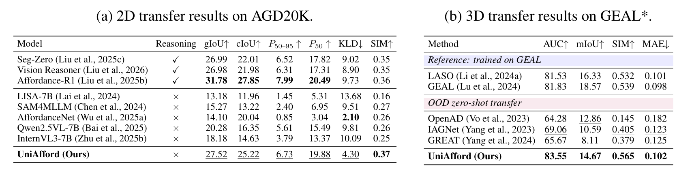
*表 2｜零样本迁移主表：左表为 AGD20K 上的二维迁移，右表为 GEAL\* 上的三维迁移；LASO 与 GEAL 两行是在目标域训练过的参考模型，不计入零样本排名。论文原图表编号：Table 2*

| 设定 | 指标 | UniAfford | 最强对照 | 读法 |
| --- | --- | --- | --- | --- |
| AGD20K 二维零样本 | gIoU / cIoU | 27.52 / 25.22 | Affordance-R1 31.78 / 27.85 | 阈值化重叠不如推理式模型 |
| AGD20K 二维零样本 | P50 / P50–95 | 6.73 / 19.88 | Affordance-R1 7.99 / 20.49 | 高阈值命中率同样略低 |
| AGD20K 二维零样本 | KLD ↓ / SIM | 4.30 / 0.37 | Affordance-R1 9.73 / 0.36 | 分布一致性明显更好 |
| GEAL\* 三维零样本 | AUC / SIM | 83.55 / 0.565 | GEAL 81.83 / 0.539 | 未训目标域仍超过参考模型 |
| GEAL\* 三维零样本 | mIoU / MAE ↓ | 14.67 / 0.102 | GEAL 18.57 / 0.098 | 区域重叠与点级误差落后 |

这张表需要冷静读。二维端并不是重叠指标的第一名，作者的原话是“在所有不做显式推理链生成的对比方法中领先”，同时拿到全表最高的 SIM 与最低的 KLD——它给出的是更接近真值的分布，而不是更贴合阈值的掩码。

三维端的表述同样精确：四项指标全面超过所有零样本基线，并在 AUC 与 SIM 上超过在目标域训练过的参考模型，但 mIoU 与 MAE 仍落后于这两条参考。

### H2：分支独立训练与评测

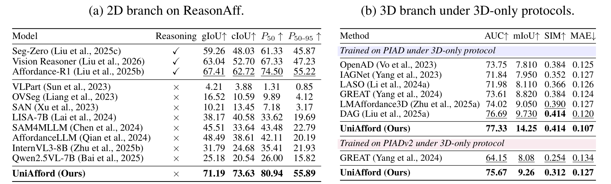
*表 3｜模态隔离协议下的分支级结果：左表为 ReasonAff 上的二维分支，右表为仅三维训练协议下的三维分支，PIAD 与 PIADv2 两块分别排名。论文原图表编号：Table 3*

- **二维分支**：gIoU 71.19、cIoU 73.63、P50 80.94、P50–95 55.89，四项全部第一。相对最强的推理式模型 Affordance-R1（67.41、62.72、74.50、55.22），cIoU 提升 10.91 个点，说明整块区域的覆盖率改善远大于单图平均重叠。
- **三维分支，PIAD 协议**：曲线下面积 77.33、平均重叠 14.25、相似度 0.414、平均绝对误差 0.107。相对 DAG 的平均重叠 9.73 提升 4.52 个绝对点，曲线下面积从 76.69 提到 77.33，相似度打平、误差更好。
- **三维分支，PIADv2 协议**：曲线下面积 75.67、平均重叠 9.26、相似度 0.312、平均绝对误差 0.127，相对 GREAT（64.15、8.08、0.254、0.134）四项全面提升。

值得留意：在模态隔离协议下，UniAfford 只用点云作为视觉输入，而部分三维基线按官方设置保留了非点云的辅助线索。这一条是作者在附录里明确写的，属于“本方约束更严”的有利偏差。

### H3：消融

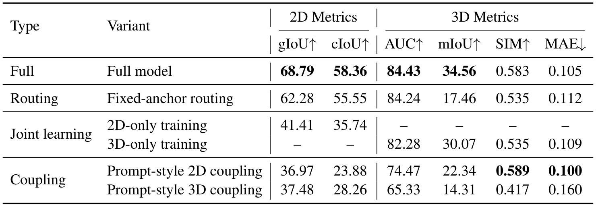
*表 4｜路由、联合训练与解码器耦合的消融；所有变体在同一子集上训练、同一留出集上评测。论文原图表编号：Table 4*

| 类型 | 变体 | 2D gIoU | 2D cIoU | 3D AUC | 3D mIoU | 3D SIM | 3D MAE ↓ |
| --- | --- | --- | --- | --- | --- | --- | --- |
| 完整 | 完整模型 | 68.79 | 58.36 | 84.43 | 34.56 | 0.583 | 0.105 |
| 路由 | 固定锚点选择 | 62.28 | 55.55 | 84.24 | 17.46 | 0.535 | 0.112 |
| 联合 | 仅二维训练 | 41.41 | 35.74 | — | — | — | — |
| 联合 | 仅三维训练 | — | — | 82.28 | 30.07 | 0.535 | 0.109 |
| 耦合 | 提示式二维耦合 | 36.97 | 23.88 | 74.47 | 22.34 | 0.589 | 0.100 |
| 耦合 | 提示式三维耦合 | 37.48 | 28.26 | 65.33 | 14.31 | 0.417 | 0.160 |

三组对照最能说明问题：固定锚点换成学习路由，二维 gIoU 增加 6.51、三维 mIoU 增加 17.10；单分支训练换成联合训练，二维 gIoU 从 41.41 到 68.79、三维 mIoU 从 30.07 到 34.56；把相似度耦合换成提示式注入，二维 gIoU 掉到 36.97、三维 mIoU 掉到 14.31。三组对照都发生在骨干与解码器不变的前提下，因此可以较有把握地把差异归给机制本身。

耦合两行要按被修改的分支读。提示式二维耦合那一行的 SIM 为 0.589，反而略高于完整模型的 0.583，说明这种替换并非在所有指标上单调变差。

作者另在附录给了共享子集上的专用基线对照：二维基线 AffordanceNet 的 gIoU 只有 31.44，三维基线 GREAT 的 AUC 与 mIoU 为 71.02 与 13.14，完整模型在同子集上是 68.79、84.43、34.56。这组数字支撑“整系统优于专用模型”，但两者的监督信号并不对等——完整模型用的是异构二维加三维监督。

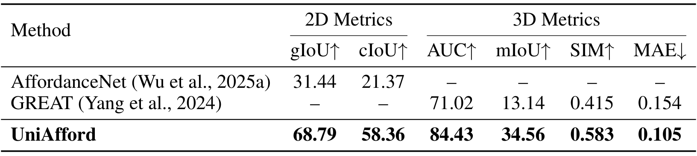
*表 7｜共享消融子集上与专用基线的对照：专用基线沿用各自的原始监督，完整模型使用异构二维加三维监督，两者监督信号并不对等。论文原图表编号：Table 7*

### 定性结果

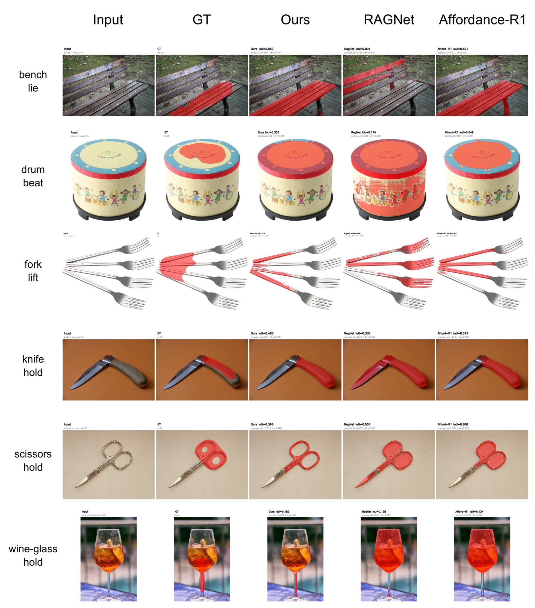
*图 5｜AGD20K 上的二维零样本定性对比：列依次为输入、真值、UniAfford、RAGNet 基线、Affordance-R1。论文原图编号：Figure 5*

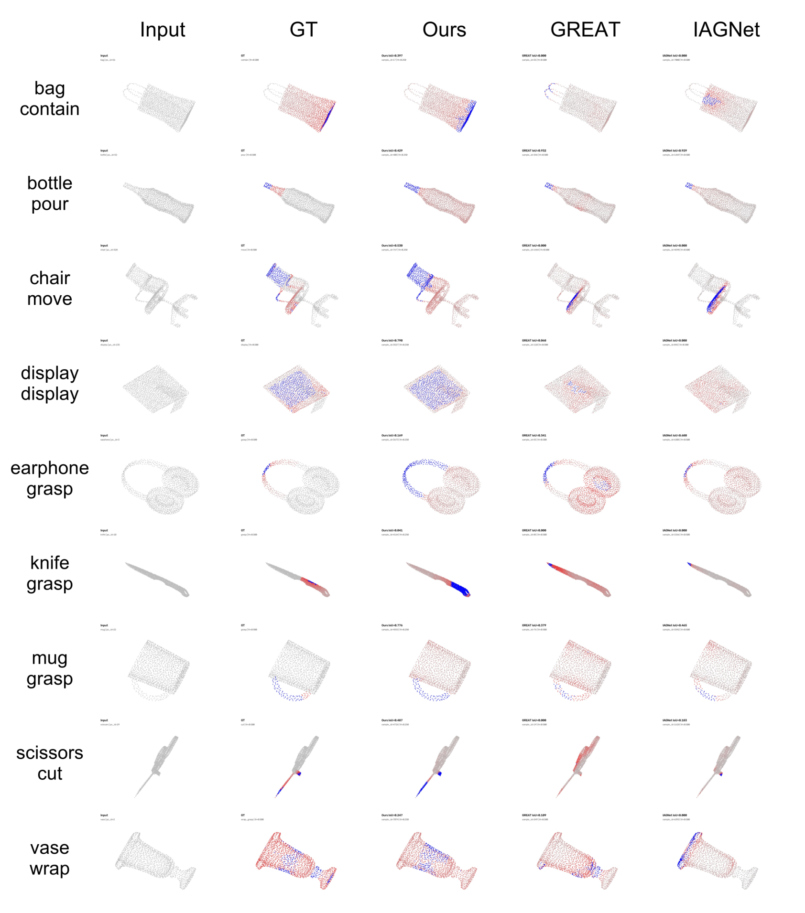
*图 6｜GEAL\* 上的三维零样本定性对比：列为输入点云、真值、UniAfford、GREAT、IAGNet，红色表示逐点可供性分数，蓝色标出最高置信区域。论文原图编号：Figure 6*

定性图里的模式是一致的：面对剪刀、刀具这类工具，UniAfford 的响应更集中在真正发生交互的区域（握把），而基线常把刀刃或刀身一起点亮。作者也承认这既是优势也是差异——预测范围比标注更窄时，阈值化重叠反而会吃亏，这与表 2 里“分布型指标赢、重叠指标输”的结论互相印证。

## 深度分析

### 二维端：为什么分布型指标赢、重叠指标输

表 2 左表的排序很有意思：推理式模型的重叠指标普遍高于 27.52，但 KLD 都在 8.9 至 9.8 之间，而 UniAfford 是 4.30；相似度也是它最高（0.37 对 0.35 至 0.36）。这说明它输出的可供性响应分布在“概率质量怎么摆”上更贴近真值，但把分布二值化成掩码后边界更保守。

机制上讲得通：监督来自焦点损失加 Dice 的像素损失，Dice 项鼓励区域级重叠，而 SAM 提示解码器会把粗热图细化成较紧的掩码；推理式模型往往先产生更发散的响应再收敛，阈值化后覆盖面更大。所以“谁更好”取决于下游要什么——抓取规划可能偏好紧致可执行区域，数据标注可能偏好完整覆盖。

### 三维端：AUC 高而 mIoU 低意味着什么

GEAL\* 上 UniAfford 的曲线下面积 83.55 与相似度 0.565 都是最高，平均重叠 14.67 却低于参考模型的 18.57。三个指标关心的东西不同：曲线下面积只问逐点分数的排序对不对，相似度问归一化分布整体像不像，平均重叠则要在多个阈值上二值化再算区域交集。

三者分裂说明：模型对“哪些点亮、哪些点暗”的排序判断相当准，但分数分布的形状与标注边界不完全匹配，例如高响应区域更集中，或中间分数段偏多。这一现象与点级标注的稀疏性叠加——点云可供性标注本身依赖标注者对交互区域的判断，跨数据集时粒度差异会直接压低 mIoU。作者在附录也承认部分样例的重叠分数不是最高，但区域在视觉上仍然合理。

绝对水平同样要打记号：PIADv2 上的 mIoU 只有 9.26，PIAD 上 14.25。这是整个三维可供性定位任务当前的真实水位，不应把“全面超过基线”误读成“点级定位已经够用”。

### 路由到底在起什么作用

固定锚点与学习路由的对照最能暴露机制：两者骨干、解码器、损失完全相同，唯一差别是“查询从哪里取”。固定锚点时，查询只能来自那两个锚点位置，而这两个位置在序列里数量固定、语义上被语言目标牵着走；换成学习路由后，查询可以来自任意被判定为对应模态的上下文位置，数量也随之浮动。

三维 mIoU 从 17.46 跳到 34.56，接近翻倍，远大于二维的增益。合理的解释是：点云分支对查询的语义密度更敏感——三维定位缺少图像那样的外观先验，若查询只来自一个被语言头支配的锚点状态，几何定位几乎没有可用信息；二维端还有 SAM 稠密特征兜底，对查询质量没那么敏感。

这里也留了一个未回答的问题：增益究竟来自“查询数量变多、位置更自由”，还是来自“被选中的状态语义更好”？论文没有给出固定查询数、只改选择方式的对照，也没有报告硬路由的分布统计，例如各分支实际分到多少词元、是否存在分支坍缩。

### 语言头诊断的证据强度

附录的做法是把路由状态直接过语言头，取最高分词看它“读出了什么”。结果：只在 ReasonAff 上训练时，解码分布集中在 39 个类别且频繁出现数字词元；联合训练后在三个评测集上分别扩到 238、398、426 个类别，并出现桌子、把手、摩托车以及支撑、移动、握持、坐这类物体词与交互词。

这组证据的定位必须说清：它是相关性诊断，不是因果证明。路由决策由分类头给出，与解码出的词无关；类别计数也不是受控的语义丰富度指标，不同数据集样本量本就不同。作者自己也承认少数词元仍解码成无关字符，并归因于骨干预训练分布的遗留痕迹，以及下游解码器在联合训练中把词元嵌入从纯语言空间拉向空间预测需求所导致的表征漂移。

比较公允的结论是：路由状态没有退化成纯几何向量，仍保留可读的物体—交互语义，这为“共享大模型当语义接口”提供了间接支持，但离“语义是路由的因果依据”还有距离。

### 计算成本：路由很便宜，骨干很贵

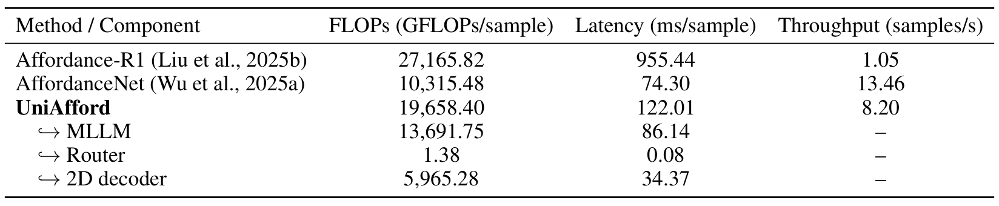
*表 8｜AGD20K 上的计算开销：顶层行是完整流程，缩进行是模块级拆分。论文原图表编号：Table 8*

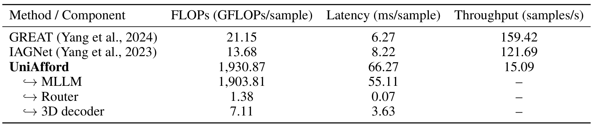
*表 9｜GEAL\* 上的计算开销与模块级拆分。论文原图表编号：Table 9*

| 项 | 浮点运算（十亿次/样本） | 延迟（毫秒/样本） | 吞吐（样本/秒） |
| --- | --- | --- | --- |
| Affordance-R1（二维） | 27,165.82 | 955.44 | 1.05 |
| AffordanceNet（二维专用） | 10,315.48 | 74.30 | 13.46 |
| UniAfford（二维流程） | 19,658.40 | 122.01 | 8.20 |
| 其中骨干 | 13,691.75 | 86.14 | — |
| 其中路由 | 1.38 | 0.08 | — |
| 其中二维解码器 | 5,965.28 | 34.37 | — |
| GREAT（三维专用） | 21.15 | 6.27 | 159.42 |
| IAGNet（三维专用） | 13.68 | 8.22 | 121.69 |
| UniAfford（三维流程） | 1,930.87 | 66.27 | 15.09 |
| 其中骨干 | 1,903.81 | 55.11 | — |
| 其中路由 | 1.38 | 0.07 | — |
| 其中三维解码器 | 7.11 | 3.63 | — |

结论清楚也很不客气：相对推理式基线，二维流程省了约 27.6% 的浮点运算，吞吐提升约 7.8 倍；但相对专用二维模型 AffordanceNet 仍更慢（8.20 对 13.46）。三维端更悬殊——约 91 倍的浮点运算、约 10 倍延迟，吞吐只有 15.09 对 159.42。

而路由本身只有 1.38 十亿次、0.07 至 0.08 毫秒，几乎不占成本。换言之，“统一”的代价全部由共享骨干承担，未来降本的空间在骨干与蒸馏，而不在路由设计。显存侧，批大小为 1 时加载后约分配 10.26 GiB，推理峰值 11.60 GiB，保留峰值为 13.78 GiB。

### 与相邻路线的定位

- **对标记式多任务接口**（LISA、UnifiedMLLM）：本方法把任务分派与词表生成解耦，理论上分支数可以继续增加而不需要新增特殊词元；代价是路由标签仍要靠在锚点位置构造，本质上是“训练时用锚点、推理时不看锚点”。
- **对输入融合式跨模态方法**（IAGNet、GREAT）：那些方法把图像线索作为额外输入喂进点云分支，输出空间仍以点云为主；UniAfford 是双输出，同一套状态驱动两个解码器。
- **对专家混合路由**：那类方法在专家维度上做稀疏激活以扩容量；这里是在序列位置维度上做任务分派，两个结构损失也只是控制分支覆盖与冗余，不涉及容量扩展。
- **对推理式二维分割**（Seg-Zero、Affordance-R1）：那些方法显式生成推理链，在阈值化重叠上更强；UniAfford 不生成推理链，换来更低的分布散度、更高的相似度，以及可同时输出三维。

## 局限

论文自述三条：依赖大规模预训练骨干，训练与推理成本都高（前文实测三维端约 91 倍浮点运算）；语义级配对只连接语义，不建立实例级空间对应，因而缺少几何一致性监督；评测止于可供性定位基准，没有闭环机器人操作验证。

阅读时还应补充几条：

- **零样本的定义偏宽**：附录明确“零样本”指跨数据集、不做目标域适配，并不要求目标类别在训练分类体系之外。因此表 2 不宜被引用为开放词表泛化的证据。
- **GEAL\* 只是子集**：它是腐蚀鲁棒性基准中 LASO-C 的子集（尺度、抖动、旋转三种扰动，严重度 2），不等于完整榜单。
- **数据是重组而非新采**：增量在覆盖面与索引统一，不在标注质量；2.5 万与 6.9 万的数字来自合并去重后的统计口径。
- **缺少方差统计**：主表与消融都是单次训练结果，没有误差棒或多种子，几个点的差距（例如三维 AUC 84.43 对 84.24）不宜过度解读。
- **消融基座偏小**：消融统一在固定子集上做，绝对数值（如三维 mIoU 34.56）与主表不可直接比较。
- **路由行为缺少统计刻画**：分支词元数分布、分支坍缩率、零查询触发频率这些能直接验证路由健康度的指标，正文都没有给出。

## 我的笔记

**如果要复现，先对齐这四件事**

1. 路由标签必须由位移后的响应目标派生，且锚点位置要从语言损失里屏蔽；这两步任一错位，路由就会退化成生成标记。
2. 三个掩码要分清：响应有效位、分支可用性、查询填充。训练时分支可用性要求“观测加标注”，推理时只要求“观测”。
3. 稠密损失只经查询投影回传到被选中的状态（硬路由不可导），路由头单独由分类损失驱动，两者通过共享表征耦合。
4. 解码器侧坚持归一化余弦相似度加可学习缩放；换成提示式注入后二维 gIoU 从 68.79 掉到 36.97，这不是超参问题，是机制问题。

**判断这套方法值不值得跟进**

- 值得：它把“多模态统一”落到了接口层面（状态路由），而不是只做输入融合；路由成本可以忽略，意味着后续加分支（法向、抓取位姿、可供性排序）的边际成本很低。
- 需要警惕：统一带来的性能优势在二维端主要体现在分布型指标；如果下游指标是阈值化重叠或平均精度，收益可能不如预期。三维端的绝对精度仍然很低，离机器人可用还有距离。
- 成本是硬门槛：三维流程 1.93 万亿次浮点运算、66 毫秒每样本，要做实时闭环几乎必须蒸馏或换小骨干。

**未插入正文的图表（内容已用文字概括）**

- 图 3（论文第 15 页）：数据集的代表性标注示例，与图 1 左侧信息重复，未插入。
- 图 4（论文第 21 页）：语言头读出的四组柱状分布，结论已在“语言头诊断的证据强度”用数字说明（39 类扩展到 238、398、426 类），图像信息量低于数字本身。
- 表 5（论文第 13 页）：数据存储布局（指令表、图像目录、点云目录、划分文件），已在正文以文字描述。
- 表 6（论文第 20 页）：三种协议的模块学习率与输入尺寸，已在“训练目标”内联。
- 表 10（论文第 23 页）：单卡显存（10.26、11.60、13.78 GiB），已在“计算成本”内联。

**可以延伸的实验**

1. 固定查询数量、只改变“查询来源”（锚点位置与学习位置），拆开验证三维端增益的真正来源。
2. 报告硬路由的词元数分布与零查询比例，检验是否存在分支坍缩。
3. 用同一批数据的实例级对齐版本重跑联合训练，量化语义配对相对实例对齐的损失。
4. 把三维流程蒸馏到小骨干，测量精度与延迟的拐点，判断能否进入闭环。

## 引用

- 原文：Yuhao Liu, Yiming Zhong, Hanqing Wang, et al. UniAfford: Token-Routed Multitask Learning for Generalizable 2D-3D Affordance Perception. arXiv:2609.37264, 2026. https://arxiv.org/abs/2609.37264
- 项目页：https://4dvlab.github.io/UniAfford/
- Lai et al. LISA: Reasoning Segmentation via Large Language Model. CVPR 2024.（标记式分割接口，本文的主要对照面）
- Li et al. UnifiedMLLM: 多任务多模态大模型接口相关工作. 2024.
- Wu et al. RAGNet / AffordanceNet: 指令引导可供性分割与二维基线. 2025a.
- Liu et al. Affordance-R1: 推理式可供性定位基线. 2025b.
- Yang et al. PIADv2: 三维可供性数据集与协议. 2024.
- Lu et al. GEAL: 三维可供性腐蚀鲁棒性基准. 2024.
- Yang et al. GREAT: 几何属性与交互意图融合的三维可供性定位. 2024.
- Wu et al. SONATA: 自监督点云表征. 2025c.
- Kirillov et al. Segment Anything. ICCV 2023.（提示式二维解码器的结构来源）
- Hu et al. LoRA: Low-Rank Adaptation of Large Language Models. ICLR 2022.
