---
tags:
  - papers/CV
  - papers/3D-Vision
  - papers/Embodied-AI
aliases:
  - "UniFunc3D"
date: 2026-03-24
doi: 10.48550/arxiv.2603.23478
---

# UniFunc3D: Unified Active Spatial-Temporal Grounding for 3D Affordance Segmentation

## 核心信息

- 标题: UniFunc3D: Unified Active Spatial-Temporal Grounding for 3D Affordance Segmentation
- 标题翻译: 面向 3D 可供性分割的统一主动时空定位框架
- 作者: Jiaying Lin, Dan Xu
- 机构: 香港科技大学计算机科学与工程系
- 发表时间: 2026-03-24
- 发表渠道:NeurIPS 2026
- DOI: 10.48550/arxiv.2603.23478
- arXiv: 2603.23478
- 论文链接: https://arxiv.org/abs/2603.23478
- 代码 / 项目: https://jiaying.link/unifunc3d
- 数据 / 资源: SceneFun3D
- 论文类型: AI 方法论文

## 原文摘要翻译

3D 场景中的可供性分割要求智能体把隐式的自然语言指令落地为细粒度交互部件的精确掩码。现有的免训练方法通常依赖碎片化流水线，这不仅在任务解析阶段引入"视觉盲区"，还通过单尺度的空间与时间处理限制了精度。我们提出 UniFunc3D——一个统一且免训练的框架，把多模态大语言模型当作主动观察者。借助统一的大模型主干，UniFunc3D 执行语义、时间、空间的联合推理，把任务分解直接锚定到视觉证据之上。我们的方法引入了带粗到细策略的主动时空定位：模型可以自适应地选择正确的视频帧，聚焦高细节的交互部件，同时保留消歧所需的全局上下文。在 SceneFun3D 上，UniFunc3D 取得最先进性能，以相对 59.9% 的 mIoU 提升大幅超越以往的免训练方法，甚至在不做任何任务特定训练的情况下超过需训练的方法。代码已发布于项目主页：https://jiaying.link/unifunc3d。

## 创新点

1. **统一多模态架构**：把任务解析、时间选帧、空间定位合并进一个视觉感知的时空大模型，消除碎片化流水线中文本盲推理导致的级联错误；与 Fun3DU 那种文本大模型、开放词汇检测、视觉定位、几何提升的多模型串联形成直接对照。
2. **主动时空定位**：用多次带偏移采样加视觉掩码验证替代被动启发式选帧规则，模型依据直接视觉证据自主挑选最有信息量的帧与部件，去掉了阈值化居中度与均匀度打分等手工超参。
3. **类人粗到细感知**：粗阶段低分辨率通览全视频，细阶段在原分辨率上处理密集时间窗，在不裁剪图像的前提下获得放大能力，既聚焦小部件又保留全局上下文供自我纠错。
4. **最先进性能与效率**：在 SceneFun3D 上全面刷新免训练与需训练方法的指标，30B 版本相对 Fun3DU 的 mIoU 相对提升 59.9%，8B 版本相对 Fun3DU 达到 5.2 倍加速。

## 一句话总结

UniFunc3D 用同一个冻结的多模态大模型同时充当主动观察者与掩码验证器，以粗到细的主动时空定位取代碎片化流水线，在 SceneFun3D 上以更小的模型和零任务训练取得全面最优的可供性分割掩码。

## 研究问题

**任务本质**：可供性分割关注的不是物体是什么，而是基于意图该如何与之交互。例如指令打开天花板灯，智能体必须推断目标是某个墙壁开关，即便指令里从未出现开关一词。这要求高层世界知识（语言解读）与细粒度空间感知（小部件定位）协同工作。

**现有免训练方法的三类失败模式**（以 Fun3DU 为代表）：

- **语义误读**：初始任务分解由一个纯文本大模型在看不见场景的情况下完成，把指令拆成上下文物体与功能物体。一旦分解错误（如把插座设备中的 device 误判为功能物体，正确答案其实是 socket），后续全盘皆错。
- **时空上下文不一致**：用手工阈值分数（居中度、掩码均匀度）被动挑选含上下文物体的帧，默认功能部件与上下文物体总在同一帧；且把每帧当孤立图像处理，不利用跨帧时间信息做空间消歧或可见性聚合。
- **小目标不可见**：单尺度处理缺少类人的放大机制，小功能部件只占极小区域，在全图中形同噪声。

作者把这三类症状归结为**感知—推理鸿沟**：方法无法主动寻找所需上下文，导致初始盲推理或启发式选帧的一个错误就不可挽回地污染所有下游步骤。这直接引出了统一主动观测框架的设计动机。

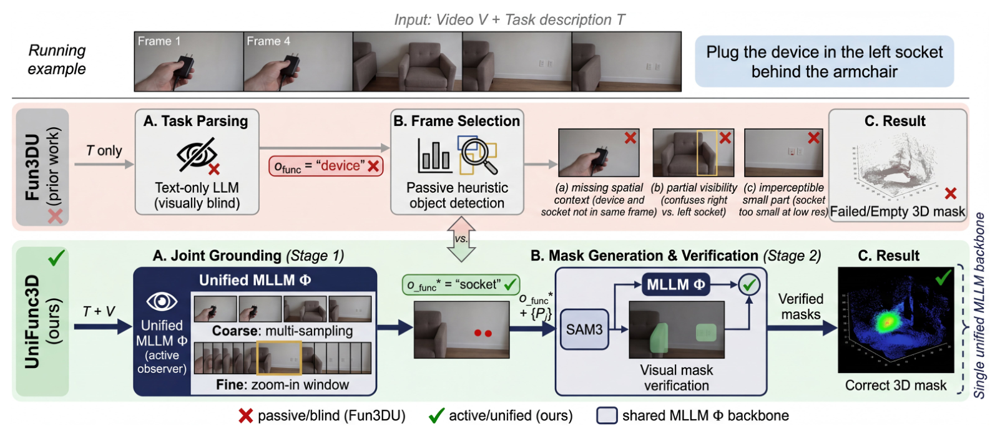
*论文原图编号：Figure 1。上半部分为 Fun3DU 的碎片化流水线及其三类失败，下半部分为 UniFunc3D 的统一主动观测流程；放在这里是为了直观对照两类范式。*

## 数据与任务定义

**形式化输入**：三维场景表示为点云，一组带位姿的彩色深度视图，以及自然语言任务描述。记点云为 $C$，视图集合为 $V$，任务描述为 $T$。

$$C=\{c_i\}_{i=1}^{C},\quad c_i\in\mathbb{R}^{3},\quad V=\{v_i\}_{i=1}^{V}$$

输出为三维掩码，标记哪些点属于功能物体。与分割把手这类显式查询不同，本任务需要推断三件事：基于世界知识与哪些物体交互；哪个具体部件支撑该动作；多个相似实例中哪一个满足空间约束。

**数据集与协议**：`SceneFun3D` 是唯一面向三维场景可供性分割的数据集，含 230 个高分辨率室内场景。

沿用 `Fun3DU` 的划分：`split0` 含 30 个验证场景，`split1` 含 200 个训练场景。

评测指标为 `AP25` 与 `AP50`（两种交并比阈值下的平均精度），并补充 `AR25`、`AR50` 与 `mIoU`。

**基线**：开放词汇三维分割方法（`OpenMask3D`、`LERF`、`OpenIns3D`）。

需训练的 `TASA` 与 `AffordBot`（均基于 `Qwen2.5-VL-72B`），以及免训练的 `Fun3DU`。

## 方法主线

核心是用同一个大模型主干完成两个视觉落地阶段：联合定位功能物体与可供性点，再对掩码做视觉复核。

$$(o^*_{\mathrm{func}}, \{P_j\}) = \Phi_{\mathrm{ground}}(T, V),\qquad b^i_j = \Phi_{\mathrm{verify}}(\tilde{I}_j, o^*_{\mathrm{func}})$$

其中功能物体名与可供性点由定位阶段联合给出；叠加图上的掩码由验证阶段判为通过或拒绝。两阶段构成推理链：阶段一的选帧与定位由视觉证据驱动，阶段二再用同一模型复核分割结果，语义判断全程一致。

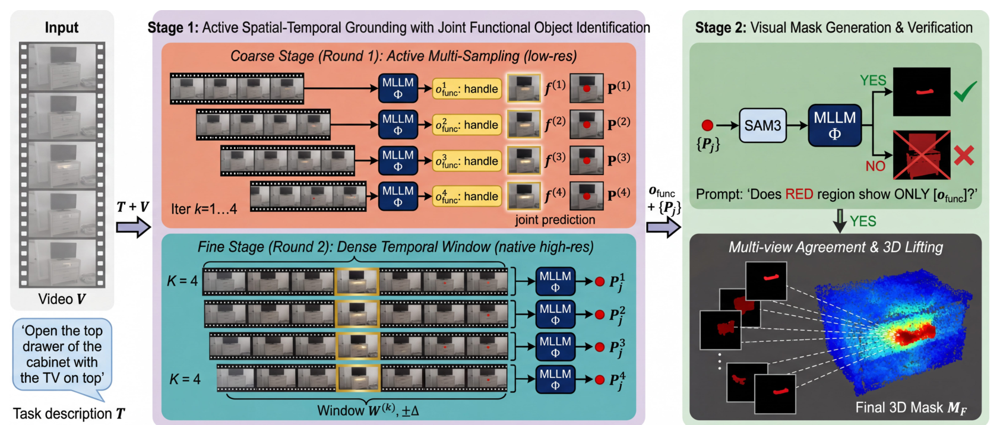
*论文原图编号：Figure 2。完整方法总览：粗阶段低分辨率多采样选帧，细阶段高分辨率密集时间窗，分割模型生成掩码并视觉验证，多视图一致性提升到三维；放在这里作为机制流程的主索引图。*

### 机制流程

1. **粗阶段主动多采样选帧**：输入视频帧序列与任务描述；做多轮带偏移的均匀采样，每轮抽取固定数量帧，不同轮次以时间偏移覆盖互补片段。每帧前插入帧号标签，使模型能在回答中引用具体帧。一次前向联合输出功能物体名、选中帧号与点坐标。所有返回有效帧号的轮次都保留，输出候选帧集合。

$$
j^{(k)}_i = (i-1)\cdot\frac{L}{N} + k\cdot\frac{L}{K\cdot N}
$$

2. **细阶段原分辨率密集时间窗**：输入候选帧；对每个候选帧抽取其前后各一个采样间隔的密集时间窗，逐帧以原始分辨率查询模型。窗口半径由采样间隔推出，取候选帧时间戳前后一段时间内的帧。输出跨所有窗口聚合的逐帧点集。

$$
W^{(k)}=\{v_{f^{(k)}-\Delta},\dots,v_{f^{(k)}},\dots,v_{f^{(k)}+\Delta}\}
$$

3. **视觉掩码生成与验证**：输入点集；每个点作为分割模型的点提示生成二值掩码，再把掩码以一定透明度渲染成彩色叠加图，交给大模型判断高亮区域是否只含目标功能物体、且不含父物体。仅保留通过的掩码，输出已验证掩码集合。

4. **多视图一致性三维提升**：输入已验证掩码；用相机位姿把二维掩码投影到点云，对每个三维点统计被投影命中的掩码数量，归一化后以阈值截取，输出最终三维掩码。该一致性投票抑制离群预测，仅保留多视角一致的点。

$$
s_i=\sum_k\left|\{p^k\mid \Gamma_k(p^k)=c_i,\ p^k\in M^k\}\right|,\qquad M_F=\{c_i\mid s_i>\tau\}
$$

**关键实现细节**：两个变体分别采用 `Qwen3-VL-8B` 与 `Qwen3-VL-30B`，全部冻结、不做微调。

粗阶段每个视频采样 64 帧，分辨率为 512 乘 384，共 4 轮不同时间偏移。

细阶段时间窗按采样间隔设定；分割阈值 0.5，叠加透明度 0.7，一致性阈值 0.7。

### 三阶段提示词

粗阶段提示词让模型一次完成三项判断并按规定格式输出；细阶段只让模型在给定功能物体上标一个可供性点；验证阶段把问题简化为视觉是非题。

> [!figure] Table 9 粗阶段 Grounding 提示词
> 建议位置：机制流程
> 放置原因：该提示词定义了粗阶段识别功能物体、选帧与打点的三合一输出格式，是复现机制流程的关键。
> 当前状态：保留占位；候选裁切为纯文本提示框，无法稳定还原为可独立展示的表格图体，内容已在正文转述。

> [!figure] Table 10 细阶段 Grounding 提示词
> 建议位置：机制流程
> 放置原因：细阶段提示词决定高分辨率逐帧打点的输出约束，直接关系小部件定位。
> 当前状态：保留占位；正文已转述其标出单个可供性点的核心指令。

> [!figure] Table 11 验证阶段提示词
> 建议位置：机制流程
> 放置原因：验证提示词把掩码复核简化为视觉是非题，是理解验证机制的输入端。
> 当前状态：保留占位；正文已转述其判断标准。

## 关键结果

### 主结果与强基线

下表汇总 SceneFun3D 两个划分上的核心指标（括号内为相对 Fun3DU 的提升）。30B 版本在所有方法、所有指标、两个划分上均最优。

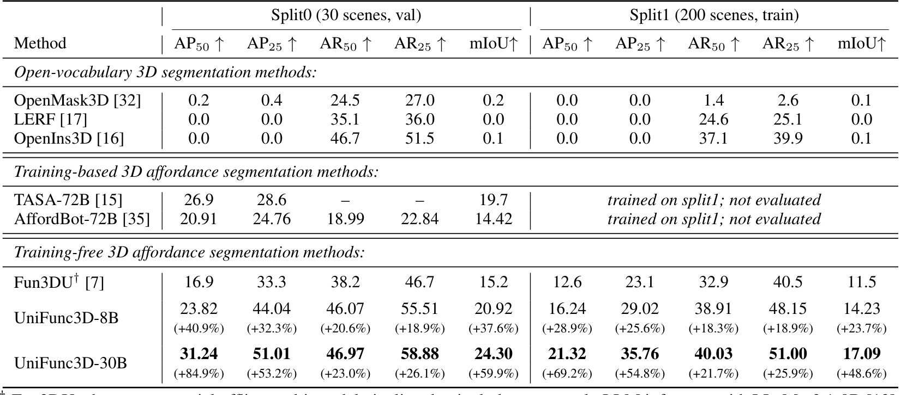
*论文原图编号：Table 1。SceneFun3D 两个划分的全指标对比；放在这里作为主结果总表。*

| Method        | split0 AP50 | split0 AP25 | split0 mIoU | split1 AP50    | split1 AP25 | split1 mIoU |
| ------------- | ----------- | ----------- | ----------- | -------------- | ----------- | ----------- |
| Fun3DU        | 16.9        | 33.3        | 15.2        | 12.6           | 23.1        | 11.5        |
| TASA-72B      | 26.9        | 28.6        | 19.7        | 训练于 split1，未评测 | —           | —           |
| AffordBot-72B | 20.91       | 24.76       | 14.42       | 训练于 split1，未评测 | —           | —           |
| UniFunc3D-8B  | 23.82       | 44.04       | 20.92       | 16.24          | 29.02       | 14.23       |
| UniFunc3D-30B | **31.24**   | **51.01**   | **24.30**   | **21.32**      | **35.76**   | **17.09**   |

- 对 Fun3DU：30B 版本在第一个划分上的 AP50 提升 14.34 点（相对 +84.9%），AP25 提升 17.71 点（+53.2%），mIoU 提升 9.1 点（相对 +59.9%）。8B 版本的 AP50 也提升 6.92 点（+41.0%）。

- 对需训练方法：30B 版本相对 AffordBot-72B 的 AP50 提升 10.33 点、AP25 提升 26.25 点、mIoU 提升 9.88 点，而后者需在场景数据上微调 1000 个周期。

开放词汇三维分割方法精度近零但召回中等，说明它们过度分割且缺乏任务推理能力。

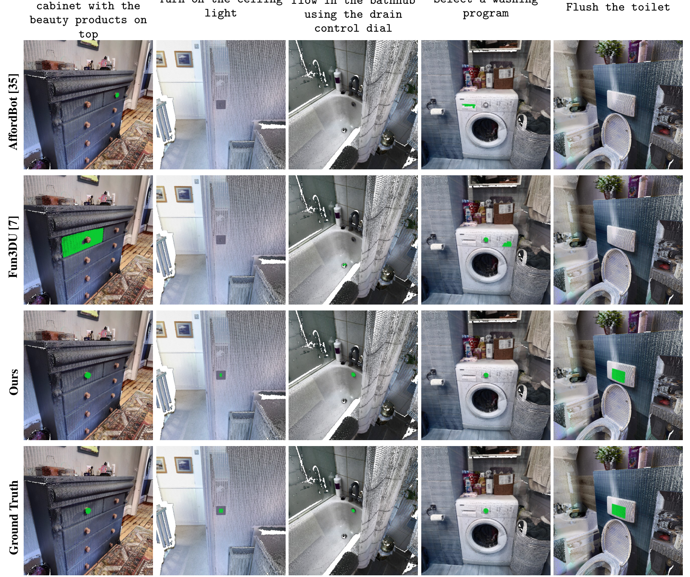
*论文原图编号：Figure 3。五个代表性查询上 AffordBot、Fun3DU、本文方法与真值的定性对比；放在这里展示空间消歧与小物体处理的直观差异。*

### 消融到底说明了什么

高层设计消融显示：直接用现成大模型处理全部高分辨率帧反而最差（AP50 为 4.27，mIoU 为 3.11），因为长上下文下模型既要处理细粒度又缺全局时间概览；纯低分辨率也受限于空间细节。粗到细的两阶段结构才是关键，多采样与密集时间窗各自再叠加收益。

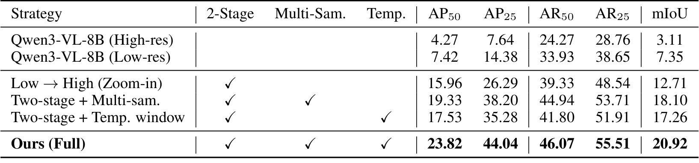
*论文原图编号：Table 2。一阶段与两阶段、多采样与时间窗的高层设计消融；放在这里支撑两阶段是核心的判断。*

| Strategy | AP50 | AP25 | mIoU |
|---|---|---|---|
| High-res one-stage | 4.27 | 7.64 | 3.11 |
| Low-res one-stage | 7.42 | 14.38 | 7.35 |
| Low-to-high zoom-in | 15.96 | 26.29 | 12.71 |
| Two-stage + multi-sampling | 19.33 | 38.20 | 18.10 |
| Two-stage + temporal window | 17.53 | 35.28 | 17.26 |
| Ours full | **23.82** | **44.04** | **20.92** |

采样策略消融（8B 版本，第一个划分）的三个关键结论：

- **时间窗是最大单项增益**：两轮时加入时间窗后 AP50 由 15.51 升到 21.12，AP25 由 28.31 升到 39.10；且时间窗让验证得以生效，无窗时加验证反而略降，因为候选帧太少无法可靠排序。

- **采样轮次在 4 处饱和**：加入时间窗后，轮次从 1 增至 2 增益显著；轮次为 4 且无验证时仅 21.35 对 21.12，轮次为 8 时收益同样递减（无验证 21.57），说明关键是采样多样性而非穷举。

- **验证依赖足够候选池**：轮次为 4 时加验证带来 AP50 提升 2.47、AP25 提升 2.92、mIoU 提升 0.93，达到 23.82、44.04、20.92；两轮时增益较小。

> [!figure] Table 3 采样策略消融全表
> 建议位置：关键结果
> 放置原因：该表列出各采样轮次配置的时间窗与验证组合，是判断时间窗最大、轮次四处饱和、验证依赖候选池的直接证据。
> 当前状态：保留占位；候选裁切在表格下方混入相邻图体，无法作为独立表格插入，关键数值已在正文与表格中转录。

骨干与分割器消融：

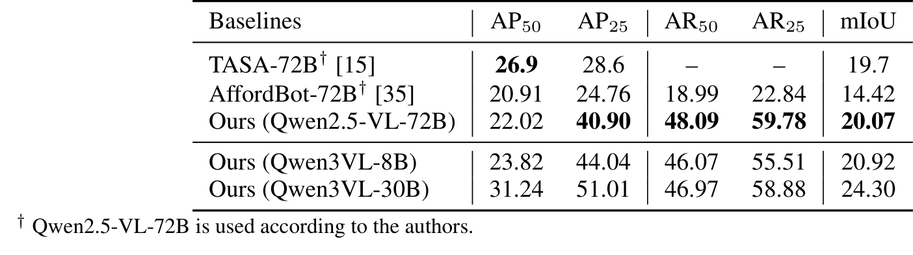
*论文原图编号：Table 4。不同骨干模型的消融对比；放在这里支撑收益来自方法而非更大骨干的判断。*

| Backbone / Method | AP50 | AP25 | AR50 | AR25 | mIoU |
|---|---|---|---|---|---|
| TASA-72B | 26.9 | 28.6 | — | — | 19.7 |
| AffordBot-72B | 20.91 | 24.76 | 18.99 | 22.84 | 14.42 |
| Ours (Qwen2.5-VL-72B) | 22.02 | 40.90 | 48.09 | 59.78 | 20.07 |
| Ours (Qwen3-VL-8B) | 23.82 | 44.04 | 46.07 | 55.51 | 20.92 |
| Ours (Qwen3-VL-30B) | 31.24 | 51.01 | 46.97 | 58.88 | 24.30 |

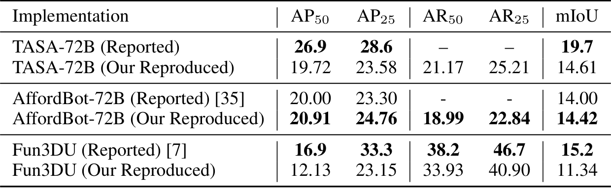
*论文原图编号：Table 8。基线方法的论文报告值与本文复现值对比；放在这里说明主结果采用两者取较高的策略。*

> [!figure] Table 5 验证模型消融
> 建议位置：关键结果
> 放置原因：该表直接检验精度增益是否来自更强的分割器。
> 当前状态：保留占位；候选裁切显示的是另一张表的左半部分且列缺失，与表格身份不符，数值已在正文转录。

> [!figure] Table 7 单场景处理时间对比
> 建议位置：关键结果
> 放置原因：该表量化统一架构带来的推理效率收益。
> 当前状态：保留占位；数值已在正文转录。

消融视觉证据：Figure 4 显示单轮采样时因视角不足误定位把手，完整模型则对齐真值；Figure 5 与 Figure 6 从两个视点展示去掉多视图、时间窗、验证后的过度分割或漏检，完整模型分别达到 0.523 与 0.476 的 mIoU。

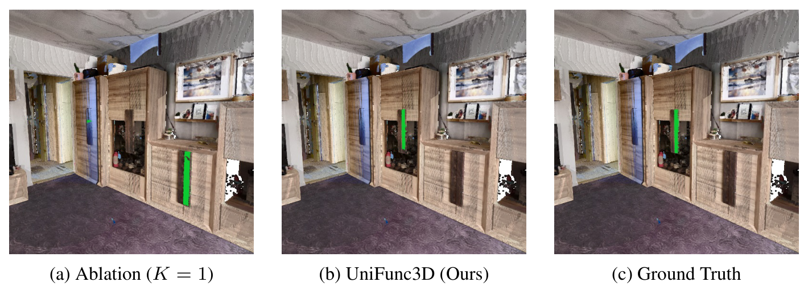
*论文原图编号：Figure 4。单轮采样消融、完整模型与真值的三栏视觉对比；放在这里支撑多采样必要性。*

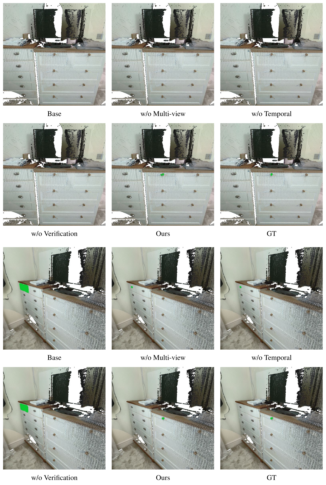
*论文原图编号：Figure 5。基础版、去多视图、去时间窗、去验证、完整版与真值的消融视觉对比；放在这里展示各组件的定位贡献。*

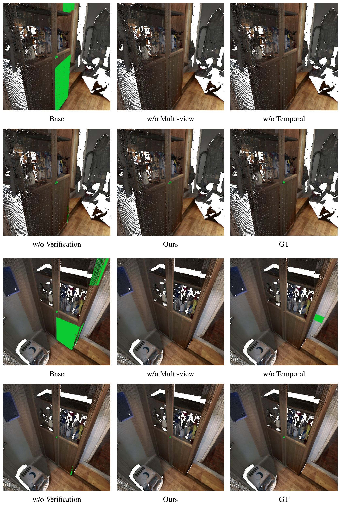
*论文原图编号：Figure 6。第二组消融视觉对比；放在这里补充多场景证据。*

### 附录定性结果

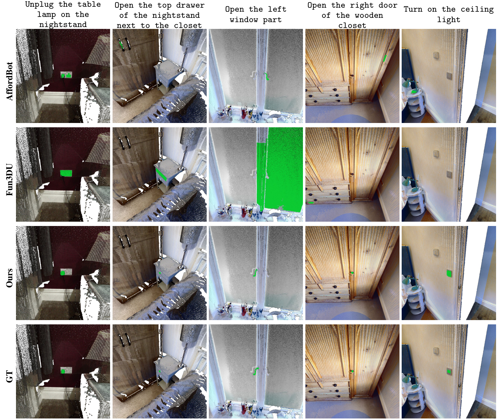
*论文原图编号：Figure 7。五个查询上的定性对比网格；放在这里补充细粒度部件的定位优势。*

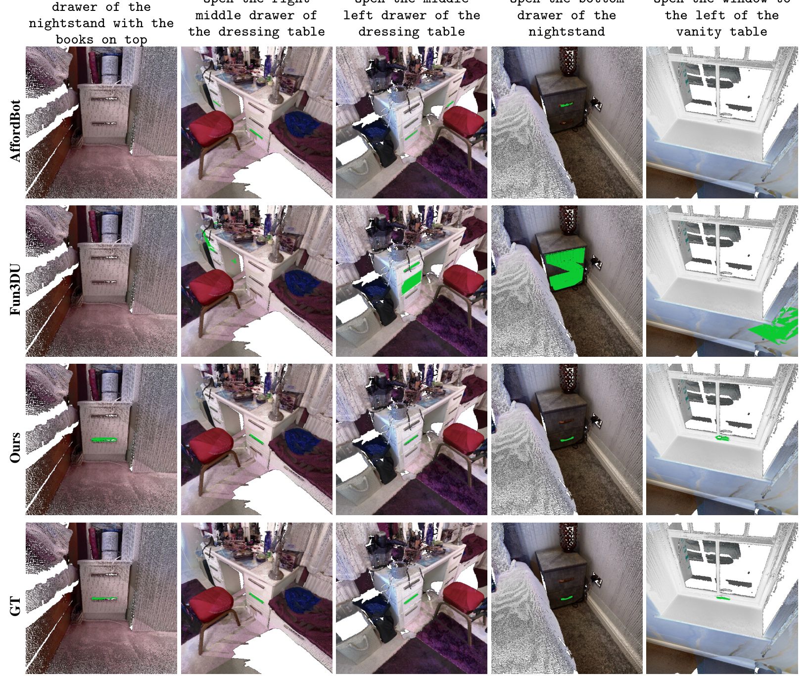
*论文原图编号：Figure 8。另一组五查询定性对比；放在这里展示跨场景的一致性。*

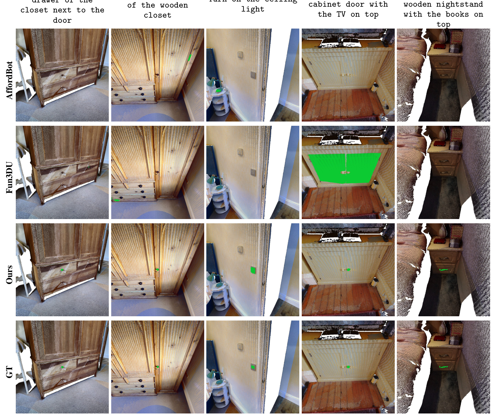
*论文原图编号：Figure 9。第三组五查询定性对比；放在这里收束定性证据。*

## 深度分析

### 为什么统一视觉落地优于单阶段放大

单阶段高分辨率大模型崩塌到 3.11 的 mIoU，而完整的粗到细结构达到 20.92，差距不是分辨率带来的，而是上下文组织方式带来的：一次性塞入全部高分辨率帧会超出模型有效上下文并淹没细粒度线索，先低分辨率通览建立全局、再在候选附近高分辨率细看，才符合先定位再聚焦的感知逻辑。Figure 1 与高层设计消融表共同支撑这一结论。

### 机制到结果的映射

| 机制选择 | 对应的结果证据 |
|---|---|
| 统一主干两阶段视觉落地 | 完整模型对单阶段高分辨率：AP50 由 4.27 升至 23.82，mIoU 由 3.11 升至 20.92 |
| 密集高分辨率时间窗替代裁剪放大 | 两轮加时间窗后 AP50 由 15.51 升至 21.12，AP25 由 28.31 升至 39.10，并使验证生效 |
| 多次带偏移采样 | 轮次从 1 到 2 大幅提升，到 4 饱和，到 8 递减 |
| 多视图一致性投票提升 | 抑制离群二维掩码，支撑 mIoU 提升 |

### 收益来源不是更强的零件

把分割模型换成旧版，指标几乎不变（mIoU 20.78 对 20.92）；在同等 72B 骨干下，本文方法仍在多数指标超过 TASA 与 AffordBot。

两条证据说明增益主要来自流水线设计（统一视觉推理与主动时空定位），而非分割器升级或骨干堆料。

速度侧同样受益：8B 版本每场景约 16 分钟、约 53 秒每查询，相对 Fun3DU 的 82 分钟约 5.2 倍加速；30B 版本约 26 分钟、约 99 秒每查询，约 3.2 倍。

单模型设计也便于用 vLLM 的分页注意力与键值缓存做高效推理。

### 比较的边界

基线数字采用论文报告值与本文复现值取较高的策略。如基线实现对照表所示，本文复现的 AffordBot 略高于原论文，而 TASA 与 Fun3DU 则是原论文更高。

这保证了增益不是基线配置不佳造成，但也意味着结论对最强基线版本的界定敏感。

TASA 训练于第二个划分，故不在第一个划分上比较，训练类方法不能简单视为同条件对照。

## 局限

- **极小部件与严重遮挡**：作者自述在面积小于 0.1% 图像区域的超小功能部件、或遮挡严重的场景中仍会失败，这恰是聚焦也看不清的边界。
- **缺少显式三维几何推理**：当前把多视图一致性投票作为隐式的三维聚合，未在模型内显式建模复杂空间布局；作者建议未来把显式三维几何推理纳入大模型。
- **无交互式修正**：不支持用户反馈纠正预测，限制真实机器人部署。
- **证据覆盖范围**：所有结论仅在单一数据集 SceneFun3D（230 室内场景）上验证；消融只在第一个划分用 8B 完成；骨干结论仅覆盖 Qwen2.5-VL-72B 与 Qwen3-VL-8B/30B；依赖冻结的大模型与分割模型，推理成本仍高，作者也说明未在不同硬件上重跑全部基线。

## 我的笔记

**值得复用的点**：

- 配置可直接照搬：Qwen3-VL-8B 与 Qwen3-VL-30B 冻结使用。

- 粗阶段采 64 帧、分辨率 512 乘 384、共 4 轮；细阶段按采样间隔设定时间窗。

- 分割阈值 0.5、叠加透明度 0.7、一致性阈值 0.7。

- 两个工程技巧很关键：帧前插入帧号标签让模型能在回答里引用具体帧；验证阶段把掩码画成彩色叠加图交给模型看图判断，比基于文本或置信度的过滤更贴合语义。

- 放大用完整高分辨率时间窗而非裁剪，能保留全局上下文并支持自我纠错，这是相对裁剪重处理路线的核心优势，做细粒度定位时可借鉴。

- 评估上报告多种精度与召回指标，并对基线取报告与复现的较高值，能更稳健地论证增益。

**开放的后续问题**：

- 统一主动定位范式在 SceneFun3D 之外的数据集、或真实机器人在线闭环中能否复现增益？
- 验证阶段的误拒与误收如何量化？能否用主动追问或置信度替代视觉叠加验证？
- 采样轮次、采样帧数、窗半径与一致性阈值的联合最优是否依赖视频长度与场景尺度，能否自适应设定？
- 引入显式点云几何分支到统一大模型，能否缓解极小部件与严重遮挡？

## 引用

- Corsetti et al. (2025). Functionality Understanding and Segmentation in 3D Scenes（Fun3DU）. [[Fun3DU - Functionality Understanding and Segmentation in 3D Scenes|Fun3DU]]
- Delitzas et al. (2024). SceneFun3D: Fine-grained Functionality and Affordance Understanding in 3D Scenes.
- 该工作的任务感知选帧与三维几何精修版本（TASA）. [[Task-Aware 3D Affordance Segmentation via 2D Guidance and Geometric Refinement|TASA]]
- AffordBot：基于点云、微调分割模型的三维可供性分割方法。
- Qwen3-VL 技术报告（2025）与分割模型 SAM 3（2025）为本方法的主干与分割器。
